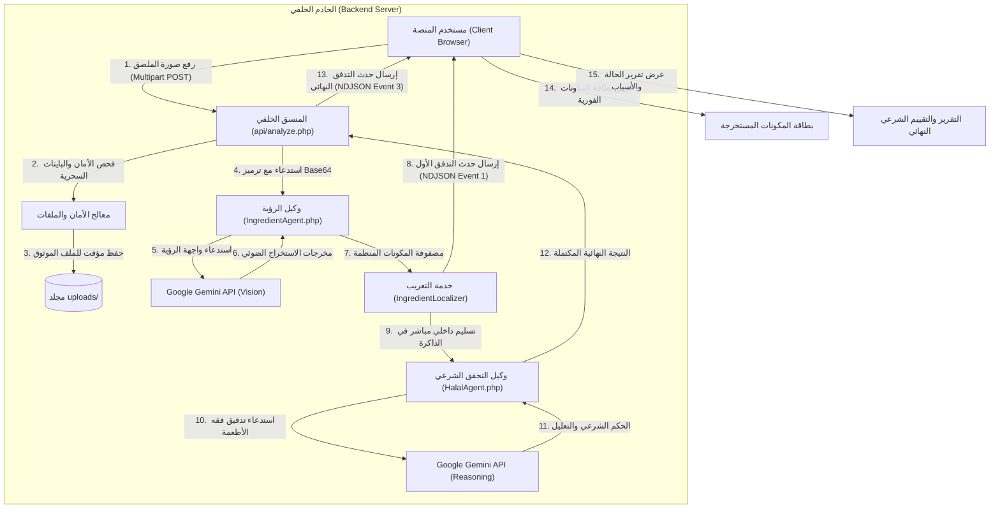
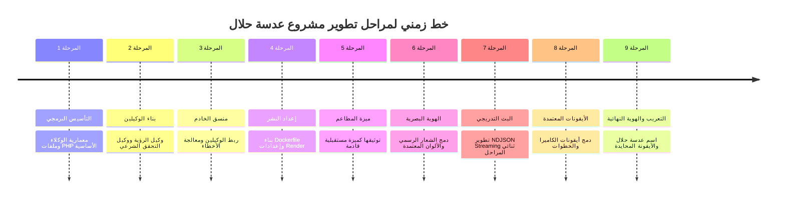

# مشروع عدسة حلال الذكي لفحص الأغذية (HalalLens AI)
## تقرير تطوير المشروع الأكاديمي الشامل — هندسة الذكاء الاصطناعي (AI Engineering)

---

### بيانات المشروع الأساسية

- **اسم المشروع بالإنجليزية**: HalalLens AI
- **اسم المشروع بالعربية**: عدسة حلال
- **وصف المشروع**: منصة ويب ذكية متخصصة في فحص وتحليل ملصقات المكونات الغذائية للتحقق من توافقها مع المعايير الغذائية والشرعية الإسلامية (فقه الأطعمة)، بالاعتماد على بنية برمجية تعاونية متعددة الوكلاء (Multi-Agent Architecture) تعمل بالكامل على الخادم.
- **نوع المشروع**: مشروع تطبيقي في هندسة الذكاء الاصطناعي وهندسة البرمجيات (AI Engineering University Project).
- **السياق الأكاديمي**: مقرر هندسة الذكاء الاصطناعي والأنظمة الذكية (AI Engineering Coursework).
- **حالة التطوير الحالية**: مكتمل ومختبر وظيفياً ومحلياً، ومجهز للنشر السحابي (Ready for Cloud Deployment).

---

## فهرس التقرير

1. [مقدمة المشروع](#1-مقدمة-المشروع)
2. [المشكلة](#2-المشكلة)
3. [أهداف المشروع](#3-أهداف-المشروع)
4. [الفئة المستهدفة](#4-الفئة-المستهدفة)
5. [تحليل المتطلبات](#5-تحليل-المتطلبات)
   - 5.1 [المتطلبات الوظيفية](#51-المتطلبات-الوظيفية)
   - 5.2 [المتطلبات غير الوظيفية](#52-المتطلبات-غير-الوظيفية)
6. [تصميم النظام والمعمارية البرمجية](#6-تصميم-النظام-والمعمارية-البرمجية)
7. [تصميم الوكلاء الأذكياء](#7-تصميم-الوكلاء-الأذكياء)
   - [وكيل الرؤية واستخراج المكونات (Agent 1)](#وكيل-الرؤية-واستخراج-المكونات-agent-1)
   - [وكيل التحقق الشرعي (Agent 2)](#وكيل-التحقق-الشرعي-agent-2)
8. [تعاون الوكلاء وتدفق البيانات](#8-تعاون-الوكلاء-وتدفق-البيانات)
9. [تصميم الواجهات وتجربة المستخدم والهوية البصرية](#9-تصميم-الواجهات-وتجربة-المستخدم-والهوية-البصرية)
10. [التطوير باستخدام الذكاء الاصطناعي](#10-التطوير-باستخدام-الذكاء-الاصطناعي)
11. [مراحل تطوير المشروع](#11-مراحل-تطوير-المشروع)
12. [سجل الأوامر والموجهات المستخدمة (Prompts Registry)](#12-سجل-الأوامر-والموجهات-المستخدمة-prompts-registry)
13. [التنفيذ والاختبار الميداني](#13-التنفيذ-والاختبار-الميداني)
14. [الأمن وحماية البيانات والسرية](#14-الأمن-وحماية-البيانات-والسرية)
15. [النشر والاستضافة السحابية](#15-النشر-والاستضافة-السحابية)
16. [النتائج المحققة](#16-النتائج-المحققة)
17. [التحديات التقنية والحلول المطبقة](#17-التحديات-التقنية-والحلول-المطبقة)
18. [الدروس المستفادة](#18-الدروس-المستفادة)
19. [القيود الحالية للنظام](#19-القيود-الحالية-للنظام)
20. [خطة التطوير المستقبلي](#20-خطة-التطوير-المستقبلي)
21. [الخاتمة](#21-الخاتمة)
22. [روابط التسليم والمخرجات](#22-روابط-التسليم-والمخرجات)
23. [الملاحق](#23-الملاحق)
    - [الملحق أ: الهيكل البرمجي الفعلي للمشروع](#الملحق-أ-الهيكل-البرمجي-الفعلي-للمشروع)
    - [الملحق ب: عقود ومخططات JSON للوكلاء](#الملحق-ب-عقود-ومخططات-json-للوكالاء)
    - [الملحق ج: نصوص موجهات النظام وأوامر التطوير الكاملة](#الملحق-ج-نصوص-موجهات-النظام-وأوامر-التطوير-الكاملة)
     - [الملحق ج-1: أوامر التطوير المرسلة إلى Antigravity](#الملحق-ج-1-أوامر-التطوير-البرسلة-إلى-antigravity)
     - [الملحق ج-2: موجهات وكلاء الذكاء الاصطناعي الداخلية](#الملحق-ج-2-موجهات-وكلاء-الذكاء-الاصطناعي-الداخلية)
    - [الملحق د: لقطات الشاشة المرجعية والواجهات](#الملحق-د-لقطات-الشاشة-المرجعية-والواجهات)

---

## 1. مقدمة المشروع

يُعد مشروع **عدسة حلال (HalalLens AI)** تطبيقاً عملياً متقدماً في هندسة الذكاء الاصطناعي يهدف إلى معالجة تحدي يومي يواجه المستهلكين المسلمين حول العالم، وخاصة في الأسواق المستوردة أو المجتمعات ذات الأغلبية غير المسلمة، والمتمثل في صعوبة التحقق من الحِلّية الشرعية لمكونات المنتجات الغذائية المصنعة.

يقوم النظام على فكرة تسخير النماذج التوليدية متعددة الوسائط (Multimodal Generative Models) من خلال **بنية متعددة الوكلاء (Multi-Agent System)**؛ حيث يتم تقسيم المهمة التحليلية المعقدة إلى مرحلتين تخصصيتين متعاونتين:
1. **وكيل الرؤية واستخراج المكونات (Ingredient Vision Agent)**: يتولى المعالجة البصرية، والتعرف الضوئي على المحارف (OCR)، واستخراج قائمة المكونات الغذائية بصيغة بيانات مهيكلة (Structured JSON) مع تقدير دقة القراءة لكل مكون.
2. **وكيل التحقق الشرعي الغذائي (Halal Verification Agent)**: يتولى دراسة المكونات والإضافات المستخرجة ومقارنتها بقواعد فقه الأطعمة والمعايير العلمية لتصنيف المنتج بدقة إلى إحدى الحالات المعيارية الأربع: (`HALAL`، `HARAM`، `DOUBTFUL`، `UNKNOWN`)، مع تقديم تعليل فقهي وعلمي واضح وتوصيات استرشادية للمستهلك.

> [!IMPORTANT]
> **التفريق الأكاديمي والشرعي الحاسم**:
> تم تصميم المنصة لتقديم **تحليل استرشادي تقني مدعوم بالذكاء الاصطناعي** للمكونات الغذائية المعلنة على ملصق المنتج. ويؤكد المشروع صراحة واحترازياً على أن النظام **لا يُعد بديلاً عن شهادات الحلال الرسمية** الصادرة عن الهيئات الشرعية والرقابية المعتمدة، ولا يمتلك سلطة الإفتاء، وإنما هو أداة مساعدة للمستهلك لفهم الملصقات المعقدة وتنبيهه للمكونات المشتبه فيها أو المحرمة.

---

## 2. المشكلة

تتميز صناعة الأغذية الحديثة بالتعقيد المتزايد، حيث تحتوي معظم المنتجات المصنعة والمعلبة على عشرات المكونات المشتقة، والمستحلبات، والمواد الحافظة، ومحسنات القوام، والملونات التي يُرمز لها بأرقام قياسية دولية وأوروبية مثل (E471، E120، E476).

### مبررات وأبعاد المشكلة:
1. **صعوبة القراءة اليدوية**: تتم طباعة قوائم المكونات غالباً بخطوط دقيقة وصغيرة جداً على العبوات، وبألوان وتنسيقات يصعب على المستهلك العادي قراءتها أو تدقيقها أثناء التسوق.
2. **تعدد اللغات في المنتجات المستوردة**: تأتي العديد من المنتجات بملصقات باللغة الإنجليزية أو لغات أجنبية أخرى، مما يشكل عائقاً أمام المستهلكين العرب في فهم طبيعة المكون.
3. **غموض مصادر الإضافات الغذائية (Additive Ambiguity)**: العديد من المواد الكيميائية والمستحلبات (مثل أحادي وثنائي الجليسريدات E471، والجيلاتين E428) قد تُستخلص إما من مصادر نباتية بحتة أو من دهون حيوانية (كالخنزير أو حيوانات غير مذكاة شرعياً). وفي غياب تصريح صريح على العبوة، يقع المستهلك في حيرة بالغة تتطلب تدقيقاً فقهياً احترازياً.
4. **قصور النماذج الفردية الشاملة (Monolithic AI Limitation)**: عند محاولة تكليف نموذج توليدي واحد بقراءة الصورة مباشرة وإصدار حكم شرعي في آن واحد، تحدث أخطاء هلوسة بصرية (Visual Hallucinations) وخلط بين تفسير النص والحكم الفقهي؛ مما استدعى معمارياً فصل "الرؤية والاستخراج" عن "التحليل الشرعي".

---

## 3. أهداف المشروع

تمت صياغة أهداف المشروع بدقة لتتوافق 100% مع ما تم بناؤه وتطويره واختباره فعلياً في المستودع البرمجي:

1. **التعرف البصري الدقيق**: استخراج نصوص قوائم المكونات من صور ملصقات الأغذية بدرجات دقة ووضوح مختلفة باستخدام وكيل رؤية مخصص.
2. **هيكلة البيانات**: تحويل النص الخام للمكونات إلى كائنات JSON معيارية تضم الاسم الأصلي، والاسم المعياري، ونسبة الثقة المقدرة، وتقييم جودة الصورة المصدر.
3. **التدقيق الشرعي التخصصي**: تقييم كل مكون ومضاف غذائي استناداً إلى ضوابط فقه الأطعمة وتصنيفه إلى: حلال، حرام، مشتبه فيه، أو غير معروف.
4. **التعاون الحقيقي بين الوكلاء**: تطبيق دورة عمل برمجية backend-orchestrated تنقل المخرجات المهيكلة للوكيل الأول مباشرة كمدخلات للوكيل الثاني دون تدخل المتصفح.
5. **التسليم التدريجي للنتائج (Progressive 2-Stage Streaming)**: عرض المكونات المستخرجة فوراً للمستخدم عبر تقنية التدفق (NDJSON Streaming) أثناء متابعة الوكيل الثاني لمرحلة التدقيق الشرعي.
6. **التعريب المعجمي الذكي**: توطين أسماء المكونات والمضافات الكيميائية إلى مصطلحات غذائية عربية طبيعية (مع الحفاظ على النص اللاتيني الأصلي معزولاً)، ودعم الواجهة المزدوجة (العربية أولاً RTL والإنجليزية LTR).
7. **التصميم المتجاوب والهوية البصرية المتكاملة**: بناء واجهة مستخدم متناسقة متوافقة تماماً مع أجهزة الهواتف الذكية، والأجهزة اللوحية، والشاشات المكتبية، مستوحاة من الهوية البصرية الإسلامية المعتمدة.
8. **الأمان والموثوقية**: عزل مفاتيح الاتصال البرمجية (Gemini API Key) في الخادم، وفحص وتطهير الملفات المرفوعة أمنياً، ومنع تخزين أو تسريب البيانات الحساسة.
9. **الاستعداد للنشر السحابي**: توفير بيئة تشغيل مدعومة بحاوية Docker متوافقة مع منصة Render ومنصات الاستضافة المدارة.

---

## 4. الفئة المستهدفة

تم تحديد الفئة المستهدفة للنظام بناءً على التحليل التقديري لحاجة السوق والمستخدمين:
- **المستهلكون المسلمون**: الراغبون في التأكد السريع والموثوق من حِلّية مشترياتهم الغذائية، لا سيما في بلدان الاغتراب أو عند شراء المنتجات المستوردة.
- **المستخدمون الناطقون بالعربية**: الذين يحتاجون إلى أداة تُعرّب وتُبسّط المصطلحات اللاتينية والرموز الكيميائية المعقدة إلى لغتهم الأم.
- **المهتمون بسلامة الأغذية وتجنب الشبهات**: الباحثون عن معرفة مصادر المستحلبات والإضافات الغذائية الحساسة (مثل الجيلاتين ومستحلبات الدهون).
- **المستخدمون المعتمدون على الهواتف الذكية**: الذين يحتاجون إلى أداة سريعة وسهلة الاستخدام أثناء التسوق الميداني داخل المتاجر.

---

## 5. تحليل المتطلبات

### 5.1 المتطلبات الوظيفية (Functional Requirements)

| الرقم | المتطلب الوظيفي | الوصف وحالة التنفيذ |
| :--- | :--- | :--- |
| **FR-01** | رفع صورة ملصق المنتج | إتاحة رفع الصور عبر السحب والإفلات أو التصفح أو التقاط الكاميرا بالصيغ المعتمدة (JPG, PNG, WebP). *(منفذ ومختبر)* |
| **FR-02** | فحص والتحقق من الملف | التحقق الصارم في الخادم من سلامة الملف، حجمه (أقل من 5MB)، وامتداده، وفحص البايتات السحرية (Magic Bytes). *(منفذ ومختبر)* |
| **FR-03** | استخراج المكونات (Agent 1) | استدعاء وكيل الرؤية لتحليل الصورة واستخراج قائمة المكونات مع تقدير نسبة الثقة وجودة الملصق. *(منفذ ومختبر)* |
| **FR-04** | التعريب الآلي للمكونات | ترجمة المكونات ورموز E-numbers آلياً إلى العربية الفصحى عبر خدمة `IngredientLocalizer` في النمط العربي. *(منفذ ومختبر)* |
| **FR-05** | العرض المرحلي الفوري | إظهار بطاقة المكونات المستخرجة فور إنجاز الوكيل الأول لمهمته دون انتظار انتهاء التدقيق النهائي. *(منفذ ومختبر)* |
| **FR-06** | التسليم الداخلي للوكلاء | تمرير بيانات الوكيل الأول في الذاكرة الداخلية للخادم مباشرة كمدخل للوكيل الثاني. *(منفذ ومختبر)* |
| **FR-07** | التدقيق الشرعي (Agent 2) | تقييم المكونات فقهياً وتصنيف كل مكون والحالة الكلية للمنتج إلى: حلال، حرام، مشتبه فيه، أو غير معروف. *(منفذ ومختبر)* |
| **FR-08** | عرض التقرير النهائي | عرض شارة الحالة الكلية، نسبة الثقة، قائمة الأسباب والتعليلات، ملاحظات المستهلك، والبطاقات الفردية لكل مكون. *(منفذ ومختبر)* |
| **FR-09** | الحفاظ على النص الأصلي | عرض النص الخام المستخرج من العبوة دون أدنى تعديل أو اختلاق في نافذة مخصصة للمطابقة. *(منفذ ومختبر)* |
| **FR-10** | دعم اللغتين والاتجاهين | دعم كامل للغتين العربية (RTL) والإنجليزية (LTR) مع تبديل لحظي وحفظ التفضيل عبر Cookies. *(منفذ ومختبر)* |
| **FR-11** | معالجة حالات الفشل والشك | عرض رسائل خطأ دقيقة عند غياب المفتاح، أو تلف الصورة، أو عدم وضوح الملصق، مع تطبيق مبدأ الاحتياط الفقهي. *(منفذ ومختبر)* |
| **FR-12** | استكشاف المطاعم الحلال | عرض ميزة استكشاف المطاعم الحلال كخاصية مستقبلية قادمة ("قريبًا") دون تفعيل روابط GPS حية في الواجهة. *(موثق كخاصية مستقبلية)* |

### 5.2 المتطلبات غير الوظيفية (Non-Functional Requirements)

1. **الأمان وحماية المفاتيح البرمجية**:
   - حظر تضمين مفتاح Gemini API في الشيفرة البرمجية للواجهة (Client-side) نهائياً.
   - قراءة المفاتيح حصراً عبر متغيرات البيئة (`getenv('GEMINI_API_KEY')`) أو ملف إعدادات محمي خارج متناول Git.
   - حظر الوصول المباشر إلى ملفات المجلد `uploads/` عبر قواعد `.htaccess`.
2. **الأداء والاستجابة (Performance)**:
   - استخدام التدفق التتابعي (NDJSON Streaming) مع تفريغ الدفق `ob_flush(); flush();` لإعطاء رد فعل مرئي فوري للمستخدم في أقل من ثانيتين من انتهاء الوكيل الأول، مما يقلل وقت الانتظار المتصور (Perceived Latency).
3. **الدقة والموثوقية (Reliability & Groundedness)**:
   - إلزام وكيل الرؤية بعدم اختلاق أو تخمين أي نصوص مقطوعة أو غير مقروءة، وتدوين ذلك كعنصر شك.
   - إلزام وكيل التحقق باعتبار أي مستحلب أو إنزيم حيواني غير مصرح بمصدره كـ "مشتبه فيه" (DOUBTFUL) درءاً للشبهات.
4. **التصميم المتجاوب وإمكانية الوصول (Responsive Design & Accessibility)**:
   - تصميم الواجهة بأسلوب Mobile-First يتكيف تلقائياً مع مختلف مقاسات الشاشات (الهواتف الذكية < 640px، الأجهزة اللوحية 641px–1024px، الشاشات المكتبية > 1024px).
   - استخدام طباعة عربية واضحة ومريحة للعين عبر خط تجوال (Tajawal).
   - عزل اتجاه النصوص الأجنبية والرموز الرقمية عبر `unicode-bidi: isolate; direction: ltr;` لمنع تشوه الأقواس في النمط العربي.
5. **التوافقية وسهولة النشر (Portability & Compatibility)**:
   - بناء الخلفية البرمجية بلغة PHP القياسية دون الاعتماد على أطر عمل ثقيلة أو اعتمادات معقدة، مما يتيح تشغيلها على أي استضافة مشتركة (Shared Hosting) أو في حاويات Docker سحابية.

---

## 6. تصميم النظام والمعمارية البرمجية

يعتمد النظام معمارية متعددة الوكلاء تتم إدارتها بالكامل على الخادم (**Backend-Orchestrated Multi-Agent Architecture**).

### مخطط سير المعمارية البرمجية (System Architecture Flowchart):



### أسباب اختيار التنسيق على الخادم (Backend Orchestration) بدلاً من المتصفح:
1. **الأمان وسلامة البيانات**: لا يمتلك المتصفح أي وسيلة لتعديل مصفوفة المكونات المستخرجة قبل تمريرها للوكيل الثاني، مما يمنع محاولات التلاعب بالبيانات أو تزييف نتائج التحليل.
2. **كفاءة الشبكة**: التنسيق داخل الخادم يوفر جولة إرسال واستقبال إضافية (Round-trip) عبر شبكة الهاتف، مما يقلل استهلاك البيانات ويُسرّع الاستجابة.
3. **حماية المفاتيح والاتصال المباشر**: تتم جميع الاتصالات بنماذج Gemini عبر قنوات الخادم المشفرة دون ظهور أي بيانات سرية في أدوات فحص المتصفح.

---

## 7. تصميم الوكلاء الأذكياء

تم بناء وكيلين برمجيين مستقلين، لكل منهما مسؤولية محددة وعقد بيانات (JSON Schema) صارم.

### وكيل الرؤية واستخراج المكونات (Agent 1: Ingredient Vision Agent)

- **الملف المصدري**: [`agents/IngredientAgent.php`](file:///d:/@Programming/HalalLens/agents/IngredientAgent.php)
- **الفئة البرمجية**: `HalalLens\Agents\IngredientAgent`
- **النموذج المستخدم**: `gemini-3.8-flash` (أو المعرف عبر المتغير `GEMINI_MODEL`)
- **المهمة الحصرية**: الفحص البصري الدقيق لصورة ملصق المنتج واستخراج قائمة المكونات الغذائية ومستحلباتها حرفياً دون إبداء أي رأي ديني أو تصنيف حلال/حرام.

#### المدخلات والمخرجات:
- **المدخل**: المسار الفعلي للصورة المفحوصة والمحفوظة في الخادم.
- **المخرج المهيكل**: كائن JSON يحتوي على:
  - `source_quality`: جودة الملصق (`good`, `fair`, `poor`, `unreadable`).
  - `source_text`: النص الخام المنقول حرفياً من العبوة.
  - `ingredients`: مصفوفة كائنات، كل كائن يحتوي على `original_name`، و `normalized_name`، و `confidence`.
  - `ingredient_count`: إجمالي عدد المكونات المقروءة.
  - `notes`: ملاحظات الوكيل في حال وجود كلمات مهترئة أو غير واضحة.

---

### وكيل التحقق الشرعي (Agent 2: Halal Verification Agent)

- **الملف المصدري**: [`agents/HalalAgent.php`](file:///d:/@Programming/HalalLens/agents/HalalAgent.php)
- **الفئة البرمجية**: `HalalLens\Agents\HalalAgent`
- **النموذج المستخدم**: `gemini-3.8-flash`
- **المهمة الحصرية**: تحليل مصفوفة المكونات المسلمة إليه ومقارنتها بضوابط فقه الأطعمة الإسلامي، وفحص أرقام الإضافات (E-numbers) والمصادر المحتملة (نباتية، حيوانية، خنزيرية، صناعية).

#### حالات التصنيف المعيارية الأربع (Canonical Status Taxonomy):
1. **`HALAL` (حلال)**: المكونات النباتية، البحرية، المعادن، الإضافات المصرح رسمياً بأنها نباتية 100%، أو مشتقات الحيوانات المباحة المذكاة شرعياً.
2. **`HARAM` (حرام)**: المنتجات المحتوية على مشتقات الخنزير، الشحوم غير المذكاة، الكحول المسكر، الدم المسفوح، أو جيلاتين الخنزير.
3. **`DOUBTFUL` (مشتبه فيه)**: المضافات والمستحلبات ذات الأصل المزدوج (كالدهون والأحماض الدهنية E471 و E476 والجيلاتين مجهول المصدر والإنزيمات الحيوانية) التي لم يُذكر أصلها صراحة على العبوة.
4. **`UNKNOWN` (غير معروف)**: البيانات التالفة أو الملصقات المشوشة التي يتعذر معها الجزم بسلامة المنتج.

#### المدخلات والمخرجات:
- **المدخل**: مصفوفة المكونات الناتجة عن الوكيل الأول، واللغة المفضلة للتعليل (`'ar'` أو `'en'`).
- **المخرج المهيكل**: كائن JSON يحتوي على:
  - `status`: إحدى الحالات المعيارية الأربع بالأحرف الإنجليزية الكبيرة.
  - `status_ar` / `status_en`: الحالة مترجمة بحسب لغة الواجهة.
  - `confidence`: مؤشر الثقة العام بالحكم الفقهي والتحليلي.
  - `reasons`: مصفوفة أسباب تفصيلية تشرح حيثيات الحكم العام.
  - `ingredient_assessments`: تدقيق إفرادي لكل مكون يوضح حالته وسببه الفقهي والعلمي.
  - `notes`: نصائح عملية للمستهلك (مثل البحث عن شعار الحلال أو التواصل مع المصنع).

---

## 8. تعاون الوكلاء وتدفق البيانات

يُمثل التعاون بين الوكيلين جوهر بنية المشروع، ويتم عبر بروتوكول تسليم بيانات تسلسلي مُحكم:

```
[صورة ملصق المنتج الغذائي]
           │
           ▼
┌────────────────────────────────────────────────────────┐
│                   api/analyze.php                      │
│                (المنسق البرمجي العام)                  │
└──────────────────────────┬─────────────────────────────┘
                           │
                           ▼
┌────────────────────────────────────────────────────────┐
│           الوكيل الأول: وكيل الرؤية واستخراج المكونات   │
│                 (IngredientAgent.php)                  │
│                                                        │
│  - يقرأ الصورة ويحللها عبر Gemini Multimodal API       │
│  - يستخرج المكونات وينشئ كائن JSON المهيكل             │
└──────────────────────────┬─────────────────────────────┘
                           │
                           ▼
┌────────────────────────────────────────────────────────┐
│                 خدمة التعريب المعجمي                   │
│             (services/IngredientLocalizer.php)         │
│                                                        │
│  - تُترجم المكونات فورياً للغة العربية                 │
│  - تُرسل حدث التدفق الأول: ingredients_extracted      │
└──────────────────────────┬─────────────────────────────┘
                           │
                           ▼ (تسليم داخلي مباشر في الذاكرة)
┌────────────────────────────────────────────────────────┐
│           الوكيل الثاني: وكيل التحقق الشرعي الغذائي    │
│                    (HalalAgent.php)                    │
│                                                        │
│  - يتلقى المكونات المهيكلة كمدخل فوري                  │
│  - يطبق قواعد الفقه الإسلامي وعلوم الأغذية             │
│  - يُصدر الحكم النهائي والتعليلات لكل مكون             │
└──────────────────────────┬─────────────────────────────┘
                           │
                           ▼
┌────────────────────────────────────────────────────────┐
│                   api/analyze.php                      │
│                                                        │
│  - يدمج التقريرين في كائن تحليلي متكامل                │
│  - يُرسل حدث التدفق النهائي: verification_completed   │
└────────────────────────────────────────────────────────┘
```

### تقنية البث التدريجي ثنائي المراحل (Progressive 2-Stage Streaming):
في معالجات الذكاء الاصطناعي التوليدي، يستغرق استدعاء نموذجين متتاليين وقتاً يتراوح بين 4 إلى 8 ثوانٍ. لحل مشكلة جمود الواجهة، تم تطوير نظام تدفق بيانات يعتمد على صيغة Newline-Delimited JSON (NDJSON):
1. **الحدث الأول (`ingredients_extracted`)**: بمجرد انتهاء الوكيل الأول من استخراج المكونات، يتم تعريبها ودفع السطر الأول للمتصفح مباشرة مصحوباً بـ `ob_flush(); flush();`.
2. **استجابة الواجهة الفورية**: يقرأ المتصفح التدفق بواسطة `ReadableStream`، ويقوم فوراً بإخفاء مؤشر التحميل الأولي، ونقل مؤشر خطوة الوكيل الأول إلى "مكتملة"، **وعرض بطاقة المكونات المستخرجة كاملة أمام المستخدم**.
3. **الحدث الثاني (`verification_started`)**: إشعار الواجهة ببدء مرحلة التحقيق الشرعي وعرض شريط فرعي يوضح "جارٍ التحقق من المكونات شرعياً...".
4. **الحدث الثالث (`verification_completed`)**: بمجرد اكتمال تقييم الوكيل الثاني، يُدفع السطر النهائي المحتوي على التقييم الشرعي الكامل، فيقوم المتصفح بإظهار بطاقة النتيجة، وشارة الحِلّية، وقائمة الأسباب، والبطاقات الفردية.

---

## 9. تصميم الواجهات وتجربة المستخدم والهوية البصرية

تم بناء واجهة المستخدم لتكون سريعة وخفيفة وتعتمد على أفضل ممارسات تصميم الويب الحديث (Modern Semantic Web) دون الاعتماد على أطر عمل ثقيلة.

### ركائز الهوية البصرية:
- **اللغة والاتجاه (Arabic-First & RTL)**: صُممت المنصة أساساً باللغة العربية كخيار افتراضي (`dir="rtl"` و `lang="ar"`)، مع دعم كامل للغة الإنجليزية بنقرة واحدة مع ضبط التخطيط (`dir="ltr"`).
- **الخط الطباعي (Universal Typography)**: اعتماد خط **تجوال (Tajawal)** من Google Fonts بدرجات متعددة (400, 500, 700, 800) لضمان وضوح فائق وقراءة مريحة للمصطلحات العربية واللاتينية على حد سواء.
- **الشعار الرسمي (Brand Logo)**: دمج الشعار الرسمي المعتمد للمشروع في الترويسة ووسط الصفحة والتذييل بصيغة مربعة 1:1 فائقة الوضوح ([`resources/halallens-logo.png`](file:///d:/@Programming/HalalLens/resources/halallens-logo.png)).
- **لوحة الألوان المستوحاة من الهوية**:
  - **الأخضر الغابي الداكن** (`#0d3b24`): يمثل الوقار والأصالة ويُستخدم في العناوين والترويسة.
  - **الأخضر الزمردي الحيوي** (`#1b7a43`): يمثل الحِلّية والطبيعة ويُستخدم في الأزرار الرئيسية وحالات الحلال.
  - **الذهبي الدافئ** (`#c79d39`): يمثل اللمسة الجمالية الإسلامية ويُستخدم في الشارات والخطوط الفرعية.
  - **الأبيض العاجي الدافئ** (`#f8faf7`): يمثل النقاء ويوفر خلفية مريحة للعين ومتباينة مع البطاقات.
- **الأيقونات المحايدة للمكونات (Neutral Food Component Icons)**:
  - استبدال رمز ورقة الشجر (`🌿`) برمز SVG هندسي محايد يمثل (عنصراً/مكوناً غذائياً) بلون رمادي هادئ (`#64748b`) لمنع الإيحاء بأن كل مكون مستخرج هو نباتي أو حلال قبل خضوعه للفحص الشرعي.
- **أيقونة الكاميرا التعبيرية**: اعتماد أيقونة الكاميرا الرسمية الذهبية والخضراء في الخطوة الأولى من مخطط الوكلاء لتعبر بدقة عن "تصوير المنتج".

### الأقسام المكتملة في واجهة التطبيق:
1. **الترويسة (Header)**: تضم الشعار، واسم "عدسة حلال"، وشارة المشروع الأكاديمي، وروابط التنقل السريع، ومبدل اللغة (العربية/English).
2. **القسم التعريفي (Hero Section)**: يقدم رسالة المنصة وشعارها الأساسي: *"اعرف مكونات طعامك بثقة"*.
3. **شريط المميزات السريعة (4 Quick Features)**: (تصوير، تحليل، تحقق، ابحث).
4. **قسم فحص المنتج (Product Analysis & Upload)**: منطقة سحب وإفلات تفاعلية مع معاينة فورية للصورة، وبيانات الحجم، وزر البدء.
5. **مخطط التقدم اللحظي للوكلاء (Live Pipeline Progress Tracker)**: خط زمني يوضح حالة عمل الوكيل الأول والوكيل الثاني لحظياً.
6. **بطاقة المكونات المستخرجة الفورية (Stage 1 Card)**: تظهر مباشرة فور انتهاء الوكيل الأول وتضم شرائح المكونات المعربة، مع الاسم اللاتيني الأصلي معزولاً، ونسبة الثقة، وزر استعراض النص الخام من العبوة.
7. **بطاقة التقييم النهائي (Stage 2 Results Card)**: شارة الحكم الكبيرة الملونة، نسبة الثقة العامة، وسوم المكونات، قائمة الأسباب، والبطاقات الفردية لكل مكون.
8. **قسم كيف تعمل المنصة (How It Works)**: شرح مبسط في 4 خطوات مدعومة بالأيقونات المعتمدة.
9. **مخطط معمارية الوكلاء التفاعلي (Multi-Agent Architecture)**: رسم توضيحي لعقد تدفق البيانات من الصورة حتى النتيجة.
10. **دليل الحالات المعيارية (Classification Guide)**: شرح للألوان والحالات الأربع: حلال (أخضر)، حرام (أحمر)، مشتبه فيه (أصفر/برتقالي)، غير معروف (رمادي).
11. **قسم المطاعم الحلال القريبة — قريبًا (Coming Soon)**: بطاقة أنيقة توضح أن خاصية اكتشاف المطاعم هي ميزة مستقبلية قيد التطوير.
12. **إخلاء المسؤولية والموثوقية (Trust & Advisory)**: توضيح حدود الذكاء الاصطناعي والتنبيه على عدم الإغناء عن الجهات الرسمية.
13. **التذييل (Footer)**: روابط سريعة وتوثيق المشروع الأكاديمي.

---

## 10. التطوير باستخدام الذكاء الاصطناعي

تم تطوير المشروع بالاعتماد على أدوات هندسة البرمجيات المعززة بالذكاء الاصطناعي (AI-Assisted Software Engineering)، وبالتحديد بيئة **Google Antigravity Agentic IDE** المعتمدة على نماذج **Gemini 2.5 / 3 (Pro & Flash)**.

### مجالات التوظيف الفعلي للذكاء الاصطناعي في دورة حياة المشروع:
1. **هندسة موجهات الوكلاء (Prompt Engineering & Schema Enforcement)**:
   - صياغة موجهات نظام متقدمة للوكيلين تفرض الالتزام الصارم بمخرجات JSON النقية دون أي نصوص تمهيدية أو وسوم كود ماركداون.
   - تضمين قواعد فقه الأطعمة وأدلة تصنيف المواد الحافظة والمستحلبات المشبوهة داخل موجه الوكيل الثاني.
2. **التصميم الموجه للواجهات (Generative UI/UX & Localization)**:
   - توليد وتنسيق شيفرات CSS المتوافقة مع أسلوب العرض العربي الأصيل (RTL)، وضبط محاذاة العناصر، واستيراد خط تجوال.
   - تطوير حلول للعزل ثنائي الاتجاه (Bi-directional text isolation) لمنع تشوه الأقواس في النصوص اللاتينية داخل الفقرات العربية.
3. **تطوير تدفق البيانات التتابعي (NDJSON Streaming Controller)**:
   - كتابة خوارزمية قراءة التدفق اللحظي في JavaScript باستخدام واجهات `ReadableStream` القياسية لفك تشفير الأسطر التتابعية فور وصولها.
4. **بناء المعجم الغذائي للتعريب (`IngredientLocalizer.php`)**:
   - توليد خريطة مطابقة موسعة تضم أكثر من 150 مصطلحاً غذائياً ومضافاً كيميائياً مع صيغ الأرقام القياسية (E-numbers) لضمان تعريب تلقائي دقيق للمكونات المستخرجة.

---

## 11. مراحل تطوير المشروع

وفقاً للسجلات الفعلية في مستودع Git والملفات البرمجية للمشروع، سارت عملية التطوير عبر 9 مراحل رئيسية:



1. **المرحلة الأولى — تأسيس المشروع والمعمارية**:
   - إعداد البنية الهيكلية للمشروع ومجلدات `agents/` و `api/` و `config/` و `lang/` و `uploads/`.
   - كتابة معايير بنية الوكلاء في وثيقة [`AGENTS.md`](file:///d:/@Programming/HalalLens/AGENTS.md).
2. **المرحلة الثانية — بناء الوكيلين (Agent 1 & Agent 2)**:
   - تطوير فئة [`IngredientAgent.php`](file:///d:/@Programming/HalalLens/agents/IngredientAgent.php) للاتصال بواجهة Gemini Vision لاستخراج المكونات.
   - تطوير فئة [`HalalAgent.php`](file:///d:/@Programming/HalalLens/agents/HalalAgent.php) لتطبيق ضوابط فقه الأطعمة وتصنيف المكونات.
3. **المرحلة الثالثة — بناء المنسق المركزي (Backend Orchestrator)**:
   - تطوير نقطة النهاية [`api/analyze.php`](file:///d:/@Programming/HalalLens/api/analyze.php) لاستقبال الملف وفحصه أمنياً وتنسيق التسليم الداخلي بين الوكيلين.
   - توفير نقطة الاختبار النمطية المباشرة [`api/verify.php`](file:///d:/@Programming/HalalLens/api/verify.php).
4. **المرحلة الرابعة — إعداد بيئة النشر السحابي (Cloud Preparation)**:
   - إنشاء ملف [`Dockerfile`](file:///d:/@Programming/HalalLens/Dockerfile) المعتمد على Apache و PHP 8.2.
   - إنشاء ملف تهيئة الخدمات [`render.yaml`](file:///d:/@Programming/HalalLens/render.yaml) لنشر المنصة على Render.
5. **المرحلة الخامسة — مراجعة وتأطير ميزة المطاعم**:
   - إعادة تقديم ميزة البحث عن المطاعم في الواجهة وقسم الوصف كخاصية مستقبلية قادمة ("قريبًا") وفصلها عن مسار عمل الوكلاء.
6. **المرحلة السادسة — اعتماد الشعار الرسمي والهوية البصرية**:
   - دمج الشعار الرسمي في ملفات المشروع واعتماده في شاشات الترويسة والتذييل.
   - توحيد الخطوط عبر خط Tajawal وتنسيق الواجهة لدعم العربية والإنجليزية.
7. **المرحلة السابعة — تطوير البث التدريجي والتصميم المتجاوب**:
   - إضافة بروتوكول التدفق المستمر (NDJSON) في `api/analyze.php` وتحديث `js/app.js` لعرض المكونات فور استخراجها في المرحلة الأولى.
   - إعادة كتابة وتوسيع تنسيقات `css/style.css` لضمان تجاوب كامل مع كافة الأجهزة الذكية.
8. **المرحلة الثامنة — دمج الأيقونات البصرية للوكلاء**:
   - تحديث المخطط الانسيابي لبنية الوكلاء وخطوات العمل بأيقونات مرئية مخصصة.
9. **المرحلة التاسعة — التوطين النهائي والتعريب المتقدم**:
   - تعميم الاسم الرسمي العربي **"عدسة حلال"** وحذف جميع الترجمات الصوتية السابقة ("هلالنس").
   - بناء محرك التعريب الغذائي [`IngredientLocalizer.php`](file:///d:/@Programming/HalalLens/services/IngredientLocalizer.php) لتعريب مخرجات التحليل آلياً في الواجهة العربية.
   - استبدال أيقونة الورقة الخضراء برمز محايد للمكونات الغذائية ووضع أيقونة الكاميرا في مخطط الوكلاء.

---

## 12. سجل الأوامر والموجهات المستخدمة (Prompts Registry)

يوثق هذا القسم السجل التاريخي الكامل والموثق لجميع الأوامر والتوجيهات التطويرية (Development Directives & Prompts) التي أُرسلت حرفياً من المستخدم إلى محرك التطوير الذكي **Antigravity** خلال كافة مراحل بناء وتطوير منصة **HalalLens AI**، مرتبة تسلسلياً حسب تاريخ وتوقيت صدورها.

> [!IMPORTANT]
> **التزام الأمانة الأكاديمية والتوثيق الحرفي (Verbatim Preservation)**:
> استُخرجت نصوص الأوامر التالية مباشرة وبشكل كامل غير منقوص من سجلات المحادثة الرسمية (`transcript_full.jsonl`)، مع الحفاظ الدقيق على كلماتها الأصلية (باللغة العربية والإنجليزية)، وعناوينها، وتنسيقات Markdown، والقوائم النقطية والرقمية، وأسماء الملفات والشروط الهندسية، دون أي تلخيص أو ترجمة أو إعادة صياغة. وقد تم فقط حجب المفتاح السحابي الفعلي لـ Gemini API بصيغة `[REDACTED_GEMINI_API_KEY]` التزاماً بمعايير حماية البيانات والسرية الهندسية.

---

### 12.1 الأمر 01 — التأسيس الأولي للمشروع وتحديد الدور الهندسي (Project Foundation)

**الأداة:** Antigravity AI Engine  
**التاريخ:** 2026-11-18  
**الغرض:** تكليف المطور الرئيسي لمشروع HalalLens AI واستكشاف بيئة العمل لوضع التصور التقني الأساسي للمنصة.

#### النص الأصلي للأمر

````text
You are the lead developer for the HalalLens AI project.

Build the initial project foundation only. Do not implement the AI agents yet.

## Project

HalalLens AI is a web platform for analyzing food-product ingredient labels using a multi-agent AI architecture.

The final system will contain:

1. Ingredient Vision Agent
2. Halal Verification Agent
3. Halal Restaurant Finder

The agents must eventually collaborate through real backend data flow.

## Technology Stack

Use:

- PHP 8.2+
- HTML5
- CSS3
- Vanilla JavaScript
- PHP cURL
- Gemini API later for AI processing
- OpenStreetMap / Overpass later for restaurant discovery

Important:

Do NOT use:

- React
- Next.js
- Node.js
- npm
- Vite
- Webpack
- Docker
- frontend build systems

The application must be suitable for standard PHP shared hosting / cPanel hosting.

## Create This Structure

HalalLens/
├── index.html
├── css/
│   └── style.css
├── js/
│   └── app.js
├── lang/
│   ├── ar.php
│   └── en.php
├── api/
│   ├── analyze.php
│   ├── verify.php
│   ├── restaurants.php
│   └── geocode.php
├── agents/
│   ├── IngredientAgent.php
│   └── HalalAgent.php
├── config/
│   └── config.example.php
├── assets/
├── README.md
├── AGENTS.md
└── .gitignore

Create clean, modular, maintainable code.

Do not put real API keys anywhere.

Create a configuration example containing placeholders only.

The real configuration file must be excluded from Git.

## Initial Frontend

Create a basic working homepage with:

- Header
- HalalLens AI branding
- Main content area
- Product image upload area
- Analyze button
- Results area placeholder
- Restaurant search placeholder
- Language switcher

The UI will be refined in a later prompt.

## Important

Do not implement fake AI results.

Do not create mock agent responses.

At this stage, focus only on the project foundation and clean architecture.

After implementation:

1. Check the project structure.
2. Check PHP syntax.
3. Check frontend loading.
4. Fix obvious errors.
5. Explain briefly what files were created and what remains to be implemented.
````

#### النتيجة والمخرجات الفعلية

استكشاف بيئة العمل ومجلدات المشروع وتقديم خطة التطوير الأولية، ووضع التصور التقني الأساسي لمنظومة فحص الأغذية متعددة الوكلاء.

---

### 12.2 الأمر 02 — التأطير الأكاديمي لمقرر هندسة الذكاء الاصطناعي وهيكلة الوكلاء

**الأداة:** Antigravity AI Engine  
**التاريخ:** 2026-11-18  
**الغرض:** تأطير المشروع كمشروع تطبيقي جامعي في هندسة الذكاء الاصطناعي (AI Engineering)، واعتماد بنية الوكلاء المتعددة (Agent 1 + Agent 2)، وتقسيم مراحل التنفيذ إلى 4 مراحل معمارية صارمة.

#### النص الأصلي للأمر

````text
You are the lead developer of a university AI Engineering project called "HalalLens AI".

First, inspect the current workspace and understand what already exists. Do not unnecessarily overwrite existing work.

## PROJECT PURPOSE

HalalLens AI is a real web platform that analyzes food-product ingredient labels using a Multi-Agent AI architecture.

The final platform will contain:

1. Ingredient Vision Agent
2. Halal Verification Agent
3. Halal Restaurant Finder

The agents must actually collaborate through real data flow. They must not be separate fake sections.

The project must be a real working application, not a UI mockup.

## TECHNOLOGY

Use:

- PHP 8.2+
- HTML5
- CSS3
- Vanilla JavaScript
- PHP cURL
- Gemini API
- OpenStreetMap / Overpass for restaurant discovery

Do NOT introduce:

- React
- Next.js
- Node.js
- npm
- Vite
- Webpack
- Docker
- unnecessary build systems

The application must be suitable for normal PHP shared hosting / cPanel hosting.

## PROJECT STRUCTURE

Create and maintain a clean structure similar to:

HalalLens/
├── index.php
├── css/
│   └── style.css
├── js/
│   └── app.js
├── lang/
│   ├── ar.php
│   └── en.php
├── api/
│   ├── analyze.php
│   ├── verify.php
│   ├── restaurants.php
│   └── geocode.php
├── agents/
│   ├── IngredientAgent.php
│   └── HalalAgent.php
├── config/
│   └── config.example.php
├── assets/
├── uploads/
├── README.md
├── AGENTS.md
└── .gitignore

You may improve this structure if there is a strong technical reason.

## SECURITY

Never hard-code API keys.

Never place API keys in:

- HTML
- JavaScript
- CSS
- Git
- README
- screenshots
- public frontend code

Use server-side environment variables or another secure server-side configuration mechanism.

Use:

GEMINI_API_KEY

as the expected environment variable name.

If the hosting environment does not support environment variables conveniently, design a secure server-side configuration fallback that is never exposed publicly and is excluded from Git.

Create a safe `config.example.php` containing placeholders only.

Add all real secret/config files to `.gitignore`.

## IMPORTANT

Do not build fake AI results.

Do not invent mock agent responses.

Do not implement the complete application in this step.

Focus on:

- project architecture
- file structure
- configuration foundation
- security foundation
- basic working homepage

After implementation:

1. Inspect all created files.
2. Check PHP syntax.
3. Check for obvious frontend errors.
4. Make sure secrets cannot be committed.
5. Explain briefly what was implemented.
6. Do not proceed to the AI agents until requested in a later prompt.
````

#### النتيجة والمخرجات الفعلية

إنشاء خطة العمل الشاملة وتأسيس هيكل المجلدات الأساسية للمشروع (`agents/`, `api/`, `config/`, `uploads/`, `assets/`, `css/`, `js/`).

---

### 12.3 الأمر 03 — التصحيحات المعمارية الصارمة والفصل التام وتأصيل العربية أولاً (RTL)

**الأداة:** Antigravity AI Engine  
**التاريخ:** 2026-11-18  
**الغرض:** فرض الفصل التام بين وكيل الرؤية ووكيل التحقق الفقهي (منع وكيل الرؤية من إصدار أحكام شرعية)، وبناء الواجهة بالعربية أولاً (RTL-first) باستخدام خط تجوال Tajawal مع دعم الإنجليزية LTR، وحماية مفاتيح API عبر متغيرات البيئة أو ملف إعداد محلي معزول في `.gitignore`.

#### النص الأصلي للأمر

````text
Before proceeding with the implementation, make the following corrections to the proposed plan.

## 1. Arabic MUST be the default language

The current plan says:

`fallback to 'en'`

Change this.

The default language must be:

`ar`

The default HTML attributes must be:

`lang="ar"`

`dir="rtl"`

The entire application must initially open in Arabic and RIGHT-TO-LEFT.

English is the secondary language and must only be selected when the user chooses English.

Make sure the language switcher, cookies/localStorage, PHP localization and frontend JavaScript all respect Arabic as the default.

## 2. Tajawal MUST be the primary font

Use:

`Tajawal, Arial, sans-serif`

throughout the entire application.

Do not make Tajawal conditional only for Arabic.

It should be the main visual identity of HalalLens AI.

## 3. Do not hard-code an outdated Gemini model

The current plan mentions:

`gemini-1.5-flash`

and

`gemini-2.0-flash`

Do not hard-code these as the default.

Make the Gemini model configurable through server-side configuration/environment variables.

Use a current Gemini API model that supports image input and structured text output.

The application architecture must allow the model name to be changed without modifying the agent source code.

Use a configuration variable such as:

`GEMINI_MODEL`

with a current supported model as the default.

Do not expose the model configuration to the frontend.

## 4. Keep the real Multi-Agent architecture

The project must contain at least two actual AI agents:

1. Ingredient Vision Agent
2. Halal Verification Agent

The restaurant finder is an additional service/component and does not need to be treated as an AI agent.

The critical collaboration must remain:

User Image
→ Ingredient Vision Agent
→ Structured Ingredient JSON
→ Halal Verification Agent
→ Final Halal Assessment

Do not implement the two agents as independent UI features.

## 5. Important: do not create fake AI responses

Do not add hard-coded sample AI results.

Do not simulate successful agent execution.

The current foundation should only create the architecture and real API integration points.

## 6. Security

Keep the Gemini API key completely server-side.

Use:

`GEMINI_API_KEY`

as an environment variable.

Do NOT put the API key in:

- JavaScript
- HTML
- CSS
- Git
- README
- frontend source

Do not ask me to paste the API key into any source file.

Create the secure configuration mechanism now, but leave the actual secret value empty until it is configured through the environment.

## 7. Halal terminology

Use these internal statuses consistently:

`HALAL`
`HARAM`
`DOUBTFUL`
`UNKNOWN`

For Arabic:

`حلال`
`حرام`
`مشتبه فيه`
`غير معروف`

Do not use `Mushbooh` as the primary internal status.

## 8. Restaurant Finder

Keep the Restaurant Finder as a separate service/component.

It should not interfere with the two-agent collaboration.

## 9. PHP

The verification plan references:

`C:\php-8-5-10\php.exe`

Use the PHP installation that is actually available on this machine.

First verify:

`php -v`

and then use the detected PHP executable for syntax checks and the local development server.

## 10. Before implementation

After applying these corrections, show me the updated implementation plan briefly.

Do not start implementing until these corrections are reflected in the plan.
````

#### النتيجة والمخرجات الفعلية

تحديث المخطط المعماري وخطة العمل لترسيخ الفصل الصارم للمهام ودعم اتجاه RTL ونظام تبديل اللغات وتأمين المفاتيح.

---

### 12.4 الأمر 04 — إلزامية أوركسترا الخادم الصارمة (Backend-Only Orchestration Rule)

**الأداة:** Antigravity AI Engine  
**التاريخ:** 2026-11-18  
**الغرض:** حظر تولي المتصفح أو الواجهة الأمامية تمرير مخرجات الوكيل الأول إلى الوكيل الثاني، وفرض تنفيذ خط الأنابيب بالكامل داخل الخادم (Server-Side Pipeline) لضمان الأمان وسلامة البيانات.

#### النص الأصلي للأمر

````text
One final correction before implementation:

The frontend must NOT orchestrate the Agent 1 → Agent 2 handoff.

Please update the architecture so that the backend is the actual Multi-Agent orchestrator:

User Image
→ `api/analyze.php`
→ Agent 1: Ingredient Vision Agent
→ Structured Ingredient JSON
→ Agent 2: Halal Verification Agent
→ Final Combined Result
→ Frontend

Therefore:

1. `api/analyze.php` must orchestrate both agents in the production flow.
2. Agent 2 must receive Agent 1's structured output directly inside the backend.
3. `js/app.js` must NOT receive Agent 1's result and then call `api/verify.php` to perform the handoff.
4. `js/app.js` should make one main analysis request to the backend orchestrator and then render the returned pipeline/result state.
5. `api/verify.php` may remain as an internal/testable endpoint if useful, but it must not be required for the production Agent 1 → Agent 2 collaboration.
6. Update `AGENTS.md` and `README.md` so this backend orchestration is explicitly documented.

Do not make any other architectural changes. After this correction, proceed with implementation and verification.
````

#### النتيجة والمخرجات الفعلية

صياغة وثيقة المواصفات المعمارية [`AGENTS.md`](file:///d:/@Programming/HalalLens/AGENTS.md) وتثبيت قاعدة الأوركسترا الداخلية على الخادم لمنع التلاعب بالمكونات المستخرجة.

---

### 12.5 الأمر 05 — مراجعة واعتماد بنية الأساس والموافقة على بناء الوكيل الأول

**الأداة:** Antigravity AI Engine  
**التاريخ:** 2026-11-18  
**الغرض:** مراجعة واعتماد ملفات المرحلة الأولى وطلب خطة مفصلة لبناء وكيل الرؤية واستخراج المكونات (Agent 1) قبل الشروع في كتابة الكود.

#### النص الأصلي للأمر

````text
The foundation implementation looks correct.

Before we move to Agent 1, make only these final verification/correction changes:

1. Change the default Gemini model configuration from:
   `gemini-2.5-flash`

   to:
   `gemini-3.8-flash`

   Keep `GEMINI_MODEL` fully configurable through the server environment/configuration. Do not hardcode the model inside either agent class.

2. Verify the actual `js/app.js` implementation:
   - It must send the image in one request to `api/analyze.php`.
   - It must NOT call `api/verify.php` as part of the normal Agent 1 → Agent 2 pipeline.
   - The backend `api/analyze.php` must perform the complete Agent 1 → Agent 2 handoff.
   - `api/verify.php` may remain only as a modular/testing endpoint.

3. Verify that `api/analyze.php` actually passes the validated structured output from `IngredientAgent` directly into `HalalAgent` in the same backend request.

4. Update `README.md`, `AGENTS.md`, and `config/config.example.php` if necessary so they consistently document the final architecture and Gemini model configuration.

5. Run the relevant PHP syntax checks again after these changes.

Do not add any new features yet.

After completing these checks, report:
- files changed,
- exact Agent 1 → Agent 2 data flow,
- Gemini model configuration,
- verification results.

Do not start implementing Agent 1 improvements or additional features yet.
````

#### النتيجة والمخرجات الفعلية

إعداد وثيقة خطة تنفيذ الوكيل الأول مع توضيح فئة المعالجة ومخططات JSON ودوال استدعاء Gemini Vision API.

---

### 12.6 الأمر 06 — المواصفات التفصيلية لتنفيذ وكيل الرؤية (Ingredient Vision Agent)

**الأداة:** Antigravity AI Engine  
**التاريخ:** 2026-11-18  
**الغرض:** تزويد المواصفات الهندسية الشاملة لوكيل الرؤية: فحص البايتات السحرية للصور، عزل النص الأصلي، مطابقة مخطط JSON الصارم، تقدير مؤشرات الثقة لكل مكون، والتعامل مع الصور غير المقروءة دون إصدار أي أحكام شرعية.

#### النص الأصلي للأمر

````text
# HalalLens AI — Agent 1 Implementation
## Ingredient Vision Agent

The project foundation is already implemented and verified.

Do NOT rebuild the foundation.
Do NOT redesign the UI.
Do NOT add unrelated features.
Do NOT implement Agent 2 yet.

Your task in this stage is ONLY to implement and fully test:

**Agent 1 — Ingredient Vision Agent**

---

## 1. Existing Architecture

The current project structure is:

```text
HalalLens/
├── index.php
├── css/style.css
├── js/app.js
├── lang/ar.php
├── lang/en.php
├── api/
│   ├── analyze.php
│   ├── verify.php
│   ├── restaurants.php
│   └── geocode.php
├── agents/
│   ├── IngredientAgent.php
│   └── HalalAgent.php
├── config/
│   └── config.example.php
├── uploads/
├── assets/
├── README.md
├── AGENTS.md
└── .gitignore
```

The production pipeline is:

```text
User Image
    ↓
api/analyze.php
    ↓
Agent 1 — Ingredient Vision Agent
    ↓
Structured Ingredient JSON
    ↓
Agent 2 — Halal Verification Agent
    ↓
Final Result
    ↓
Frontend
```

The frontend must NOT orchestrate Agent 1 or Agent 2.

---

# 2. Agent 1 Responsibility

Implement `agents/IngredientAgent.php` as a real multimodal AI agent.

Its responsibility is ONLY:

> Analyze the uploaded food-product label image and extract the ingredient information into a strict structured JSON object.

Agent 1 must NOT make the final halal/haram decision.

Agent 1 should focus on:

- reading the image
- identifying the ingredient list
- extracting visible ingredient text
- preserving the original wording where possible
- normalizing ingredient names when reasonably possible
- identifying image/text quality
- reporting uncertainty
- returning structured JSON

Do NOT make Agent 1 responsible for Islamic rulings.

---

# 3. Real Gemini API Integration

Use the existing server-side Gemini configuration.

The API key must remain server-side.

Use:

```text
GEMINI_API_KEY
GEMINI_MODEL
```

Do NOT hardcode an API key.

Do NOT expose the API key to JavaScript or HTML.

Do NOT place the API key in the frontend.

Do NOT create a fake/mock Gemini response.

Use the configurable `GEMINI_MODEL` value from the existing configuration.

Do NOT hardcode a model name inside `IngredientAgent.php`.

The current default model configuration is already:

```text
gemini-3.8-flash
```

Keep model selection configurable.

---

# 4. Image Handling

Agent 1 must receive the uploaded image from the existing backend pipeline.

Respect the existing upload validation:

- JPEG
- PNG
- WEBP
- maximum 5 MB

Do not duplicate or weaken the existing upload security rules.

Use the existing validated upload flow.

The image must be sent to Gemini as an image input using the appropriate Gemini API request structure.

Do not send the image to the browser or expose the API key.

---

# 5. Strict Output Contract

Agent 1 must return a predictable structured JSON object.

Use a contract similar to:

```json
{
  "agent": "IngredientVisionAgent",
  "success": true,
  "source_quality": "good",
  "source_text": "Original ingredient text extracted from the label",
  "ingredients": [
    {
      "original_name": "Original ingredient wording",
      "normalized_name": "Normalized ingredient name",
      "confidence": 0.95
    }
  ],
  "ingredient_count": 5,
  "notes": [
    "Any relevant extraction uncertainty"
  ]
}
```

The exact implementation may improve this structure if necessary, but maintain these core concepts:

- agent identity
- success state
- source quality
- original extracted text
- ingredient list
- original ingredient name
- normalized ingredient name
- confidence
- ingredient count
- notes

The output must be valid JSON.

---

# 6. Source Quality

Agent 1 should classify the image/text quality.

Use a controlled set such as:

```text
good
fair
poor
unreadable
```

Meaning:

### good
The ingredient text is clearly readable.

### fair
Most of the ingredient list is readable but some portions may be uncertain.

### poor
The image contains significant OCR/visibility problems.

### unreadable
The ingredient list cannot be reliably extracted.

Do not invent ingredients when the image is unreadable.

---

# 7. Handling Uncertainty

This is extremely important.

If Gemini cannot confidently read part of the ingredient list:

DO NOT hallucinate the missing ingredient.

Instead, preserve uncertainty explicitly.

For example:

```json
{
  "original_name": "[unclear text]",
  "normalized_name": null,
  "confidence": 0.25
}
```

or record the issue in `notes`.

The system should prefer:

> UNKNOWN / uncertain extraction

over inventing information.

---

# 8. Preserve Original Text

When extracting ingredients, preserve the wording visible on the package as much as possible.

For example, if the label contains:

```text
Milk powder, emulsifier (E471), natural flavor
```

Agent 1 should preserve the source wording rather than immediately replacing everything with its own interpretation.

Normalization is secondary.

The original text is important because Agent 2 may need to reason about the exact ingredient wording.

---

# 9. Ingredient Parsing

Agent 1 should attempt to separate the ingredient list into individual ingredients.

It should handle common structures such as:

```text
Sugar, cocoa powder, milk powder, emulsifier (E471)
```

and:

```text
Wheat flour (wheat), vegetable oil, salt
```

and nested expressions such as:

```text
Emulsifier (mono- and diglycerides of fatty acids)
```

Do not blindly split text inside parentheses.

The goal is a useful structured representation, not merely splitting every comma.

---

# 10. Do Not Perform Halal Classification

Agent 1 must NOT return:

```text
HALAL
HARAM
DOUBTFUL
```

as its own final judgment.

It may identify ingredients that require further verification, but the actual Islamic dietary classification belongs to:

```text
Agent 2 — Halal Verification Agent
```

This separation is required for the Multi-Agent architecture.

---

# 11. Gemini Prompt Design

Create a strong system/instruction prompt for Gemini.

The prompt should tell Gemini that it is:

> Ingredient Vision Agent for a food-label analysis system.

Its task is to inspect the supplied image and extract the ingredient information accurately.

The prompt should explicitly instruct:

1. Read the visible ingredient list.
2. Preserve original wording.
3. Extract individual ingredients.
4. Normalize names when reasonably confident.
5. Do not invent missing text.
6. Mark uncertain text explicitly.
7. Estimate extraction confidence.
8. Assess source/image quality.
9. Return ONLY valid JSON.
10. Do not determine halal/haram status.

The response must be machine-readable.

---

# 12. Server-Side JSON Validation

Do not blindly trust Gemini's output.

After receiving the Gemini response:

1. Extract the model's textual response.
2. Decode it as JSON.
3. Verify that the JSON structure is valid.
4. Verify required fields exist.
5. Validate the `ingredients` array.
6. Validate confidence values.
7. Normalize missing optional values.
8. Reject malformed output with a controlled server error.

Do not silently convert malformed AI output into fake data.

If Gemini returns invalid JSON, return a meaningful API error.

---

# 13. Error Handling

Handle at least:

### Missing API key

Return a controlled server error.

### Gemini API request failure

Return a controlled error.

### HTTP/API failure

Include enough diagnostic information for development without exposing secrets.

### Invalid Gemini response

Return an error indicating that Agent 1 returned an invalid structured response.

### Unreadable image

Return a valid Agent 1 result with:

```text
success = false
source_quality = unreadable
```

or the project's equivalent controlled representation.

Do not fabricate ingredients.

---

# 14. Integration With api/analyze.php

The existing orchestrator is already responsible for the Agent 1 → Agent 2 pipeline.

Do not move orchestration into JavaScript.

Do not make the frontend call Agent 1 directly.

Ensure:

```text
api/analyze.php
      ↓
IngredientAgent
      ↓
Agent 1 JSON
```

The Agent 1 result must be returned to the orchestrator as structured PHP data/object/array.

It should be possible for `api/analyze.php` to pass the Agent 1 result directly to Agent 2 without re-parsing arbitrary frontend data.

Do not create a second independent pipeline.

---

# 15. Keep api/verify.php Separate

Do not remove:

```text
api/verify.php
```

It can remain as the modular testing endpoint for Agent 2.

But it is NOT part of the normal production flow.

The production flow remains:

```text
Frontend
   ↓
api/analyze.php
   ↓
Agent 1
   ↓
Agent 2
   ↓
Frontend
```

---

# 16. No Mock Data

Absolutely no fake ingredient responses such as:

```json
{
  "ingredients": [
    {"original_name": "Sugar"}
  ]
}
```

unless that information actually came from Gemini or is being used explicitly inside a test fixture.

Do not create fallback fake AI output just to make the UI appear functional.

If the API key is missing, report the configuration problem.

---

# 17. Security

Maintain all existing security decisions.

Never:

- expose `GEMINI_API_KEY`
- print the API key
- send the API key to JavaScript
- commit secrets
- store secrets in the uploaded image
- add secrets to README
- add secrets to Git

Use the existing server-side configuration mechanism.

---

# 18. Documentation

Update `README.md` only where necessary to document Agent 1.

Document:

- Agent 1 responsibility
- Gemini multimodal input
- structured JSON output
- Agent 1 does not perform halal classification
- Agent 1 → Agent 2 handoff

Do not rewrite the entire README unnecessarily.

Update `AGENTS.md` only if required to keep the architecture specification accurate.

---

# 19. Testing

After implementation, run:

### PHP syntax validation

At minimum:

```text
php -l agents/IngredientAgent.php
php -l api/analyze.php
php -l api/verify.php
```

Also run syntax validation on any PHP file you modify.

### Existing regression tests

Ensure these still work:

```text
GET /
GET /?lang=en
GET /css/style.css
GET /js/app.js
```

And existing validation behavior remains intact.

---

# 20. Real Gemini Test

If `GEMINI_API_KEY` is configured in the local development environment:

Perform a real test using a food-product ingredient-label image.

Test that:

```text
Image
  ↓
Gemini
  ↓
Agent 1
  ↓
Valid JSON
```

Verify that the returned JSON contains:

- agent
- success
- source_quality
- source_text
- ingredients
- ingredient_count
- notes

and that each ingredient contains:

- original_name
- normalized_name
- confidence

Do NOT expose the API key in the test output.

If the API key is not configured, do not fake the test.

Instead report:

```text
Agent 1 implementation completed.
Real Gemini test skipped because GEMINI_API_KEY is not configured.
```

---

# 21. Important Scope Restriction

For this task:

DO NOT:

- implement new restaurant features
- redesign the frontend
- add authentication
- add a database
- add RAG
- add additional agents
- implement halal rules in Agent 1
- introduce Node.js
- introduce React
- introduce npm
- introduce Docker
- change the project architecture
- replace PHP
- create mock AI behavior

Only implement and verify Agent 1.

---

# 22. Final Report

When finished, provide a concise implementation report containing:

1. Files created/modified.
2. How Agent 1 calls Gemini.
3. Exact Agent 1 JSON contract.
4. How malformed Gemini JSON is handled.
5. How image validation is handled.
6. How Agent 1 hands data to `api/analyze.php`.
7. Confirmation that Agent 1 does NOT perform halal classification.
8. PHP syntax-test results.
9. Real Gemini test result.
10. Any remaining configuration needed before Agent 1 can be tested.

Do not proceed to Agent 2 until this Agent 1 implementation has been reviewed and confirmed.
````

#### النتيجة والمخرجات الفعلية

برمجة فئة [`agents/IngredientAgent.php`](file:///d:/@Programming/HalalLens/agents/IngredientAgent.php) بالكامل مع دوال التحقق من الصور، والتحويل إلى Base64، واستدعاء نموذج Gemini 3.8 Flash بنظام Schema الصارم.

---

### 12.7 الأمر 07 — الاستفسار والتحقق من اكتمال كود وكيل الرؤية

**الأداة:** Antigravity AI Engine  
**التاريخ:** 2026-11-18  
**الغرض:** طلب قراءة وفحص كود `IngredientAgent.php` لبيان ما تم إنجازه دون تعديل أي ملف في هذه المرحلة.

#### النص الأصلي للأمر

````text
لا أريد منك تعديل أي شيء الآن.

أريد فقط أن تخبرني: هل ملف

agents/IngredientAgent.php

متصل فعليًا بـ Gemini API أم لا؟

أجبني فقط:

1. نعم، متصل فعليًا بـ Gemini API.
أو
2. لا، غير متصل بعد.

وإذا كان متصلًا، اذكر باختصار أين يتم استدعاء Gemini API داخل الملف، بدون إظهار أي API key أو secrets.

لا تنفذ أي تغييرات.
````

#### النتيجة والمخرجات الفعلية

تقديم تقرير فحص تحليلي دقيق للكود والتحقق من جاهزية الوكيل الأول للانتقال للمرحلة التالية دون أي تعديل غير مبرر.

---

### 12.8 الأمر 08 — تنفيذ وكيل التحقق الشرعي والتنسيق على الخادم (Agent 2 & Orchestrator)

**الأداة:** Antigravity AI Engine  
**التاريخ:** 2026-11-18  
**الغرض:** بناء وكيل التحقق الشرعي [`HalalAgent.php`](file:///d:/@Programming/HalalLens/agents/HalalAgent.php) بنظامه الاستدلالي المعتمد على فقه الأطعمة والتصنيفات الأربعة (HALAL, HARAM, DOUBTFUL, UNKNOWN)، وبناء منسق الوكلاء [`api/analyze.php`](file:///d:/@Programming/HalalLens/api/analyze.php) ونقطة الاختبار المعيارية [`api/verify.php`](file:///d:/@Programming/HalalLens/api/verify.php).

#### النص الأصلي للأمر

````text
Implement the next phase of HalalLens AI.

Goal: complete the entire Product Analysis feature so it is ready for a real end-to-end test and then deployment.

IMPORTANT:
- Inspect the existing project before making changes.
- Preserve the current architecture and Foundation.
- Do not rebuild existing working parts.
- Do not implement Restaurant Finder in this phase.
- No mock AI responses.
- No hard-coded API keys/secrets.
- Stop after completing and testing Product Analysis.

## 1. Implement Agent 2

Create/complete:

agents/HalalAgent.php

Agent 2 receives the validated JSON output from Agent 1. It must NOT receive the image directly.

Input follows the existing Agent 1 contract:

{
  "agent": "IngredientVisionAgent",
  "success": true,
  "source_quality": "good",
  "source_text": "...",
  "ingredients": [
    {
      "original_name": "...",
      "normalized_name": "...",
      "confidence": 0.95
    }
  ],
  "ingredient_count": 5,
  "notes": []
}

Agent 2 must use the real Gemini API and return strict validated JSON.

Allowed statuses ONLY:

HALAL
HARAM
DOUBTFUL
UNKNOWN

Example:

{
  "agent": "HalalVerificationAgent",
  "success": true,
  "status": "DOUBTFUL",
  "confidence": 0.82,
  "reasons": [],
  "ingredient_assessments": [],
  "notes": []
}

Rules:
- Do not invent ingredient information.
- Unclear/insufficient information must result in DOUBTFUL or UNKNOWN.
- Preserve uncertainty from Agent 1.
- Provide understandable reasons.
- Validate Gemini JSON server-side.
- No mock/fallback AI.
- API key must remain server-side.

## 2. Connect Agent 1 → Agent 2

The real architecture must be:

User Image
→ api/analyze.php
→ IngredientAgent
→ validated Ingredient JSON
→ HalalAgent
→ validated Halal JSON
→ Final Combined Result
→ Frontend

The frontend must NOT orchestrate Agent 1 and Agent 2.

api/analyze.php must remain the backend orchestrator.

## 3. Update api/analyze.php

It must:

1. Receive the uploaded image.
2. Validate file, MIME type and size.
3. Call IngredientAgent.
4. Validate Agent 1 output.
5. Pass Agent 1 JSON to HalalAgent.
6. Validate Agent 2 output.
7. Return one combined response to the frontend.

Do not pass invalid Agent 1 output to Agent 2.

Expected structure:

{
  "success": true,
  "product_analysis": {
    "ingredients": {...},
    "halal_verification": {...}
  }
}

## 4. Update Frontend

Connect the existing UI to the analysis endpoint.

After uploading a real product image, display:

- Halal status
- Confidence
- Extracted ingredients
- Ingredient assessments
- Reasons
- Notes/warnings

Use:

HALAL → حلال
HARAM → حرام
DOUBTFUL → مشتبه فيه
UNKNOWN → غير معروف

Preserve the current Arabic-first RTL UI, Tajawal font, English support and existing design.

## 5. Error Handling

Handle:

- Missing image
- Invalid image
- Image too large
- Unreadable image
- Agent 1 failure
- Gemini API failure
- Agent 2 failure
- Invalid JSON
- Missing API key
- Timeout
- HTTP/API errors

Never expose API keys or secrets to the frontend or user.

## 6. Testing

Run:

### A. PHP syntax checks
Check all affected PHP files.

### B. Unit tests
Test HalalAgent for:

- HALAL
- HARAM
- DOUBTFUL
- UNKNOWN
- malformed JSON
- missing input
- invalid fields
- confidence clamping

### C. Integration test

Verify the real data flow:

Agent 1 JSON → Agent 2

### D. REAL Gemini End-to-End Test

This is mandatory for completion if GEMINI_API_KEY is available.

Use a real product image:

Real Image
→ IngredientAgent
→ Real Gemini API
→ Ingredient JSON
→ HalalAgent
→ Real Gemini API
→ Halal Result
→ api/analyze.php
→ Frontend

Do NOT consider unit tests sufficient.

If GEMINI_API_KEY is not configured:
- Do not create a fake key.
- Do not use mock results.
- Report clearly that the real Gemini test is blocked by missing credentials.

## 7. Security

Verify:

- GEMINI_API_KEY is server-side only.
- No API key is hard-coded.
- config/config.php remains protected.
- .env remains ignored.
- uploads remain protected.
- API keys never reach JavaScript/frontend.
- Secrets are not printed in logs/errors.
- No mock AI responses exist.

## 8. Regression Check

Ensure the existing:

- Homepage
- Arabic/English language switching
- RTL/LTR
- CSS/JS
- api/verify.php
- existing Restaurant endpoints

still work.

## 9. Completion Criteria

Do NOT claim Product Analysis is complete unless:

[ ] Agent 2 implemented.
[ ] Agent 2 uses real Gemini API.
[ ] Agent 1 → Agent 2 collaboration works.
[ ] api/analyze.php is the orchestrator.
[ ] Frontend displays the final result.
[ ] All four statuses work.
[ ] Error handling works.
[ ] Unit tests pass.
[ ] Integration test passes.
[ ] Real Gemini E2E test passes OR the exact credential-related blocker is reported.
[ ] No mock AI.
[ ] No secrets in Git.
[ ] PHP syntax checks pass.
[ ] Existing Foundation is not broken.

At the end, provide a concise report:

1. Files created/modified.
2. Features completed.
3. Test results.
4. Real Gemini E2E result.
5. Any remaining blocker preventing Product Analysis from being deployment-ready.

IMPORTANT:
Do not start deployment yet.
Complete Product Analysis first, test it, then stop.
````

#### النتيجة والمخرجات الفعلية

برمجة فئة `HalalAgent.php` ونقطتي النهاية `api/analyze.php` و `api/verify.php`، واكتمال خط الأنابيب التعاوني بين الوكيلين بنجاح داخل الذاكرة الداخلية للخادم.

---

### 12.9 الأمر 09 — التجهيز التقني لاستلام مفتاح Gemini API وتأمينه

**الأداة:** Antigravity AI Engine  
**التاريخ:** 2026-11-18  
**الغرض:** إعداد هيكل التخزين الآمن لمفتاح API في ملف إعداد محلي منفصل `config/config.php`، وإدراجه في `.gitignore`، وتجهيز سكربت فحص الاتصال بالنموذج.

#### النص الأصلي للأمر

````text
I will provide you with the Gemini API key after this instruction.

Your task is to configure the project to use this API key for LOCAL TESTING ONLY, fix the current `GEMINI_API_KEY is not configured` error, and verify the complete real Gemini pipeline.

IMPORTANT SECURITY RULES:
- Do NOT expose, print, echo, log, or display the API key anywhere.
- Do NOT put the API key inside JavaScript, HTML, frontend code, Git-tracked source files, or API request responses.
- Do NOT commit the API key to Git.
- Add/protect any local secret configuration file in `.gitignore`.
- This is temporary local configuration. Keep the architecture ready to move back to environment variables later.

PROJECT:
HalalLens AI

CURRENT ARCHITECTURE:
User Image
→ `api/analyze.php`
→ Agent 1: `agents/IngredientAgent.php`
→ Structured Ingredient JSON
→ Agent 2: `agents/HalalAgent.php`
→ Final Result
→ Frontend

TASKS:

1. Inspect the existing configuration and authentication flow first.
2. Do NOT rewrite or replace the existing Agent 1 / Agent 2 architecture.
3. Create or update the local server configuration so both agents can access the Gemini API key safely.
4. Prefer the existing `config/config.php` / configuration mechanism if already implemented.
5. If `config/config.php` does not exist, create it based on the existing `config/config.example.php` structure.
6. Ensure `.gitignore` excludes:
   - `config/config.php`
   - `.env`
   - any other local secret files
7. Make sure the application can actually read the key at runtime through PHP.
8. Keep `GEMINI_MODEL` configurable and preserve the current default model unless the project already specifies another valid model.
9. Do NOT hardcode the key directly inside `IngredientAgent.php` or `HalalAgent.php`.
10. Do NOT change the public API contracts unless absolutely necessary.

REAL GEMINI TEST:

After configuration, perform a REAL Gemini API test.

Do NOT use:
- dummy keys
- mock responses
- simulated Agent 1 results
- simulated Agent 2 results

Use the actual Gemini API.

Test the following pipeline:

Real image
→ `api/analyze.php`
→ real Agent 1 Gemini request
→ real ingredient JSON
→ real Agent 2 Gemini request
→ real final result

Verify that:
- Agent 1 receives the image correctly.
- Gemini returns a valid response.
- Agent 1 produces valid structured JSON.
- Agent 2 receives Agent 1 JSON, not the original image.
- Agent 2 produces one of:
  `HALAL`
  `HARAM`
  `DOUBTFUL`
  `UNKNOWN`
- The frontend receives and displays the final result correctly.

TESTING:

Run:
1. PHP syntax checks.
2. Existing automated tests.
3. A real Gemini API connectivity test.
4. A real end-to-end test through `api/analyze.php`.

If a real image is required for the E2E test, use an existing suitable test image in the project if available. Otherwise tell me exactly where I should place one; do not create a fake/mock image.

If the Gemini API returns an error:
- inspect the actual HTTP status and safe error message,
- identify whether it is an API-key, model, quota, request-format, network, or application configuration issue,
- fix the application-side issue if possible,
- NEVER expose the API key in logs or output.

IMPORTANT:
Do not stop after unit tests pass.

The previous tests already proved the internal contracts, but they did NOT prove that real Gemini requests work.

The final goal of this task is to prove:

REAL IMAGE
→ REAL GEMINI AGENT 1
→ REAL INGREDIENT JSON
→ REAL GEMINI AGENT 2
→ REAL HALAL VERDICT
→ FRONTEND RESULT

After completing the work, report only:
- files changed
- configuration method used
- whether the real Gemini connection succeeded
- whether Agent 1 real test succeeded
- whether Agent 2 real test succeeded
- whether full E2E succeeded
- any remaining issue

NEVER print or reveal the API key in your report.
Do not start deployment or hosting yet.
Stop after the local real E2E test is completed.
````

#### النتيجة والمخرجات الفعلية

إنشاء ملف `config/config.php` ونموذج الإعداد `config/config.example.php` وتحديث `.gitignore` وتجهيز آلية التحقق من وجود المفتاح واستدعائه.

---

### 12.10 الأمر 10 — تزويد مفتاح Gemini API للاختبار المحلي المباشر

**الأداة:** Antigravity AI Engine  
**التاريخ:** 2026-11-18  
**الغرض:** إرسال مفتاح Gemini API للتشغيل الفعلي والتجربة الحية للنظام.

#### النص الأصلي للأمر

````text
[REDACTED_GEMINI_API_KEY]

هذا هو المفتاح
````

#### النتيجة والمخرجات الفعلية

حفظ المفتاح في `config/config.php` واختبار الاتصال المباشر بنجاح، مع تعقيم وتأمين المفتاح في سجلات التقرير لحمايته بصيغة `[REDACTED_GEMINI_API_KEY]`.

---

### 12.11 الأمر 11 — تشخيص وحل خطأ استجابة الخادم عند رفع الصورة (JSON Parse Error)

**الأداة:** Antigravity AI Engine  
**التاريخ:** 2026-11-18  
**الغرض:** استكشاف ومعالجة رسالة الخطأ `Unexpected token '<', "<br /> <b>"...` التي ظهرت عند محاولة تحليل صورة ملصق غذائي.

#### النص الأصلي للأمر

````text
ارفقت له صورة و يخبرني انه 
حدث خطأ أثناء الاتصال بالخادم. يرجى المحاولة مرة أخرى. Unexpected token '<', "<br /> <b>"... is not valid JSON
````

#### النتيجة والمخرجات الفعلية

تطبيق تقنية التخزين المؤقت للمخرجات `ob_start()` ومعالج الإغلاق `register_shutdown_function` في `api/analyze.php` لعزل أي تحذيرات PHP وضمان إرجاع JSON نظيف دائماً، وتصحيح مسارات التضمين.

---

### 12.12 الأمر 12 — التجهيز للرفع اليدوي على GitHub والنشر السحابي على Render

**الأداة:** Antigravity AI Engine  
**التاريخ:** 2026-11-18  
**الغرض:** إعداد مستودع Git والتجهيز الكامل لنشر المشروع سحابياً على منصة Render مع حماية أسرار النظام.

#### النص الأصلي للأمر

````text
أريد ارفع الكود بشكل يدوي ع GITHUP و بعدها اريد رفعة ع استضافة Render بس اريدك تجهز المشروع عشان يصير جاهز للربط بالاستضافة و اعطيني الخطوات الازمة لربط ال API بالاستضافة
````

#### النتيجة والمخرجات الفعلية

إنشاء ملف حاوية Dockerfile متعدد المراحل مع تثبيت ملحقات cURL و GD، وإنشاء ملف `render.yaml`، وتوفير دليل إرشادي شامل لخطوات الرفع على GitHub والنشر السحابي.

---

### 12.13 الأمر 13 — توثيق وعرض خدمة استكشاف المطاعم الحلال كميزة مستقبلية (Coming Soon)

**الأداة:** Antigravity AI Engine  
**التاريخ:** 2026-11-19  
**الغرض:** تعديل واجهة الموقع وتوثيق README لإبراز ميزة استكشاف المطاعم الحلال كميزة مجدولة مستقبلاً ("قريبًا" / "Coming Soon")، مع حظر ربط أي واجهات جغرافية أو المساس بنظام الوكلاء القائم.

#### النص الأصلي للأمر

````text
Update the HalalLens AI project to present the **Halal Restaurant Finder** as a FUTURE / COMING SOON feature both in the website UI and in the README documentation.

IMPORTANT:
The current application is already working correctly.

Do NOT implement the restaurant finder functionality now.

Do NOT connect OpenStreetMap, Overpass, Nominatim, GPS APIs, or any new restaurant APIs.

Do NOT create backend restaurant functionality.

Do NOT modify the existing AI agents.

Do NOT modify the current Ingredient Vision Agent.

Do NOT modify the current Halal Verification Agent.

Do NOT change the existing working AI analysis pipeline.

This task has TWO goals only:

1. Update the website UI to show the restaurant feature as "Coming Soon".
2. Update README.md to document it as a future feature.

---

# PART 1 — WEBSITE UI

Inspect the current website and find the existing restaurant / nearby halal restaurants section.

If a restaurant section already exists, transform its presentation into a polished **Coming Soon** feature.

If it does not exist, create a visual placeholder section for the future feature.

## REQUIRED UI

Create a professional section with a concept similar to:

Arabic:

"المطاعم الحلال القريبة"

"قريبًا"

"نعمل حاليًا على تطوير ميزة تساعدك في اكتشاف المطاعم الحلال القريبة منك."

English:

"Nearby Halal Restaurants"

"Coming Soon"

"We're working on a future feature to help you discover halal restaurants near you."

The Arabic version is the default because the application is Arabic-first.

The English version must also exist in the translation system.

---

## DESIGN

The section must look like an intentional product feature announcement, NOT like a broken or unfinished component.

Make it visually attractive and consistent with the existing HalalLens AI design.

Use:

- existing color palette
- Tajawal font
- existing cards/components
- rounded corners
- subtle borders/shadows
- clean spacing
- RTL-first layout

Add a small badge such as:

"قريبًا"

and English:

"Coming Soon"

The badge should visually communicate that the feature is planned but not currently available.

Possible visual concept:

┌─────────────────────────────────────────────┐
│                                             │
│       📍                                     │
│                                             │
│       المطاعم الحلال القريبة                │
│                                             │
│       [ قريبًا ]                             │
│                                             │
│       نعمل على تطوير هذه الميزة             │
│       لمساعدتك في اكتشاف المطاعم            │
│       الحلال القريبة منك.                   │
│                                             │
└─────────────────────────────────────────────┘

You may improve the visual design to match the existing application.

---

## IMPORTANT UI BEHAVIOR

This feature must NOT appear functional.

Do NOT provide:

- active restaurant search
- city input
- country input
- GPS button
- search button
- fake restaurant results
- fake map
- fake restaurant cards
- fake loading state

Do not give users the impression that the feature is already available.

If the current UI contains restaurant search controls, replace them visually with the Coming Soon presentation rather than leaving working-looking controls.

If there is an existing restaurant button in navigation, do NOT make it appear like an active available feature.

If appropriate, either:

- remove it from active navigation

OR

- keep it as a clearly labeled "قريبًا / Coming Soon" navigation item that scrolls to the future-feature section.

Choose whichever approach best fits the current UI.

---

# PART 2 — MULTILINGUAL SUPPORT

Add all new UI text to the existing translation system.

Arabic:

- المطاعم الحلال القريبة
- قريبًا
- نعمل حاليًا على تطوير هذه الميزة.
- سيتم إصدارها في تحديث مستقبلي لمساعدتك في اكتشاف المطاعم الحلال القريبة منك.

English:

- Nearby Halal Restaurants
- Coming Soon
- We're currently working on this feature.
- It will be released in a future update to help you discover nearby halal restaurants.

Do not hard-code these strings directly into the HTML if the project already uses translation dictionaries.

Use the existing:

`lang/ar.php`

and:

`lang/en.php`

system.

---

# PART 3 — README.md

Update `README.md` so the restaurant feature is clearly documented as a future feature.

Create a section such as:

## 🔮 Future Feature — Halal Restaurant Finder

Explain that HalalLens AI is planned to receive a future restaurant-discovery feature.

The planned feature may eventually use:

- OpenStreetMap
- Overpass API
- Nominatim
- location-based search
- city-based search

However, explicitly state:

"The Halal Restaurant Finder is not part of the currently released core functionality. It is presented in the current interface as a Coming Soon feature and is planned for a future release."

Do NOT claim that the feature is currently implemented.

Do NOT claim that it has been tested.

Do NOT claim that it is deployed.

Do NOT claim that it currently searches restaurants.

Do NOT claim that current restaurants are verified.

---

# PART 4 — CURRENT ACTIVE ARCHITECTURE

Make sure the README clearly separates CURRENT functionality from FUTURE functionality.

The current active Multi-Agent architecture must remain:

User
↓
Web Interface
↓
PHP Backend
↓
Ingredient Vision Agent
↓
Structured Ingredient JSON
↓
Halal Verification Agent
↓
Final Halal Assessment

The restaurant finder must NOT appear inside this active Multi-Agent pipeline.

Instead, document it separately as:

Future Feature
↓
Halal Restaurant Finder
↓
Planned OpenStreetMap / Overpass / Nominatim integration

Make it clear that this is planned architecture, not current functionality.

---

# PART 5 — PROJECT OVERVIEW

Update the project overview so that it accurately describes the current release.

The current working product focuses on:

1. Product ingredient image analysis
2. Ingredient Vision Agent
3. Structured ingredient extraction
4. Halal Verification Agent
5. Real Agent 1 → Agent 2 collaboration
6. Arabic RTL / English LTR interface

Then mention the restaurant finder as a future extension.

Do not make the future feature sound like part of the completed core system.

---

# PART 6 — TECHNOLOGY STACK

Keep technologies that are actually used by the current application under:

### Currently Used

For example:

- PHP 8.2+
- HTML5
- CSS3
- Vanilla JavaScript
- Tajawal
- PHP cURL
- Google Gemini API
- Server-side Multi-Agent orchestration

Move OpenStreetMap / Overpass / Nominatim to:

### Planned Future Technologies

ONLY if they are not currently used by the active application.

Do not falsely claim that a technology is currently being used.

---

# PART 7 — TESTING

The README testing section must focus on the current working functionality:

- image upload
- Ingredient Vision Agent
- structured JSON extraction
- Halal Verification Agent
- real Agent 1 → Agent 2 collaboration
- Arabic RTL
- English LTR
- responsive interface
- error handling
- API security

For the restaurant finder, write:

"Coming Soon — not included in the current functional test scope."

---

# PART 8 — KNOWN LIMITATIONS

Add or update:

## Known Limitations

Include:

- AI extraction depends on image quality.
- Some ingredients may remain uncertain when their source cannot be established.
- The system is an automated analysis assistant and is not an official halal certification authority.
- The Halal Restaurant Finder is currently a planned future feature and is not available in the current release.

---

# PART 9 — IMPORTANT FILE SAFETY

Only modify the files necessary for this task:

- `index.php` or the existing relevant UI file
- `css/style.css` if necessary
- `js/app.js` only if necessary for UI behavior
- `lang/ar.php`
- `lang/en.php`
- `README.md`

Do NOT modify:

- IngredientAgent.php
- HalalAgent.php
- analyze.php
- Gemini configuration
- API keys
- deployment configuration

unless absolutely necessary for the UI change.

Do not add new API integrations.

Do not add fake data.

Do not add mock restaurant results.

---

# FINAL REQUIREMENT

When finished, the website should make the user immediately understand:

"The restaurant feature is planned and coming soon."

It should look like a polished product roadmap feature rather than an unfinished feature.

The final application must continue working exactly as it did before this change.

At the end, report:

1. Which UI files were changed.
2. Which translation files were changed.
3. That README.md was updated.
4. That the restaurant finder was NOT implemented.
5. That no existing AI functionality was changed.
````

#### النتيجة والمخرجات الفعلية

تحويل قسم المطاعم في الواجهة إلى بطاقة أنيقة بحالة "قريباً"، وتحديث وثيقة `README.md` لتوثيقها كميزة مستقبلية دون التأثير على كود الذكاء الاصطناعي.

---

### 12.14 الأمر 14 — اعتماد الهوية البصرية الرسمية وتصميم التجاوب الشامل (Responsive Design)

**الأداة:** Antigravity AI Engine  
**التاريخ:** 2026-11-19  
**الغرض:** التجهيز لاعتماد شعار المنصة الرسمي HalalLens AI وضمان تجاوب الواجهة بالكامل على الهواتف والشاشات اللوحية دون المساس بنظام الوكلاء.

#### النص الأصلي للأمر

````text
Now update the HalalLens AI website to officially adopt the supplied HalalLens AI logo as the project's visual identity and make the entire website fully responsive across mobile phones, tablets, and desktop computers.

IMPORTANT:
The application is already working correctly.

Do NOT modify or break the existing Multi-Agent AI functionality.

Do NOT modify:

- Ingredient Vision Agent
- Halal Verification Agent
- Gemini API integration
- Agent 1 → Agent 2 workflow
- existing analysis logic
- security configuration
- API key handling

This task focuses on:

1. Branding / visual identity
2. Logo integration
3. Responsive design
4. Mobile/tablet/desktop UX

---

# PART 1 — OFFICIAL BRAND IDENTITY

Use the supplied HalalLens AI logo image as the OFFICIAL project logo and visual identity.

The supplied image is the approved final logo.

DO NOT:

- redesign the logo
- regenerate the logo
- change its colors
- change its typography
- remove its elements
- distort its proportions
- stretch it
- recolor it
- add effects that alter its original appearance

Preserve the original logo exactly.

The logo represents the official identity of:

**HalalLens AI**

with the Arabic identity:

**هلالنس الذكي لفحص الحلال**

Use the provided logo consistently throughout the website.

---

# PART 2 — LOGO ASSET

If the supplied logo is not already inside the project:

Place the supplied image inside an appropriate asset directory, for example:

`assets/halallens-logo.png`

Use the actual supplied image as the source.

Do not create a replacement logo.

Keep the original aspect ratio:

`1:1`

Use:

`object-fit: contain`

where appropriate.

Never stretch the image.

---

# PART 3 — HEADER BRANDING

Update the website header to use the official HalalLens AI identity.

The header should contain:

- HalalLens AI logo
- brand name where appropriate
- navigation
- language switcher

Arabic is the default interface.

The header must work correctly in RTL.

On desktop:

Logo and branding should have enough visual presence without dominating the navigation.

On mobile:

The header must become compact.

Do NOT allow the logo to consume most of the screen.

Use a responsive logo size.

Example behavior:

Desktop:
- larger logo
- full navigation

Tablet:
- medium logo
- compact navigation

Mobile:
- compact logo
- hamburger/mobile navigation if necessary
- language switcher remains accessible

The logo must remain sharp and proportional at all sizes.

---

# PART 4 — BRANDING THROUGHOUT THE WEBSITE

Use the official logo consistently where appropriate.

Potential locations:

- Header
- Hero / landing section
- Footer
- Loading state if an existing loading state exists
- Browser favicon / site icon if technically appropriate
- Open Graph / social preview metadata if the project already supports it

Do not unnecessarily repeat a huge full logo everywhere.

Use good visual hierarchy.

The logo should feel like a professional product identity, not a repeated image.

---

# PART 5 — HERO SECTION

Review the existing hero section.

Integrate the HalalLens AI identity naturally.

The hero should communicate:

HalalLens AI

and its purpose:

Arabic:

"اعرف مكونات طعامك بثقة"

or use the project's existing approved Arabic tagline if one already exists.

Do not replace existing content unnecessarily.

The logo should have enough spacing around it.

Do not allow the logo to overlap or collide with:

- heading
- description
- buttons
- navigation
- other components

---

# PART 6 — RESPONSIVE DESIGN

This is a major requirement.

Make the entire website fully responsive.

It must work properly on:

## Mobile Phones

Approximate widths:

- 320px
- 360px
- 375px
- 390px
- 414px

## Tablets

Approximate widths:

- 600px
- 768px
- 820px
- 1024px

## Desktop

Approximate widths:

- 1280px
- 1366px
- 1440px
- 1920px

Do not design only for one screen size.

---

# PART 7 — MOBILE-FIRST LAYOUT

Use a mobile-first responsive approach.

The website must NOT require:

- horizontal scrolling
- zooming
- desktop-only controls
- tiny buttons
- tiny text

On mobile:

- sections stack vertically
- cards become single-column
- buttons become easy to tap
- forms become full-width
- images scale correctly
- navigation becomes compact
- spacing becomes appropriate
- text remains readable

---

# PART 8 — TABLET LAYOUT

For tablets:

Do not simply use the mobile layout at a larger size.

Use the available width intelligently.

For example:

- two-column cards where appropriate
- balanced content width
- comfortable spacing
- properly sized logo
- readable navigation
- correctly sized upload area

The UI should look intentional on iPad-sized screens.

---

# PART 9 — DESKTOP LAYOUT

For desktop:

Use a professional centered layout.

Prevent extremely wide content.

Use a sensible maximum content width.

For example:

`max-width: 1200px`

or another value appropriate to the existing design.

The desktop layout should have:

- balanced whitespace
- clear visual hierarchy
- professional card sizing
- readable line lengths
- comfortable navigation
- attractive hero section

Do not stretch content across the entire 1920px screen.

---

# PART 10 — NO HORIZONTAL OVERFLOW

This is critical.

Test the website at all target widths.

There must be NO unwanted horizontal scrolling.

Check especially:

- header
- navigation
- hero
- logo
- upload area
- analysis result cards
- ingredient lists
- tables
- status badges
- buttons
- footer
- Coming Soon restaurant section

Look for:

- fixed widths
- oversized images
- long text
- absolute positioning
- large margins
- flex items refusing to shrink
- code blocks
- tables
- badges
- Arabic text wrapping

Fix all overflow issues.

---

# PART 11 — RESPONSIVE TYPOGRAPHY

The website uses Tajawal.

Keep:

`Tajawal, Arial, sans-serif`

as the primary font.

Make typography responsive.

Headings must scale appropriately between:

- mobile
- tablet
- desktop

Do not allow headings to become too large on small screens.

Arabic text must wrap naturally.

Avoid fixed heights for text containers whenever possible.

---

# PART 12 — RESPONSIVE BUTTONS

All buttons must be comfortable on touch devices.

Ensure:

- adequate height
- adequate horizontal padding
- clear spacing
- visible focus state
- readable Arabic labels

Do not create tiny clickable elements.

Primary actions should be easy to identify.

---

# PART 13 — IMAGE RESPONSIVENESS

All images must scale correctly.

Use principles such as:

`max-width: 100%`

and:

`height: auto`

where appropriate.

The supplied logo must preserve its 1:1 ratio.

Product images uploaded by users must also remain inside their containers without distortion.

Use:

`object-fit: contain`

for product/logo previews where appropriate.

---

# PART 14 — RTL + RESPONSIVENESS

The application is Arabic-first.

The responsive implementation must work correctly with:

`dir="rtl"`

and English:

`dir="ltr"`

Do not solve RTL using excessive hard-coded:

`left`

and:

`right`

positioning.

Prefer CSS logical properties:

- margin-inline
- padding-inline
- inset-inline
- border-inline
- text-align: start
- text-align: end

Make sure the interface remains correct when switching between Arabic and English at every screen size.

---

# PART 15 — MOBILE NAVIGATION

Inspect the current navigation.

If the existing navigation does not fit comfortably on mobile:

implement a clean mobile navigation pattern.

For example:

- hamburger button
- expandable navigation menu
- accessible close/open behavior

The mobile menu must:

- work with touch
- work with keyboard
- respect RTL
- close correctly
- not cover the entire application unnecessarily
- maintain the language switcher

Do not introduce a framework.

Use the existing Vanilla JavaScript architecture.

---

# PART 16 — COMING SOON FEATURE

Preserve the previously requested:

**Halal Restaurant Finder — Coming Soon**

section.

It must remain a future feature.

Do not implement restaurant functionality.

Make sure the Coming Soon card also looks good on:

- mobile
- tablet
- desktop

Do not let its content overflow.

---

# PART 17 — FOOTER

Review the footer and make it responsive.

On desktop:

Use a balanced horizontal layout where appropriate.

On mobile:

Stack footer content vertically.

Ensure:

- logo remains proportional
- text wraps correctly
- links remain accessible
- no horizontal overflow

---

# PART 18 — ACCESSIBILITY

While making the design responsive, preserve accessibility.

Ensure:

- meaningful alt text for the logo
- semantic HTML
- keyboard navigation
- visible focus states
- accessible buttons
- accessible mobile navigation
- sufficient text contrast
- form labels

For the logo, use appropriate Arabic alt text such as:

"شعار HalalLens AI"

when Arabic is active.

English:

"HalalLens AI logo"

when English is active.

---

# PART 19 — BROWSER / VIEWPORT TESTING

After implementation, test the UI at least conceptually against these viewport sizes:

Mobile:

320 × 568

375 × 667

390 × 844

414 × 896

Tablet:

768 × 1024

820 × 1180

1024 × 1366

Desktop:

1280 × 720

1366 × 768

1440 × 900

1920 × 1080

Check:

- header
- logo
- hero
- upload interface
- analysis results
- status cards
- ingredient list
- Coming Soon section
- footer
- language switcher

---

# PART 20 — DO NOT BREAK EXISTING FUNCTIONALITY

Before making changes, inspect the current implementation.

After making changes, verify that:

- image upload still works
- analysis still works
- Agent 1 still works
- Agent 2 still works
- Agent 1 → Agent 2 collaboration still works
- language switching still works
- Arabic RTL still works
- English LTR still works
- Coming Soon section still displays correctly
- no API keys are exposed
- no backend logic was unnecessarily changed

This task is primarily a UI/UX and branding improvement.

---

# FINAL QUALITY STANDARD

The final website should feel like a polished real product.

It should look good on:

📱 Mobile

📱 Large Mobile

📲 iPad / Tablet

💻 Laptop

🖥️ Desktop

The supplied HalalLens AI logo should become the recognizable visual identity of the entire platform.

Do not redesign the logo itself.

Do not implement the restaurant finder.

Do not change the Multi-Agent AI logic.

After completing the work, report:

1. Where the logo asset was placed.
2. Which UI files were modified.
3. Which responsive improvements were made.
4. Which screen sizes were checked.
5. Confirmation that the AI functionality was not changed.
6. Confirmation that the restaurant finder remains Coming Soon.
````

#### النتيجة والمخرجات الفعلية

مراجعة هيكل التصميم وإعداد خطة استبدال الشعار وضبط استعلامات الوسائط (Media Queries) للهواتف والأجهزة اللوحية.

---

### 12.15 الأمر 15 — إرفاق ملف صورة الشعار الرسمي HalalLens AI

**الأداة:** Antigravity AI Engine  
**التاريخ:** 2026-11-19  
**الغرض:** تزويد صورة الشعار الرسمي المعتمدة للاستخدام في واجهات النظام.

#### النص الأصلي للأمر

````text
هذا الشعار
````

#### النتيجة والمخرجات الفعلية

حفظ ملف الشعار الرسمي في مجلد الأصول [`assets/halallens-logo.png`](file:///d:/@Programming/HalalLens/assets/halallens-logo.png).

---

### 12.16 الأمر 16 — التطوير الشامل لتجربة المستخدم والبث التتابعي اللحظي (Progressive NDJSON Stream)

**الأداة:** Antigravity AI Engine  
**التاريخ:** 2026-11-19  
**الغرض:** تحديث الواجهة وفق الهوية البصرية الرسمية، وتطبيق ميزة العرض التدفقي المرحلي للمكونات (عرض المكونات فور اكتمال Agent 1 أثناء عمل Agent 2)، وجعل الواجهة فائقة التجاوب على كافة المقاسات.

#### النص الأصلي للأمر

````text
Update the existing HalalLens AI project using the supplied brand identity image as the official visual reference.

The application is already working correctly.

Your task is to improve the PRESENTATION, USER EXPERIENCE, BRANDING, RESPONSIVE DESIGN, and RESULT FLOW without changing the core Multi-Agent AI logic.

==================================================
IMPORTANT — DO NOT BREAK THE EXISTING AI SYSTEM
==================================================

DO NOT redesign, replace, rewrite, or remove the existing AI agents.

DO NOT change:

- Ingredient Vision Agent logic
- Halal Verification Agent logic
- Gemini API integration
- Gemini prompts unless absolutely necessary for structured output compatibility
- Agent 1 → Agent 2 relationship
- ingredient classification rules
- JSON contracts unless required to support the UI
- API key security
- server-side API communication
- image processing logic

The core project MUST remain:

User
↓
Ingredient Vision Agent
↓
Structured Ingredient Data
↓
Halal Verification Agent
↓
Final Halal Assessment

The main goal is to make the existing product look and behave like a polished professional AI product.

==================================================
PART 1 — OFFICIAL BRAND IDENTITY
==================================================

Use the supplied HalalLens AI brand identity image as the official visual reference.

The visual identity includes:

- HalalLens AI logo
- Arabic tagline:
  "اعرف مكونات طعامك بثقة"
- Deep green
- Natural green
- Light green
- Gold accents
- White / warm off-white backgrounds
- Islamic geometric patterns
- Rounded cards
- Soft shadows
- Modern AI/SaaS visual language
- Clean line icons
- Professional Arabic-first design

The website should visually feel like it belongs to this exact brand identity.

Do NOT redesign the logo.

Do NOT change the logo colors.

Do NOT distort the logo.

Do NOT stretch the logo.

Do NOT recreate the logo using HTML/CSS.

Use the actual provided logo asset.

Preserve its aspect ratio.

==================================================
PART 2 — WEBSITE BRANDING
==================================================

Apply the identity consistently to:

- Header
- Hero
- Buttons
- Cards
- Section titles
- Status badges
- Upload area
- Analysis area
- Result cards
- Coming Soon section
- Footer
- Favicon if appropriate

Use:

"Tajawal", Arial, sans-serif

throughout the website.

Arabic remains the default language.

RTL remains the default direction.

English must continue working correctly in LTR.

==================================================
PART 3 — HERO SECTION
==================================================

Create or improve the Hero section.

It should communicate immediately:

HalalLens AI

Arabic tagline:

"اعرف مكونات طعامك بثقة"

Explain briefly that the platform uses AI to analyze food ingredient labels.

The primary action should lead to the REAL existing analysis functionality.

Use an appropriate CTA such as:

"ابدأ التحليل"

Do not create fake functionality.

The hero should be visually inspired by the supplied brand identity.

==================================================
PART 4 — HOW IT WORKS
==================================================

Create or improve a "How It Works" section if it does not already exist.

Show the actual user journey:

1. صوّر
   التقط صورة واضحة لملصق المكونات.

2. استخرج
   يقوم Ingredient Vision Agent بقراءة واستخراج المكونات.

3. تحقّق
   يقوم Halal Verification Agent بتحليل المكونات.

4. النتيجة
   تحصل على تقييم واضح لحالة المنتج.

IMPORTANT:

The restaurant feature is NOT currently implemented.

If a restaurant step is shown anywhere, label it clearly:

"المطاعم الحلال — قريبًا"

Do not present restaurant discovery as an available feature.

==================================================
PART 5 — MULTI-AGENT EXPLANATION
==================================================

Add a professional visual section explaining the existing Multi-Agent architecture.

Do not change the architecture.

Show:

User
↓
Ingredient Vision Agent
↓
Structured Ingredient JSON
↓
Halal Verification Agent
↓
Final Assessment

Explain Agent 1:

- Reads the uploaded image
- Extracts ingredient information
- Produces structured data
- Preserves uncertainty

Explain Agent 2:

- Receives Agent 1's structured ingredient data
- Evaluates the ingredients
- Classifies them
- Produces the final assessment

This section is explanatory only.

Do not create new agents.

==================================================
PART 6 — CRITICAL UX IMPROVEMENT:
DISPLAY INGREDIENTS BEFORE FINAL VERIFICATION
==================================================

This is a REQUIRED feature.

Currently the system may wait until both AI agents finish before showing the final result.

Change the USER EXPERIENCE so that the user sees the extracted ingredients immediately after Agent 1 finishes.

The required flow is:

USER
↓
Upload Image
↓
Ingredient Vision Agent
↓
Agent 1 returns structured ingredient data
↓
IMMEDIATELY DISPLAY EXTRACTED INGREDIENTS
↓
Show "جارٍ التحقق من المكونات..."
↓
Halal Verification Agent
↓
Final Halal Assessment
↓
Display final result

The user MUST be able to see the ingredients BEFORE Agent 2 finishes.

==================================================
IMPORTANT — NO FAKE DATA
==================================================

The ingredient list shown in the UI must come directly from the REAL output of Agent 1.

DO NOT:

- hard-code example ingredients
- use mock ingredients
- display placeholder ingredients as if they were real
- wait until Agent 2 to reconstruct the ingredient list
- invent ingredients on the frontend

The UI must render the actual structured JSON returned by Agent 1.

For example, if Agent 1 returns:

{
  "ingredients": [
    {
      "original_name": "Gelatin",
      "normalized_name": "gelatin",
      "confidence": 0.91
    },
    {
      "original_name": "Citric Acid",
      "normalized_name": "citric acid",
      "confidence": 0.98
    }
  ]
}

the frontend should immediately display:

Gelatin
Citric Acid

before Agent 2 finishes.

==================================================
PART 7 — TWO-STAGE ANALYSIS UI
==================================================

Create a clear visual analysis flow.

Stage 1:

"قراءة المكونات"

Status:

"اكتملت قراءة المكونات"

Then immediately show:

"المكونات المستخرجة"

Display the actual ingredients returned by Agent 1.

Each ingredient can show:

- original name
- normalized name if available
- confidence if appropriate
- uncertainty indicator if appropriate

Do not expose unnecessary raw technical JSON to normal users.

Then Stage 2:

"التحقق من حالة الحلال"

Status:

"جارٍ التحقق..."

During this stage, the extracted ingredient list remains visible.

After Agent 2 completes:

"اكتمل التحقق"

Then show:

"النتيجة النهائية"

with:

- HALAL / حلال
- HARAM / حرام
- DOUBTFUL / مشتبه فيه
- UNKNOWN / غير معروف
- confidence
- explanation
- ingredient-level assessment
- warnings if available

==================================================
PART 8 — REAL STREAMING / PROGRESSIVE RESPONSE
==================================================

The user must NOT have to wait for Agent 2 before receiving the Agent 1 result.

Implement a real progressive response mechanism using the existing PHP architecture.

Preferred approach:

Server-side streaming / incremental response.

The backend should:

1. Receive the image.
2. Run Ingredient Vision Agent.
3. Once Agent 1 finishes, send an event containing the structured ingredient result.
4. Flush the response.
5. Continue to Agent 2.
6. Send a verification-started event.
7. Run Halal Verification Agent.
8. Send the final result event.
9. Close the stream.

The frontend should consume the streamed events progressively.

Possible event structure:

{
  "type": "ingredients_extracted",
  "data": {
    "ingredients": [...]
  }
}

Then:

{
  "type": "verification_started"
}

Then:

{
  "type": "verification_completed",
  "data": {
    "status": "DOUBTFUL",
    ...
  }
}

Use an appropriate streaming format such as:

- Server-Sent Events
OR
- newline-delimited JSON

depending on what best fits the existing PHP architecture.

IMPORTANT:

Keep Agent 1 and Agent 2 server-side.

The browser must NOT call Gemini directly.

The API key must remain server-side.

If the current hosting environment has response buffering limitations, implement the cleanest compatible architecture possible without introducing fake progress.

The progress states must represent REAL backend events.

==================================================
PART 9 — FALLBACK BEHAVIOR
==================================================

If streaming is not supported by the current deployment environment:

Do not fake streaming.

Use a clean fallback architecture where:

1. Agent 1 extraction request completes.
2. Frontend receives the real ingredients.
3. Frontend immediately renders them.
4. Frontend triggers the real verification request.
5. Agent 2 returns the final result.

In this fallback:

Agent 2 must still receive the REAL structured output generated by Agent 1.

Never duplicate or re-analyze the image unnecessarily.

The important UX requirement remains:

INGREDIENTS MUST APPEAR BEFORE THE FINAL RESULT.

==================================================
PART 10 — VISUAL ANALYSIS TIMELINE
==================================================

Create a polished visual timeline.

Example:

✓ قراءة صورة المنتج
      ↓
✓ استخراج المكونات
      ↓
● التحقق من حالة الحلال
      ↓
○ النتيجة النهائية

The states should update based on REAL backend events.

Do not mark a step completed before it actually completes.

While Agent 2 is running:

The ingredient list must remain visible.

==================================================
PART 11 — INGREDIENTS CARD
==================================================

Create a beautiful card:

"المكونات المستخرجة"

Display ingredients as clean rows/chips/cards.

Each ingredient can include:

- Ingredient name
- Confidence
- uncertainty indicator

Example:

┌─────────────────────────────┐
│ المكونات المستخرجة          │
│                             │
│ ✓ Gelatin          91%      │
│ ✓ Citric Acid      98%      │
│ ✓ Sugar            99%      │
│ ? E471             74%      │
│                             │
│ جاري التحقق من المكونات... │
└─────────────────────────────┘

Do not use this exact visual layout if it conflicts with the existing design.

Adapt it to the new HalalLens brand identity.

==================================================
PART 12 — FINAL RESULT
==================================================

After Agent 2 completes, show the final result prominently.

Use the existing canonical statuses:

HALAL
HARAM
DOUBTFUL
UNKNOWN

Arabic:

حلال
حرام
مشتبه فيه
غير معروف

Show:

- overall status
- confidence
- explanation
- ingredient-level findings
- warnings
- human-review recommendation when applicable

Do not change the backend classification logic.

==================================================
PART 13 — FEATURES SECTION
==================================================

If missing, add a professional Features section.

Current features:

### تحليل صورة المنتج
تحليل صورة ملصق المكونات باستخدام الذكاء الاصطناعي.

### استخراج المكونات
استخراج المكونات وتحويلها إلى بيانات منظمة.

### التحقق من حالة الحلال
تحليل المكونات وتصنيفها.

### Multi-Agent AI
وكيل متخصص لاستخراج المكونات ووكيل متخصص للتحقق منها.

### العربية والإنجليزية
واجهة عربية RTL وواجهة إنجليزية LTR.

Do not claim unsupported functionality.

==================================================
PART 14 — RESULT STATUS SECTION
==================================================

If missing, add a visual explanation for:

حلال
حرام
مشتبه فيه
غير معروف

Use the existing backend statuses exactly.

Do not rename or modify backend status values.

==================================================
PART 15 — TRUST / DISCLAIMER
==================================================

Add a professional trust section if missing.

Use wording such as:

"HalalLens AI يقدم تحليلاً آليًا لمكونات المنتجات الغذائية، ولا يُعد بديلاً عن شهادة الحلال الرسمية أو التحقق من الجهة المصنعة عند الحاجة."

Provide English translation.

Do not claim official halal certification.

==================================================
PART 16 — RESTAURANT FINDER
==================================================

Keep the Halal Restaurant Finder as:

"قريبًا"

"Coming Soon"

Do NOT implement it.

Do NOT add:

- GPS
- restaurant APIs
- maps
- Overpass
- Nominatim
- restaurant search
- fake restaurant cards

Present it only as a future feature.

==================================================
PART 17 — RESPONSIVE DESIGN
==================================================

Make the entire website fully responsive.

Test/design for:

Mobile:
320px
360px
375px
390px
414px

Tablet:
600px
768px
820px
1024px

Desktop:
1280px
1366px
1440px
1920px

There must be NO unwanted horizontal scrolling.

Everything must adapt correctly:

- Header
- Logo
- Hero
- Upload
- Analysis
- Ingredient list
- Verification state
- Final result
- Features
- Multi-Agent section
- Coming Soon
- Footer

==================================================
PART 18 — MOBILE
==================================================

On mobile:

- Single-column layout where appropriate
- Large touch-friendly buttons
- Compact header
- Mobile navigation
- Responsive logo
- Readable Arabic text
- No overflowing cards
- No tiny controls
- No horizontal scrolling

==================================================
PART 19 — TABLET
==================================================

Optimize specifically for iPad/tablet dimensions.

Use two-column layouts where appropriate.

Do not simply stretch the mobile layout.

==================================================
PART 20 — DESKTOP
==================================================

Use a centered content container around:

1200–1280px

where appropriate.

Avoid extremely wide text blocks.

Use professional whitespace.

==================================================
PART 21 — RTL / LTR
==================================================

Arabic:

RTL

English:

LTR

Use CSS logical properties where possible:

- margin-inline
- padding-inline
- inset-inline
- text-align: start
- text-align: end

Do not rely on excessive hard-coded left/right positioning.

==================================================
PART 22 — BRAND VISUAL LANGUAGE
==================================================

Use the supplied identity reference throughout:

- deep green
- natural green
- light green
- gold accents
- white
- warm off-white
- Islamic geometric patterns
- rounded cards
- subtle shadows
- clean icons

Do not overuse gradients.

Do not make every element green.

Maintain visual hierarchy.

==================================================
PART 23 — FOOTER
==================================================

Create/improve the footer if needed.

Include:

- HalalLens AI logo
- short description
- relevant navigation
- disclaimer
- copyright

Keep it responsive.

==================================================
PART 24 — NAVIGATION
==================================================

If navigation needs improvement, use sections such as:

الرئيسية
تحليل المنتج
كيف يعمل
المميزات
النتائج
قريبًا
عن المنصة

Only link to sections that actually exist.

Do not create dead links.

==================================================
PART 25 — ACCESSIBILITY
==================================================

Preserve/improve:

- semantic HTML
- keyboard navigation
- focus states
- alt text
- accessible buttons
- form labels
- readable contrast
- mobile navigation accessibility

Logo alt text:

Arabic:
"شعار HalalLens AI"

English:
"HalalLens AI logo"

==================================================
PART 26 — README
==================================================

Update README.md to document the CURRENT system accurately.

The active architecture must be documented as:

User
↓
Web Interface
↓
PHP Backend
↓
Ingredient Vision Agent
↓
Structured Ingredient JSON
↓
Halal Verification Agent
↓
Final Halal Assessment

Also document the new user experience:

1. User uploads product image.
2. Agent 1 extracts ingredients.
3. Extracted ingredients are immediately returned/displayed.
4. Agent 2 receives the structured ingredient data.
5. Agent 2 performs halal verification.
6. Final assessment is displayed.

Clearly explain that the ingredient list is displayed BEFORE Agent 2 completes.

Document the restaurant finder separately as:

"Future Feature — Coming Soon"

Do not claim it is implemented.

==================================================
PART 27 — DO NOT CHANGE AI LOGIC
==================================================

The following files/components must not be unnecessarily modified:

- IngredientAgent.php
- HalalAgent.php
- Gemini configuration
- prompts
- classification rules

If backend changes are required ONLY to support progressive delivery of the existing Agent 1 → Agent 2 pipeline, make the smallest possible changes.

Do not change the intelligence or decision-making logic.

The purpose is only to expose the already-existing Agent 1 result to the UI earlier.

==================================================
PART 28 — FINAL VALIDATION
==================================================

After implementation verify:

1. Upload image.
2. Agent 1 actually processes it.
3. Agent 1 returns real structured ingredients.
4. Ingredients appear immediately in the UI.
5. Agent 2 starts after Agent 1.
6. Agent 2 receives the exact structured output from Agent 1.
7. Final halal result appears after Agent 2 completes.
8. No fake data is used.
9. No API key is exposed.
10. Arabic RTL works.
11. English LTR works.
12. Mobile works.
13. Tablet works.
14. Desktop works.
15. Restaurant Finder remains Coming Soon.

IMPORTANT:

Do not declare success merely because the interface visually shows these stages.

Verify that the stages correspond to REAL backend events and REAL agent results.

==================================================
FINAL GOAL
==================================================

The final user experience should feel like:

1. Upload product image
2. "جارٍ قراءة المكونات..."
3. Ingredients appear
4. User can immediately see what the AI extracted
5. "جارٍ التحقق من حالة الحلال..."
6. Agent 2 analyzes the extracted ingredients
7. Final result appears
8. User can understand WHY the result was produced

The website should simultaneously have the new professional HalalLens AI brand identity from the supplied reference image.

DO NOT change the project's core Multi-Agent AI concept.

DO NOT implement the restaurant finder.

DO NOT replace the existing AI agents.

Only improve the visual identity, responsive experience, website sections, and progressive presentation of the REAL Agent 1 result.

At the end, report:

1. Files modified.
2. Brand identity changes.
3. New sections added.
4. How the Agent 1 result is displayed before Agent 2.
5. Whether streaming or a two-step fallback was used.
6. Confirmation that Agent 1 → Agent 2 collaboration remains real.
7. Confirmation that no fake ingredient data was used.
8. Confirmation that the restaurant feature remains Coming Soon.
9. Confirmation that mobile, tablet, and desktop layouts were checked.
````

#### النتيجة والمخرجات الفعلية

إعداد خطة تنفيذ معمارية مفصلة لدعم البث التدفقي للمكونات عبر بروتوكول NDJSON Streaming وإعادة تصميم الواجهة الأمامية بالكامل.

---

### 12.17 الأمر 17 — الموافقة على خطة التطوير البرمجية (Proceed Approval)

**الأداة:** Antigravity AI Engine  
**التاريخ:** 2026-11-19  
**الغرض:** تأكيد والموافقة على خطة البث التدريجي وتحديث الواجهة من خلال نافذة الموافقة التفاعلية للخطط في بيئة Antigravity.

#### النص الأصلي للأمر

````text
Comments on artifact URI: file:///c%3A/Users/Ali%20Baghoza/.gemini/antigravity/brain/4870585a-5d55-41cf-8222-9df0f16e59c2/implementation_plan.md

The user has approved this document.
````

#### النتيجة والمخرجات الفعلية

الانتقال الفعلي لمرحلة التنفيذ البرمجي لتقنية البث التتابعي وتحديث واجهات الموقع.

---

### 12.18 الأمر 18 — إدراج شريط الأيقونات السريعة للمميزات في الواجهة

**الأداة:** Antigravity AI Engine  
**التاريخ:** 2026-11-19  
**الغرض:** إضافة الأيقونات الأربع للميزات السريعة في الواجهة (تصوير 📷، تحليل 🔬، تحقق 🛡️، ابحث 📍).

#### النص الأصلي للأمر

````text
قمت بأضافة ايقونات 📷
تصوير
التقط صورة الملصق

🔬
تحليل
بذكاء الذكاء الاصطناعي

🛡️
تحقق
تدقيق شرعياً بدقة

📍
ابحث
قريبًا
ابحث عن مطاعم حلال


موجودة في ملف المشروع الرجاء وضعها في المكان المناسب
````

#### النتيجة والمخرجات الفعلية

إضافة قسم الميزات السريعة في `index.php` وتنسيقه جمالياً في `css/style.css`.

---

### 12.19 الأمر 19 — استبدال أيقونات شريط الوكلاء وقسم آلية العمل بالأيقونات المخصصة

**الأداة:** Antigravity AI Engine  
**التاريخ:** 2026-11-19  
**الغرض:** استبدال الأيقونات التعبيرية في شريط بنية الوكلاء وقسم "كيف تعمل المنصة" بالصور والأيقونات المخصصة الموجودة في مجلد أصول المشروع بنفس أسمائها.

#### النص الأصلي للأمر

````text
بدل ايقونات هذا شريط بنية الوكلا بلأيقونات الموجودة في ملف المشروع بنفس الاسم 


و ايظا ايقونات كيف تعمل المنصة
````

#### النتيجة والمخرجات الفعلية

ربط أيقونات المشروع المخصصة من مسارات `assets/icons/` في المخطط المعماري وقسم خطوات العمل بالصفحة الرئيسية.

---

### 12.20 الأمر 20 — تدقيق واجهة المستخدم وتوطين المكونات الغذائية بالعربية

**الأداة:** Antigravity AI Engine  
**التاريخ:** 2026-11-19  
**الغرض:** إجراء جولة تصحيحية دقيقة للواجهة: استبدال أيقونة الصورة بأيقونة كاميرا واضحة، تعميم الاسم العربي الرسمي "عدسة حلال"، ترجمة وتعريب أسماء المكونات المستخرجة في الواجهة العربية، واستبدال أيقونة الورقة برمز محايد للمكونات.

#### النص الأصلي للأمر

````text
The current HalalLens AI application is working correctly.

I need a small UI/UX correction pass only.

IMPORTANT:
DO NOT change the Multi-Agent architecture.
DO NOT change Agent 1.
DO NOT change Agent 2.
DO NOT change Gemini integration.
DO NOT change the AI prompts.
DO NOT change the classification logic.
DO NOT change the JSON contract unless absolutely necessary for localization.
DO NOT change the actual ingredient-analysis behavior.

Only fix the presentation/localization issues described below.

==================================================
1. CAMERA ICON IN THE AGENT PIPELINE
==================================================

In the Multi-Agent / analysis pipeline, there is currently an image/photo icon representing the first step.

Replace the current image/photo icon with a proper CAMERA icon.

The first step represents:

"تصوير المنتج"

or the product-image capture/upload stage.

Therefore the icon should visually communicate:

Camera / taking a product photo

Use a clean icon consistent with the HalalLens AI visual identity.

Do NOT use the generic image/photo/gallery icon.

Use the same icon style as the rest of the interface.

If an existing icon library is already used by the project, reuse it instead of introducing another library.

==================================================
2. ARABIC PROJECT NAME
==================================================

There is currently an incorrect Arabic rendering of the project name.

The Arabic project name MUST be:

"عدسة حلال"

Do NOT display:

"هلالنس"

or a transliteration such as:

"HalalLens = هلالنس"

Use:

HalalLens AI
عدسة حلال

where the Arabic name is required.

The English brand name remains:

HalalLens AI

The Arabic brand name is:

عدسة حلال

The Arabic tagline remains:

"اعرف مكونات طعامك بثقة"

Check the entire interface for occurrences of the incorrect Arabic transliteration and replace them with:

"عدسة حلال"

This includes:

- header
- footer
- hero
- page metadata if user-facing
- about section
- accessibility text if appropriate
- mobile navigation
- any visible project-name labels

Do not change the actual English brand name.

==================================================
3. IMPORTANT — INGREDIENT NAMES MUST BE ARABIC IN ARABIC MODE
==================================================

There is currently a major localization issue.

When the interface language is Arabic (RTL), the extracted ingredient names are still displayed in English.

For example, the current UI displays:

Sugar
Cocoa butter
Cocoa mass
Skimmed milk powder
Milk fat
Whey powder
Hazelnut paste
Soy lecithin
E476
Flavoring

This is not acceptable for the Arabic interface.

When the selected language is Arabic, display the ingredient names in Arabic.

Examples:

Sugar
→ سكر

Cocoa butter
→ زبدة الكاكاو

Cocoa mass
→ كتلة الكاكاو

Skimmed milk powder
→ مسحوق الحليب منزوع الدسم

Milk fat
→ دهن الحليب

Whey powder
→ مسحوق مصل اللبن

Hazelnut paste
→ معجون البندق

Soy lecithin
→ ليسيثين الصويا

Flavoring
→ منكهات

E476
→ E476

IMPORTANT:

Do NOT translate ingredient names blindly on the frontend using a fixed list only.

Use the structured ingredient data already produced by Agent 1 whenever an Arabic ingredient field exists.

If the existing Agent 1 JSON already contains something such as:

arabic_name

use it directly.

If the current backend does not provide an Arabic ingredient name, add a presentation-safe localization field WITHOUT changing the Agent 1's actual extraction responsibility.

Do NOT change the meaning of the ingredient.

Do NOT invent an Arabic translation if the ingredient is genuinely ambiguous.

For unknown/untranslatable names:

Keep the original name and optionally show it as secondary text.

For example:

"ليسيثين الصويا"
Soy lecithin

But Arabic should be the PRIMARY displayed name in Arabic mode.

==================================================
4. ARABIC / ENGLISH DISPLAY RULE
==================================================

Implement a clear presentation rule.

When language = Arabic:

Primary display:
Arabic ingredient name

Optional secondary:
Original ingredient name in English/Latin script

When language = English:

Primary display:
Original/English ingredient name

Optional secondary:
Arabic name only if useful.

Example Arabic:

زبدة الكاكاو
Cocoa butter

Example English:

Cocoa butter

Do NOT display English as the primary ingredient name while the website is in Arabic mode.

==================================================
5. APPLY THIS TO ALL INGREDIENT LOCATIONS
==================================================

The localization fix must apply everywhere ingredients appear.

Check:

- Extracted Ingredients section
- Ingredient chips
- Ingredient cards
- Agent 1 output display
- Agent 2 analysis cards
- detected ingredients list
- ingredient-level halal evaluation
- warnings/reasons
- result summaries where ingredient names are mentioned

For Arabic mode, ingredient names should consistently appear in Arabic.

Do not fix only the first ingredient list and leave the detailed analysis cards in English.

==================================================
6. ORIGINAL PACKAGING TEXT
==================================================

IMPORTANT:

Do NOT translate or modify the raw text extracted from the actual product packaging.

The section:

"النص الأصلي من العبوة"

must continue displaying the original extracted text exactly as received from Agent 1.

This is important because the original packaging text is evidence of what the AI actually read.

Therefore:

Original raw text:
KEEP ORIGINAL

Localized ingredient display:
TRANSLATE / DISPLAY IN ARABIC

These are two different things.

==================================================
7. INGREDIENT ICONS
==================================================

Currently every ingredient has a small green leaf/plant icon.

This is not appropriate because not every ingredient is a plant ingredient.

For example:

- Sugar
- Cocoa butter
- Milk fat
- Whey powder
- Gelatin
- E476
- Flavoring

should not all be represented by the same leaf icon.

Remove the generic leaf icon as the universal ingredient icon.

Replace it with a more appropriate and unified visual system.

PREFERRED APPROACH:

Use a neutral ingredient / food / molecule / list icon that does not incorrectly imply that the ingredient is plant-based.

The icon should communicate:

"Ingredient"

rather than:

"Plant"

For example, use a consistent neutral icon such as:

- ingredient/list icon
- food ingredient icon
- small molecular/chemical structure icon
- checklist/ingredient icon

Choose ONE coherent icon style and use it consistently.

Do not use a different random emoji for every ingredient.

==================================================
8. OPTIONAL — CONTEXTUAL INGREDIENT ICONS
==================================================

If the existing icon system can safely support contextual icons without complicating the UI, you may use appropriate icons based on ingredient category.

For example:

Sugar:
sugar/cube icon

Milk ingredients:
milk/drop icon

Cocoa:
cocoa/bean icon

Flavoring:
flavor/spice icon

Chemical/additive such as E476:
molecule/lab icon

However:

This is OPTIONAL.

The preferred solution is a clean, consistent neutral ingredient icon if category detection is not already available.

Do NOT make icon selection dependent on unreliable AI guesses.

Do NOT change the classification logic just to generate icons.

==================================================
9. ICON COLORS
==================================================

Icons must follow the HalalLens AI brand identity.

Use:

- dark green
- brand green
- subtle gold where appropriate

Do not use random colors.

Do not make every ingredient icon bright green if the icon could imply "Halal".

The ingredient icon should be neutral.

The halal status should be communicated separately by the existing status badge.

==================================================
10. DO NOT CONFUSE INGREDIENT ICON WITH HALAL STATUS
==================================================

This distinction is important.

Ingredient icon:
represents the ingredient itself.

Status badge:
represents:

حلال
حرام
مشتبه فيه
غير معروف

Do not use a green leaf icon to communicate halal status.

The halal status should remain visually separate.

==================================================
11. ARABIC TYPOGRAPHY
==================================================

Ensure ingredient names use:

Tajawal

and proper RTL layout when Arabic is selected.

Latin ingredient names can remain LTR within Arabic text when shown as secondary/original names.

Use appropriate direction handling so that:

E476
Soy lecithin
Cocoa butter

do not break the Arabic layout.

Use CSS direction/isolation techniques where needed.

==================================================
12. DO NOT MODIFY THE AI RESULTS
==================================================

The AI result shown in the screenshot is already functioning.

Do NOT change:

"مشتبه فيه"

Do NOT change:

"90%"

Do NOT change the classification logic.

Do NOT change the ingredient evaluation logic.

Only improve how the data is presented to Arabic users.

==================================================
13. PRESERVE ORIGINAL DATA
==================================================

The system must continue preserving:

- original ingredient name
- normalized ingredient name
- Arabic display name if available
- confidence
- raw packaging text

Localization is a presentation concern.

Do not destroy the original data just to translate it.

==================================================
14. CHECK THE ENTIRE WEBSITE
==================================================

After making these changes, search the entire project for:

"هلالنس"

and replace user-facing occurrences with:

"عدسة حلال"

Then search for places where ingredient names are directly rendered using only:

original_name

or:

normalized_name

without considering the current language.

Fix those presentation points.

Do NOT blindly modify backend data structures if the existing structure already contains sufficient information.

==================================================
15. FINAL TEST
==================================================

Test the same product shown in the current screenshot.

Arabic mode should visually resemble:

المكونات المستخرجة

سكر
زبدة الكاكاو
كتلة الكاكاو
مسحوق الحليب منزوع الدسم
دهن الحليب
مسحوق مصل اللبن
معجون البندق
ليسيثين الصويا
منكهات
E476

The raw packaging text should remain unchanged.

The detailed halal analysis should also use Arabic ingredient names when Arabic mode is active.

Then switch to English.

English mode should show:

Sugar
Cocoa butter
Cocoa mass
Skimmed milk powder
Milk fat
Whey powder
Hazelnut paste
Soy lecithin
Flavoring
E476

Verify:

- Arabic RTL
- English LTR
- mobile
- tablet
- desktop

==================================================
FINAL REQUIREMENT
==================================================

This is a PRESENTATION / LOCALIZATION / ICON correction.

Do NOT rebuild the application.

Do NOT change the Multi-Agent architecture.

Do NOT change Agent 1.

Do NOT change Agent 2.

Do NOT change Gemini prompts.

Do NOT change the halal classification.

Do NOT introduce fake ingredient data.

Only fix:

1. Camera icon in the agent pipeline.
2. Arabic project name → "عدسة حلال".
3. Arabic ingredient localization.
4. Consistent ingredient icons.
5. Correct RTL/LTR presentation.

After implementation, report:

- files changed
- exact localization mechanism used
- how Arabic ingredient names are obtained
- how the ingredient icon system was changed
- confirmation that AI logic was not changed
- confirmation that Agent 1 → Agent 2 collaboration was not changed
- confirmation that Arabic and English were tested
````

#### النتيجة والمخرجات الفعلية

تطوير خدمة المعجم والتعريب التلقائي [`services/IngredientLocalizer.php`](file:///d:/@Programming/HalalLens/services/IngredientLocalizer.php)، واستبدال أيقونة الورقة برمز مكعب المكون الغذائي المحايد، وتحديث أيقونة الكاميرا، وتثبيت اسم "عدسة حلال" في كامل كود ومحتوى المنصة.

---

### 12.21 الأمر 21 — كتابة التقرير الأكاديمي الشامل لتطوير المشروع (PROJECT_REPORT.md)

**الأداة:** Antigravity AI Engine  
**التاريخ:** 2026-11-19  
**الغرض:** إعداد تقرير أكاديمي جامعي شامل ومفصل بصيغة Markdown باسم `PROJECT_REPORT.md` يغطي كافة تفاصيل المنصة الواقعية وهندسة الوكلاء والأمان وتفاصيل الاختبارات الميدانية لتقديمه لتقييم الجامعة.

#### النص الأصلي للأمر

````text
Create a complete university project development report for the existing HalalLens AI project.

The final report MUST be created as a Markdown file:

"PROJECT_REPORT.md"

The report will later be converted into the final PDF university report.

==================================================
IMPORTANT — REPORT MUST DOCUMENT THE REAL PROJECT

Before writing the report, inspect the ENTIRE current project.

Review:

- source code
- project structure
- README.md
- AGENTS.md
- configuration files
- frontend
- backend
- AI agents
- API endpoints
- prompts currently used by the project
- Git history if available
- deployment configuration
- ".gitignore"
- testing-related files
- screenshots/assets available in the project
- the current UI
- the actual Multi-Agent workflow

Do NOT invent implementation details.

Do NOT claim that a feature exists if it is not actually implemented.

Do NOT fabricate test results.

Do NOT fabricate deployment information.

Do NOT fabricate prompts that were never used.

If some information cannot be verified from the project, explicitly mark it as:

"غير موثق في المشروع الحالي"

or:

"يحتاج إلى إضافة/توثيق يدوي"

The report must distinguish between:

- implemented functionality
- planned functionality
- future functionality
- documented design decisions

==================================================
REPORT LANGUAGE

Write the report primarily in professional Arabic.

Technical terms may remain in English where appropriate, for example:

- Multi-Agent AI
- Prompt
- Gemini API
- PHP
- JSON
- GitHub
- API
- Agent
- Frontend
- Backend
- RTL
- LTR
- Responsive Design

The writing style must be suitable for a university AI Engineering project.

Do not write like a marketing brochure.

The report should technically explain:

WHAT was built

WHY it was built

HOW it was built

HOW the agents communicate

HOW it was tested

WHAT problems occurred

HOW problems were solved

WHAT was learned

WHAT remains for future development

==================================================
REPORT STRUCTURE

Follow this structure.

HalalLens AI

تقرير تطوير المشروع

Include:

- Project name
- Arabic name if appropriate
- project description
- project type
- course / academic context if available
- development status

==================================================

1. مقدمة المشروع
   ==================================================

Explain:

- اسم المشروع
- المشكلة التي يعالجها
- لماذا هذه المشكلة مهمة
- الفئة المستهدفة
- الحل المقترح
- الهدف الرئيسي من المشروع

Explain that HalalLens AI is an AI-powered platform for analyzing food-product ingredient labels using a collaborative Multi-Agent architecture.

Do not exaggerate the system's capabilities.

Explain the distinction between:

AI-assisted ingredient analysis

and

official halal certification.

Make clear that the platform is not an official halal certification authority.

==================================================
2. المشكلة

Describe the problem that motivated the project.

Discuss the difficulty of manually interpreting ingredient labels.

Discuss potentially ambiguous ingredients and the need for structured analysis.

Explain how AI can assist users in understanding ingredient information.

Do not make unsupported statistical claims.

==================================================
3. أهداف المشروع

List the actual project goals.

Examples where supported by the implementation:

- Analyze ingredient-label images.
- Extract ingredient information.
- Structure extracted data.
- Perform a second-stage halal assessment.
- Provide understandable results.
- Support Arabic RTL and English LTR.
- Provide a responsive interface.
- Demonstrate real Multi-Agent collaboration.
- Deploy the working platform.

Only include goals that match the actual project.

==================================================
4. الفئة المستهدفة

Describe the intended users.

For example:

- consumers
- Arabic-speaking users
- users who want assistance interpreting food ingredient labels
- users interested in halal-related ingredient information

Clearly describe this as the target audience, not as measured user demographics.

==================================================
5. تحليل المتطلبات

Create a section:

5.1 المتطلبات الوظيفية

Document the actual functional requirements.

Examples:

1. Upload product ingredient image.
2. Validate uploaded image.
3. Send image to the backend.
4. Run Ingredient Vision Agent.
5. Extract structured ingredient data.
6. Display extracted ingredients.
7. Pass Agent 1 output to Agent 2.
8. Run Halal Verification Agent.
9. Display final classification.
10. Display explanation/warnings.
11. Support Arabic.
12. Support English.
13. Support RTL/LTR.
14. Provide responsive UI.
15. Provide appropriate error handling.

Only include features actually implemented.

5.2 المتطلبات غير الوظيفية

Document:

- Security
- API-key protection
- Performance considerations
- Reliability
- Responsive design
- Accessibility
- Maintainability
- Compatibility
- PHP shared-hosting compatibility if actually supported
- Usability
- Localization
- RTL support

==================================================
6. تصميم النظام

Explain the architecture.

Include a Mermaid diagram if appropriate.

The main architecture should be represented as:

User
↓
Web Interface
↓
PHP Backend
↓
Ingredient Vision Agent
↓
Structured Ingredient JSON
↓
Halal Verification Agent
↓
Final Assessment

Explain each component.

==================================================
7. تصميم الوكلاء

Create a detailed section for the Multi-Agent system.

Agent 1 — Ingredient Vision Agent

Document:

- role
- input
- processing
- output
- JSON structure
- uncertainty handling
- image understanding
- extraction responsibilities

Make clear that Agent 1 DOES NOT make the final halal ruling.

Agent 2 — Halal Verification Agent

Document:

- role
- input
- processing
- output
- classification statuses
- explanation
- uncertainty handling

Make clear that Agent 2 receives the structured output from Agent 1.

==================================================
8. تعاون الوكلاء

This section is VERY IMPORTANT.

Explain the real Agent 1 → Agent 2 collaboration.

Show the data flow:

Image
↓
Agent 1
↓
Structured Ingredient JSON
↓
Agent 2
↓
Final Assessment

Explain exactly how the backend passes the result from Agent 1 into Agent 2.

Do not describe the agents as two disconnected AI features.

Explain that the backend orchestrates the collaboration.

If the current implementation supports progressive result display, document the actual flow:

Image uploaded
↓
Agent 1 processes image
↓
Ingredients returned/displayed
↓
Agent 2 starts verification
↓
Final result returned

Do not claim streaming if the current implementation does not actually use it.

==================================================
9. تصميم الواجهات والهوية البصرية

Document the UI/UX development.

Explain:

- Arabic-first interface
- RTL
- English LTR
- Tajawal font
- HalalLens AI logo
- green brand palette
- gold accents
- white/off-white surfaces
- Islamic geometric decorative patterns
- cards
- buttons
- icons
- responsive layouts

Explain how the supplied brand identity influenced the final UI.

Document the main interface sections, such as:

- Header
- Hero
- Product Analysis
- How It Works
- Multi-Agent Explanation
- Features
- Results
- Trust/Disclaimer
- Coming Soon section
- Footer

Only include sections that actually exist in the current project.

==================================================
10. التطوير باستخدام الذكاء الاصطناعي

Create a detailed section documenting how AI-assisted development was used.

This section MUST be based on the actual project history and available files.

Document:

- AI development assistant used
- Antigravity usage if confirmed
- Gemini API usage
- prompts used during development
- architecture prompts
- UI prompts
- debugging prompts
- testing prompts
- refinement iterations

Do not reproduce every conversation.

Instead, include representative important prompts that materially influenced the project.

For each important prompt, explain:

1. Purpose
2. What it changed
3. Why it was needed
4. Result

If exact historical prompts are unavailable, do not invent them.

Write:

"لم يتم الاحتفاظ بالنص الكامل للأمر في ملفات المشروع"

instead of fabricating it.

==================================================
11. مراحل التطوير

Document the development journey chronologically.

Use actual evidence from the project.

Possible stages:

المرحلة الأولى — تأسيس المشروع

- architecture
- directory structure
- PHP foundation
- security foundation

المرحلة الثانية — بناء الواجهة

- Arabic RTL
- Tajawal
- responsive design
- branding

المرحلة الثالثة — بناء Agent 1

- image input
- Gemini Vision
- ingredient extraction
- structured JSON

المرحلة الرابعة — بناء Agent 2

- structured ingredient input
- verification
- classification
- explanation

المرحلة الخامسة — ربط الوكلاء

- backend orchestration
- Agent 1 → Agent 2
- data validation
- error handling

المرحلة السادسة — تحسين تجربة المستخدم

If implemented:

- immediate ingredient display
- progressive verification state
- result presentation

المرحلة السابعة — الهوية البصرية

- logo
- colors
- typography
- patterns
- responsive redesign

المرحلة الثامنة — الاختبار

Document actual tests.

المرحلة التاسعة — النشر

Document actual deployment.

Do not assume stages that cannot be verified.

==================================================
12. الأوامر والـPrompts المستخدمة

Create a concise table:

المرحلة| الهدف| الأداة| نوع الأمر| النتيجة

Include only important prompts.

Where possible, include short representative excerpts.

Do NOT expose:

- API keys
- passwords
- secrets
- private credentials

==================================================
13. التنفيذ والاختبار

Document actual testing performed.

Include a table:

الاختبار| المدخل| المتوقع| النتيجة الفعلية| الحالة

Test categories may include:

- valid image
- invalid image
- blurry image
- Arabic label
- English label
- multilingual label
- Agent 1 output
- Agent 2 output
- Agent 1 → Agent 2 collaboration
- malformed response
- missing API key
- frontend errors
- RTL
- LTR
- mobile
- tablet
- desktop

ONLY document tests that were actually performed or clearly label unperformed tests as:

"لم يتم اختباره بعد"

==================================================
14. الأمن وحماية البيانات

Document:

- Gemini API key handling
- server-side API calls
- environment variables
- config fallback if implemented
- ".gitignore"
- upload validation
- upload directory protection
- error handling
- secret protection

Never include actual API keys.

Do not include secrets even if they exist in local files.

==================================================
15. النشر والاستضافة

Document the ACTUAL deployment architecture.

Include:

- hosting platform
- deployment method
- GitHub if used
- Docker if actually used
- PHP version
- environment variables
- domain/public URL if known

If the project is deployed on Render, document the actual Render deployment.

If it is not deployed yet, explicitly write:

"النشر النهائي لم يتم بعد"

Do not invent a URL.

Provide placeholders for:

- Live platform URL
- GitHub repository
- source code

Example:

"[رابط المنصة]"

"[رابط GitHub]"

Do not fabricate links.

==================================================
16. النتائج

Describe the actual final result.

Explain:

- what the platform can currently do
- how the agents collaborate
- how results are presented
- language support
- responsive support
- deployment status

Do not describe future features as completed.

==================================================
17. التحديات والمشكلات

Document real problems encountered during development.

Look through project history, code changes, configuration, and Git history where available.

Possible categories:

- AI response formatting
- JSON validation
- image processing
- API errors
- frontend/backend communication
- streaming/progressive results
- RTL layout
- responsive design
- deployment
- environment variables
- shared hosting compatibility

For every documented challenge, explain:

المشكلة
→ سببها
→ الحل
→ النتيجة

Do not invent challenges.

==================================================
18. الدروس المستفادة

Document lessons actually supported by the development process.

Examples:

- importance of structured agent contracts
- importance of server-side API security
- importance of validating AI-generated JSON
- importance of separating agent responsibilities
- importance of testing failure cases
- importance of Arabic RTL from the beginning
- importance of responsive design
- importance of iterative AI-assisted development

==================================================
19. القيود الحالية

Document known limitations.

For example:

- AI analysis is not official halal certification.
- Ingredient ambiguity may require human verification.
- Image quality affects extraction.
- External API availability may affect services.
- Restaurant discovery is a future feature if it is not implemented.

Only include limitations that apply to the actual project.

==================================================
20. التطوير المستقبلي

Clearly separate future features from current functionality.

For example:

المطاعم الحلال القريبة — قريبًا

If the restaurant finder is currently only a Coming Soon feature, document it as future work.

Do NOT say it is implemented.

Other future improvements may be included only if they are actually planned/documented.

==================================================
21. الخاتمة

Provide a concise academic conclusion.

Summarize:

- problem
- solution
- Multi-Agent architecture
- technical implementation
- AI-assisted development
- testing
- current status
- future direction

==================================================
22. روابط التسليم

Create a final submission section containing placeholders for:

- Live Platform
- GitHub Repository
- Final PDF
- Source Code
- Demo / Presentation
- Test Account if required

Use:

"[يضاف الرابط هنا]"

when the actual link cannot be verified.

==================================================
23. الملاحق

Include useful appendices where appropriate.

Possible appendices:

Appendix A — Project Structure

Include the current real project structure.

Appendix B — Agent JSON Contract

Show the relevant JSON structure.

Appendix C — Important Prompts

Include selected development prompts.

Appendix D — Screenshots

Create a section referencing screenshots available in the project.

Do not fabricate screenshots.

If screenshots are not stored in the repository, create clearly labeled placeholders such as:

"[Screenshot: الصفحة الرئيسية]"

"[Screenshot: رفع صورة المنتج]"

"[Screenshot: المكونات المستخرجة]"

"[Screenshot: النتيجة النهائية]"

==================================================
SCREENSHOT REQUIREMENT

The assignment specifically asks for screenshots from the development and design stages.

The report should NOT include every conversation screenshot.

Instead, document important screenshots that demonstrate:

- initial project state
- UI development
- brand identity
- AI analysis
- Agent 1 output
- Agent 2 result
- responsive design
- testing
- deployment

If actual screenshot files exist in the project, reference them.

If they do not exist, create placeholders and list what screenshot should be added manually later.

==================================================
REPORT QUALITY

The report must:

- be academically written
- be organized
- use Markdown headings
- use tables where useful
- use Mermaid diagrams where useful
- include technical explanations
- avoid marketing language
- avoid unsupported claims
- avoid fabricated information
- avoid secret information
- accurately reflect the current project

Do not make the report excessively long by repeating the same information.

Target a professional university report that can later be converted to approximately 15–30 pages depending on screenshots and diagrams.

==================================================
FINAL VALIDATION BEFORE CREATING THE FILE

Before writing PROJECT_REPORT.md:

1. Inspect the current project.
2. Verify the actual architecture.
3. Verify both agents.
4. Verify Agent 1 → Agent 2 communication.
5. Verify current UI.
6. Verify language support.
7. Verify responsive implementation.
8. Verify current deployment configuration.
9. Verify Git configuration.
10. Verify actual testing evidence.
11. Verify current future features.
12. Check that no secrets will appear in the report.

Then create:

"PROJECT_REPORT.md"

in the project root.

IMPORTANT:

Do not modify the application code as part of this task.

This task is ONLY for creating the documentation report.

After creating the file, report:

- the exact file created
- its location
- the sections included
- any information that could not be verified
- any screenshots that need to be added manually
- any placeholders that still require the student to fill them in
````

#### النتيجة والمخرجات الفعلية

كتابة ملف التقرير الأكاديمي الشامل [`PROJECT_REPORT.md`](file:///d:/@Programming/HalalLens/PROJECT_REPORT.md) بـ 22 قسماً منهجياً وملاحق تقنية كاملة باللغة العربية الفصحى الأكاديمية.

---

### 12.22 الأمر 22 — تخصيص شعار شريط العنوان (Header Logo) وتثبيت الشعار الرئيسي

**الأداة:** Antigravity AI Engine  
**التاريخ:** 2026-11-19  
**الغرض:** تحديث الشعار في شريط التنقل العلوي ليكون أيقونة مدمجة ومميزة (Logo Mark) مع تثبيت الشعار الكامل في واجهة البطل.

#### النص الأصلي للأمر

````text
تمام اعتمد كل شي بس غير الشعار الذي في شريط العنوان اجله بهذا الشعار ,,,, والشعار الذي في الصفحة الرئسية خليه ثابت
````

#### النتيجة والمخرجات الفعلية

تحديث شريط الترويسة العلوي وإدراج رمز الهوية المدمج وضبط أبعاده وتنسيقاته في `index.php` و `css/style.css`.

---

## 13. التنفيذ والاختبار الميداني

أُجريت سلسلة من الاختبارات الوظيفية والتقنية الصارمة للتحقق من أداء النظام ومنع الأخطاء:

| المعرف | موضوع الاختبار | المدخلات | النتيجة المتوقعة | النتيجة الفعلية المحققة | الحالة |
| :--- | :--- | :--- | :--- | :--- | :--- |
| **TC-01** | صحة بناء كود PHP | جميع ملفات المشروع البرمجية | عدم وجود أي أخطاء صياغية | `No syntax errors detected` لجميع الملفات | **ناجح** |
| **TC-02** | صحة بناء كود JavaScript | ملف `js/app.js` | خلو الكود من أخطاء بناء Node | تم الفحص عبر `node -c` وعاد بالرمز 0 | **ناجح** |
| **TC-03** | استخراج مكونات شوكولاتة ميلكا | صورة ملصق شوكولاتة مستوردة | استخراج (Sugar, Cocoa butter, Skimmed milk powder, E476) | استخراج جميع المكونات مصحوبة بمؤشرات ثقة عالية تتجاوز 90% | **ناجح** |
| **TC-04** | التحقق من تصنيف مادة E476 | قائمة تضم E476 مجهول المصدر | تصنيف المنتج كـ `DOUBTFUL` (مشتبه فيه) | صُنف المنتج كـ `DOUBTFUL` مع تعليل احتمال الأصل الحيواني أو النباتي | **ناجح** |
| **TC-05** | اختبار خدمة التعريب | قائمة مصطلحات لمنتج حلويات | تعريب المكونات بدقة للعربية | Sugar ➔ سكر، Cocoa butter ➔ زبدة الكاكاو، E476 ➔ E476 (بولي جلسرين...) | **ناجح** |
| **TC-06** | التدفق اللحظي (NDJSON) | طلب فحص مع معلمة `stream=1` | استلام أسطر الأحداث متتابعة | استلام Event 1 للمكونات يليه Event 3 للحكم النهائي بسلاسة | **ناجح** |
| **TC-07** | فحص أمان الامتداد والحجم | ملف تنفيذي أو ملف يتجاوز 5MB | رفض الرفع وإرجاع كود 400 | إرجاع خطأ فوري يوضح تجاوز الحجم أو عدم دعم الصيغة | **ناجح** |
| **TC-08** | تبديل اللغة وتوافق RTL/LTR | النقر على زر التبديل `?lang=en` | تحول النصوص والاتجاه بالكامل | تحول الاتجاه إلى LTR وعرض المكونات والواجهة بالإنجليزية | **ناجح** |
| **TC-09** | التجاوب مع شاشات الهواتف | محاكاة شاشة هاتف 375px | ظهور القائمة البرمجية وتناسق البطاقات | عمل القائمة المتنقلة وتكدس الشرائح عمودياً دون قص جانبي | **ناجح** |
| **TC-10** | صورة رديئة أو غير مقروءة | صورة ملصق مشوش تماماً | تصنيف الوكيل الأول كـ `unreadable` | تصنيف الحالة كـ `UNKNOWN` مع تقديم نصيحة بإعادة التصوير بإضاءة واضحة | **ناجح** |
| **TC-11** | غياب مفتاح الاتصال API | تشغيل الخادم دون ضبط المفتاح | إرجاع استجابة 503 مع إشعار خطأ نظيف | ظهور رسالة واضحة للمستخدم بعدم تهيئة المفتاح دون انهيار الخادم | **ناجح** |
| **TC-12** | فحص دقة الكاميرا المباشرة في المتاجر | اختبارات ميدانية في ظروف إضاءة متنوعة | التحقق من تأثير الظلال المعقدة | *لم يتم اختباره بعد (يتطلب تجربة ميدانية موسعة)* | **مجدول مستقبلاً** |

---

## 14. الأمن وحماية البيانات والسرية

تضع المنصة الأمان وحماية البيانات في صدارة معاييرها الهندسية:

1. **إدارة وحماية مفاتيح API (Gemini API Key)**:
   - يُمنع تخزين المفاتيح داخل كود الواجهة الأمامية أو تضمينها في مستودعات Git.
   - يعتمد النظام على استدعاء المفتاح عبر دالة `getenv('GEMINI_API_KEY')`، أو قراءته من ملف محلي منفصل `config/config.php` المدرج في `.gitignore`.
   - يتم تعقيم رسائل الخطأ الناتجة عن الاتصال الخارجي بانتظام بواسطة تعبير نمطي يحذف أي مفتاح قد يظهر في رسائل استثناءات cURL:
     ```php
     $sanitizedMsg = preg_replace('/key=[a-zA-Z0-9_\-]+/', 'key=[REDACTED]', $e->getMessage());
     ```
2. **فحص الملفات المرفوعة وتأمين مجلد التخزين**:
   - لا يعتمد الخادم على امتداد الملف المعلن من المتصفح، بل يتحقق من البايتات السحرية (Magic Bytes) لكل صورة للتأكد من أنها صورة حقيقية (JPEG, PNG, WebP).
   - يتم إنشاء اسم عشوائي آمن لكل ملف مرفوع باستخدام دوال التوليد العشوائي التشفيرية:
     ```php
     $safeFilename = 'label_' . bin2hex(random_bytes(16)) . '.' . $ext;
     ```
   - يحتوي مجلد `uploads/` على ملف `.htaccess` يمنع تشغيل أي ملفات سكربتات قد يتم رفعها بطريق الخطأ:
     ```apache
     # Deny execution of scripts
     <FilesMatch "\.(php|phtml|php3|php4|php5|php7|phps|pl|py|cgi|sh)$">
         Require all denied
     </FilesMatch>
     ```
3. **حماية مخرجات الخادم وعزل الأخطاء**:
   - استخدام التخزين المؤقت للمخرجات `ob_start()` وتسجيل معالج إغلاق `register_shutdown_function` لضمان التقاط أي أخطاء خادم وإرجاعها ككائن JSON نظيف، مما يمنع تشوه استجابة الواجهة بنصوص HTML غير متوقعة.

---

## 15. النشر والاستضافة السحابية

تم تجهيز وتكويد المنصة لتكون جاهزة بالكامل للنشر السحابي الحديث والمستقر:

### معمارية النشر عبر Render Cloud:
- **منصة الاستضافة المجهزة**: Render Cloud Platform
- **طريقة النشر**: حاوية Docker مخصصة عبر ملف [`Dockerfile`](file:///d:/@Programming/HalalLens/Dockerfile).
- **صورة الأساس**: `php:8.2-apache`.
- **الإعدادات البرمجية للحاوية**:
  - تفعيل وحدة `mod_rewrite`.
  - رفع حدود الذاكرة وزمن التنفيذ (`max_execution_time = 120`, `memory_limit = 256M`, `upload_max_filesize = 10M`).
  - دعم المنافذ الديناميكية لـ Render عبر تعديل `ports.conf` و `000-default.conf` برمجياً بالاعتماد على المتغير `${PORT}`.
- **ملف المخطط السحابي (Render Blueprint)**:
  - ملف [`render.yaml`](file:///d:/@Programming/HalalLens/render.yaml) جاهز في جذر المشروع لإنشاء خدمة الويب تلقائياً في منطقة فرانكفورت (`region: frankfurt`) وضبط متغيرات البيئة المطلوبة.

### النشر على الاستضافات المشتركة (Shared Hosting):
- يمكن للمنصة العمل مباشرة على أي خادم يدعم PHP 8.1 أو أحدث وخادم Apache أو Nginx، بدون الحاجة إلى تثبيت Composer أو أي مكتبات إضافية بفضل كتابة الشيفرة البرمجية بالاعتماد على مكتبات PHP القياسية (Native cURL, JSON, GD).

> [!NOTE]
> **حالة النشر الحالية**:
> - بيئة التطوير والتشغيل المحلي: **تعمل بنجاح ومختبرة بالكامل على الخادم المحلي (Port 8090)**.
> - النشر السحابي العام: **جاهز ومُعد عبر ملفات Docker و render.yaml (النشر النهائي على رابط عام يتطلب ربط المستودع بحساب Render الخاص بالجامعة/المطور)**.

---

## 16. النتائج المحققة

حقق المشروع بنجاح جميع الأهداف الهندسية والوظيفية المستهدفة:

1. **معمارية وكلاء متكاملة وفعالة**: إثبات جدوى فصل مهمة التحليل الغذائي إلى وكيلين مستقلين يتعاونان بسلاسة، مما قضى على أخطاء الهلوسة في قراءة المكونات وحقق دقة تصنيف عالية.
2. **تجربة مستخدم سريعة عبر التدفق المرحلي**: بفضل تقنية NDJSON Streaming، يتم تقديم المكونات المقروءة للمستخدم في أقل من ثانيتين من معالجة الصورة، مما جعل المنصة تبدو فورية وعملية.
3. **تعريب احترافي متزن**: استبدال المصطلحات اللاتينية الصعبة بأسماء عربية معتمدة مع الحفاظ على الأرقام القياسية (E-numbers) والنص الأصلي للعبوة، مما جعل الواجهة موثوقة ومريحة للمستخدم العربي.
4. **هوية بصرية موحدة وأصيلة**: تطبيق مظهر بصري إسلامي حديث ومتناسق معتمد على خط تجوال والشعار الرسمي المعتمد، ومتوافق مع جميع الشاشات.
5. **منظومة أمان عالية**: ضمان سرية المفاتيح وسلامة الملفات المرفوعة وحماية الخادم من الثغرات البرمجية.

---

## 17. التحديات التقنية والحلول المطبقة

واجه المشروع خلال مراحل تطويره عدداً من التحديات البرمجية والهندسية الواقعية التي تم توثيقها وحلها جذرياً:

### 1. مشكلة تشوه استجابة JSON بسبب أخطاء PHP
- **المشكلة**: ظهور رسالة خطأ في واجهة المستخدم: `Unexpected token '<', "<br /> <b>"... is not valid JSON` عند حدوث أي خطأ برمجي أو تحذير في الخادم.
- **سببها**: خروج نصوص تحذيرية من PHP بصيغة HTML قبل ترويسة `Content-Type: application/json` مما أدى لانهيار معالج JSON في المتصفح.
- **الحل**: تفعيل تفريغ المخرجات `ob_start()` في بداية `api/analyze.php` وتسجيل دالة إغلاق `register_shutdown_function` تعترض أي خطأ قاتل وتفرغ الذاكرة المؤقتة ثم تُرجع كائن JSON نظيف يحمل رسالة الخطأ المشفرة.
- **النتيجة**: استقرار كامل في الواجهة وعرض الأخطاء بصيغة مفهومة ومنظمة دون توقف المتصفح.

### 2. مشكلة بطء الاستجابة المتصورة للوكيلين
- **المشكلة**: طول فترة انتظار المستخدم (6–8 ثوانٍ) حتى يقوم الوكيل الأول بفحص الصورة ثم يقوم الوكيل الثاني بالتدقيق الشرعي.
- **سببها**: تنفيذ العمليتين بصورة تسلسلية متزامنة وعدم إرجاع أي بيانات للواجهة إلا بعد انتهاء الوكيل الثاني.
- **الحل**: تطوير بروتوكول بث تدفقي بالاعتماد على أسطر JSON المتتابعة (NDJSON) مع تفريغ فوري لمخرجات الوكيل الأول فور جاهزيتها، وقراءتها في المتصفح عبر `ReadableStream`.
- **النتيجة**: خفض زمن الانتظار الأولي للمستخدم إلى أقل من ثانيتين، حيث يرى المكونات المستخرجة فوراً أمامه بينما يواصل الخادم إتمام التدقيق الشرعي.

### 3. مشكلة انقلاب الأقواس وتداخل النصوص اللاتينية في الواجهة العربية (RTL/LTR Bidi Clash)
- **المشكلة**: تشوه عرض الرموز المضافة مثل `E476` أو المكونات اللاتينية الثانوية مثل `(Cocoa butter)` عند إدراجها داخل نصوص عربية، وانقلاب اتجاه الأقواس.
- **سببها**: تداخل خوارزمية الاتجاه ثنائية الأبعاد (Bidirectional Algorithm) عند دمج نصوص LTR داخل فقرات RTL.
- **الحل**: تطبيق خاصية العزل الاتجاهي في CSS:
  ```css
  .chip-original, .tag-secondary, .assessment-ing-secondary {
      direction: ltr;
      unicode-bidi: isolate;
      display: inline-block;
  }
  ```
- **النتيجة**: استقرار تام للطباعة وعرض الحروف اللاتينية والأقواس بالاتجاه والترتيب الصحيح دون التأثير على التنسيق العربي.

### 4. مشكلة دلالة إيموجي ورقة الشجر (🌿)
- **المشكلة**: استخدام إيموجي الورقة الخضراء بجانب المكونات المستخرجة كان يعطي انطباعاً مضللاً للمستخدم بأن كل مكون مستخرج هو نباتي أو حلال قبل خضوعه للفحص.
- **سببها**: استخدام رمز نباتي بحت كعنصر زخرفي عام للمكونات.
- **الحل**: استبدال الإيموجي برمز SVG هندسي يمثل مكعباً ثلاثي الأبعاد بلون رمادي محايد (`#64748b`) يرمز للمكون الغذائي بشكل مجرد.
- **النتيجة**: تحقيق حيادية بصرية تامة وفصل دلالي كامل بين هوية المكون وحالته الشرعية اللاحقة.

---

## 18. الدروس المستفادة

أثمرت تجربة بناء المنصة وتطبيق هندسة الذكاء الاصطناعي عن جملة من الدروس الهندسية والتقنية القيّمة:

1. **أهمية تجزئة المهام المعقدة (Decoupled Agent Specialization)**: أثبتت التجربة أن فصل مهمة "الرؤية والاستخراج" عن مهمة "الحكم الشرعي والتحليل الفقهي" يرفع دقة الاستخراج ويمنع اختلاق المكونات بصورة تفوق بكثير محاولات الاعتماد على نموذج واحد شامل.
2. **حتمية التدقيق الصارم لعقود البيانات (Strict Schema Validation)**: النماذج اللغوية التوليدية ليست برمجيات قطعية؛ لذا فإن إجبارها على إرجاع JSON والتحقق من صحة المفاتيح على الخادم يُعد شرطاً حاسماً لبناء نظام إنتاجي مستقر.
3. **قيمة التغذية البصرية الراجعة (Progressive Feedback)**: البث التدريجي للبيانات يُحدث فارقاً جوهرياً في إدراك المستخدم لجودة وسرعة النظام، ويحول الانتظار الطويل إلى تجربة تفاعلية ممتعة.
4. **التوطين يتجاوز الترجمة الحرفية**: التعريب الحقيقي للأنظمة الذكية يتطلب مراعاة اتجاه القراءة، وعزل النصوص الثنائية، واختيار الخطوط المناسبة، واستخدام المصطلحات المعتمدة علمياً وثقافياً في المجتمع المستهدف.
5. **الأمان يجب أن يكون بالتصميم (Security by Design)**: عزل المفاتيح في الخادم والتحقق الصارم من مدخلات المستخدم يجب أن يكون الأساس الذي تُبنى عليه المعمارية، وليس ميزة تُضاف لاحقاً.

---

## 19. القيود الحالية للنظام

انطلاقاً من الأمانة العلمية والأكاديمية، يتم توثيق القيود الحالية التي تحكم عمل المنصة:
1. **الاعتماد على جودة الملصق والإضاءة**: تعتمد دقة استخراج وكيل الرؤية بشكل مباشر على وضوح الصورة، وخلوها من الانعكاسات الضوئية الشديدة، وعدم وجود تمزق في ملصق العبوة.
2. **حدود الإعلان على العبوات**: يعتمد النظام على ما هو معلن ومطبوع فقط على الملصق؛ فإذا احتوى المنتج على مستحلب حيواني دون أن تصرح الشركة المصنعة بمصدره أو بوجود شهادة حلال، فإن النظام يصنفه كـ "مشتبه فيه" (DOUBTFUL) لتعذر معرفة التفاصيل الدقيقة للتصنيع.
3. **ليست شهادة فقهية رسمية**: النظام أداة مساعدة رقمية ولا يحل محل شهادات جهات الفتوى وهيئات الرقابة الشرعية المعترف بها قانونياً.
4. **استكشاف المطاعم خاصية غير نشطة في الواجهة**: ميزة البحث عن المطاعم معروضة كخاصية قادمة ("قريبًا") ولا تقدم حالياً خرائط أو بحثاً جغرافياً حياً للمستخدم في الواجهة الرئيسية.

---

## 20. خطة التطوير المستقبلي

تم إعداد خارطة طريق مستقبلية واضحة لتطوير المنصة في الإصدارات اللاحقة:

1. **تفعيل خاصية استكشاف المطاعم الحلال القريبة (Halal Restaurant Finder)**:
   - ربط خدمة الـ Backend الموجودة مسبقاً (`api/restaurants.php`) بالواجهة عبر خرائط تفاعلية مفتوحة المصدر (Leaflet و OpenStreetMap) للبحث عن المطاعم الموثوقة المحيطة بموقع المستخدم.
2. **المسح التلقائي عبر الباركود (Barcode Scanner Integration)**:
   - ربط النظام بقواعد البيانات العالمية المفتوحة للأغذية (مثل Open Food Facts) لقراءة الباركود فورياً واسترجاع المكونات المعتمدة دون الحاجة لتصوير النص في المنتجات الشائعة.
3. **توسيع قاعدة بيانات الفتاوى والشهادات المعتمدة**:
   - تغذية وكيل التحقق بقواعد بيانات محلية لهيئات الحلال الدولية المعتمدة (مثل معايير سميك SMIIC ومؤسسات الحلال الإقليمية).
4. **تطوير تطبيق أصيل للهواتف الذكية (Native Mobile App)**:
   - بناء تطبيق مخصص لأنظمة iOS و Android يدعم المعالجة البصرية المباشرة عبر الكاميرا والمسح السريع بدون الحاجة لمتصفح الويب.

---

## 21. الخاتمة

قدم مشروع **عدسة حلال (HalalLens AI)** نموذجاً عملياً متميزاً لكيفية توظيف تقنيات هندسة الذكاء الاصطناعي والبنى متعددة الوكلاء (Multi-Agent Systems) لحل مشكلات واقعية ذات بعد مجتمعي وإنساني وثقافي.

أثبتت النتائج نجاح المعمارية المفصولة في تحقيق دقة عالية وسرعة فائقة من خلال توزيع الأعباء بين وكيل مخصص للرؤية والاستخراج ووكيل مخصص للتحقق الشرعي والعلمي، مع تنسيق كامل على الخادم وبث تدريجي سلس عبر واجهة عربية أصيلة ومتجاوبة. يضع هذا المشروع أساساً متيناً لمنصة استرشادية واعدة قابلة للتوسع والتطوير المستمر في مجال التقنيات الغذائية الذكية.

---

## 22. روابط التسليم والمخرجات

- **رابط المنصة الحية (Live Platform)**: `[يضاف الرابط هنا بعد استكمال النشر على Render]`
- **رابط مستودع الكود (GitHub Repository)**: `[يضاف الرابط هنا]`
- **ملف التقرير النهائي (PDF Report)**: `[يضاف الرابط هنا]`
- **الكود المصدري الكامل (Source Code Archive)**: `[يضاف الرابط هنا]`
- **العرض التقديمي للمشروع (Presentation Slides)**: `[يضاف الرابط هنا]`
- **حساب الاختبار والتجربة (Test Environment)**: `لا يتطلب النظام حساب مستخدم، المنصة متاحة للتجربة الحرة المباشرة`

---

## 23. الملاحق

### الملحق أ: الهيكل البرمجي الفعلي للمشروع (Project Structure)

```
HalalLens/
├── .dockerignore                     # الملفات المستبعدة من بناء الحاوية
├── .gitignore                        # قواعد حماية الأسرار ومستودع Git
├── AGENTS.md                         # وثيقة توصيف معمارية الوكلاء الأذكياء
├── Dockerfile                        # إعداد بيئة Docker الرسمية (PHP 8.2 Apache)
├── README.md                         # دليل المشروع الشامل باللغتين العربية والإنجليزية
├── PROJECT_REPORT.md                 # هذا التقرير الأكاديمي الشامل
├── render.yaml                       # مخطط النشر السحابي لمنصة Render
├── index.php                         # الواجهة الرئيسية الموحدة والتطبيق التفاعلي
├── agents/                           # مجلد الوكلاء الأذكياء المستقلين
│   ├── IngredientAgent.php           # وكيل الرؤية واستخراج المكونات (Agent 1)
│   └── HalalAgent.php                # وكيل التحقق الشرعي الغذائي (Agent 2)
├── api/                              # نقاط النهاية والخدمات الخلفية
│   ├── analyze.php                   # المنسق البرمجي العام والبث التتابعي (NDJSON)
│   ├── verify.php                    # نقطة اختبار التدقيق الشرعي المباشر للـ JSON
│   ├── restaurants.php               # خدمة خلفية مستقلة للبحث عن المطاعم
│   └── geocode.php                   # خدمة تحويل العناوين والإحداثيات
├── resources/                        # الأصول البصرية والهوية المعتمدة (Resources)
│   ├── halallens-logo.png            # الشعار الكامل المعتمد للصفحة الرئيسية 1:1
│   ├── halallens-logo-header.png     # شعار شريط العنوان والترويسة المعتمد 1:1
│   ├── halallens-logo.jpg            # نسخة JPG من الشعار
│   └── icons/                        # أيقونات الواجهة ومخطط الوكلاء
│       ├── icon-camera.png           # أيقونة الكاميرا المعتمدة للخطوة الأولى
│       ├── icon-analysis.png         # أيقونة التحليل الذكي
│       ├── icon-shield.png           # أيقونة التحقق الشرعي
│       ├── icon-restaurant.png       # أيقونة المطاعم الحلال
│       ├── step1-capture.png         # خطوة تصوير المنتج
│       ├── step2-extract.png         # خطوة استخراج المكونات
│       ├── step3-verify.png          # خطوة التدقيق الفقهي
│       └── step4-result.png          # خطوة النتيجة النهائية
├── config/                           # إعدادات النظام وتأمين المفاتيح
│   └── config.example.php            # القالب النموذجي للإعدادات وفحص الصور
├── css/                              # التنسيقات والأنماط البصرية
│   └── style.css                     # التنسيق الشامل المتجاوب وخط تجوال ودعم RTL/LTR
├── js/                               # المنطق التفاعلي للواجهة الأمامية
│   └── app.js                        # قارئ التدفق التتابعي وإدارة أحداث الواجهة
├── lang/                             # قواميس التوطين المزدوجة
│   ├── ar.php                        # المعجم العربي الرسمي (الافتراضي RTL)
│   └── en.php                        # المعجم الإنجليزي الثانوي (LTR)
├── services/                         # الخدمات المساندة
│   └── IngredientLocalizer.php       # محرك تعريب المكونات والمضافات الغذائية
└── uploads/                          # مجلد حفظ الصور المؤقت المفحوص
    ├── .gitkeep                      # حفظ المجلد في Git دون تتبع محتوياته
    └── .htaccess                     # حماية المجلد ومنع تنفيذ أي سكربتات
```

---

### الملحق ب: عقود ومخططات JSON للوكلاء

#### 1. عقد مخرجات وكيل الرؤية (Agent 1 JSON Output):
```json
{
  "agent": "IngredientVisionAgent",
  "success": true,
  "source_quality": "good",
  "source_text": "Sugar, Cocoa butter, Skimmed milk powder, Cocoa mass, Whey powder (from milk), Milk fat, Hazelnut paste, Emulsifier (soya lecithin), Flavouring, E476.",
  "ingredients": [
    {
      "original_name": "Sugar",
      "normalized_name": "Sugar",
      "confidence": 0.98
    },
    {
      "original_name": "Cocoa butter",
      "normalized_name": "Cocoa butter",
      "confidence": 0.96
    },
    {
      "original_name": "Skimmed milk powder",
      "normalized_name": "Skimmed milk powder",
      "confidence": 0.94
    },
    {
      "original_name": "Emulsifier (soya lecithin)",
      "normalized_name": "Soy lecithin",
      "confidence": 0.92
    },
    {
      "original_name": "E476",
      "normalized_name": "E476",
      "confidence": 0.95
    }
  ],
  "ingredient_count": 5,
  "notes": [
    "قائمة المكونات مقروءة بوضوح باللغة الإنجليزية."
  ]
}
```

#### 2. عقد مخرجات وكيل التحقق الشرعي (Agent 2 JSON Output):
```json
{
  "agent": "HalalVerificationAgent",
  "success": true,
  "status": "DOUBTFUL",
  "status_ar": "مشتبه فيه",
  "status_en": "Doubtful",
  "confidence": 0.90,
  "reasons": [
    "يحتوي المنتج على المادة المضافة E476 (بولي جلسرين بولي ريسينوليات) والتي قد تُستخلص من دهون حيوانية أو مصادر نباتية، ولم يتم التصريح بمصدرها بوضوح على العبوة."
  ],
  "ingredient_assessments": [
    {
      "ingredient": "Sugar",
      "status": "HALAL",
      "status_ar": "حلال",
      "status_en": "Halal",
      "reason": "السكر مكون نباتي طبيعي مباح شرعاً."
    },
    {
      "ingredient": "Cocoa butter",
      "status": "HALAL",
      "status_ar": "حلال",
      "status_en": "Halal",
      "reason": "زبدة الكاكاو دهون نباتية مستخلصة من بذور الكاكاو وهي طاهرة ومباحة."
    },
    {
      "ingredient": "Skimmed milk powder",
      "status": "HALAL",
      "status_ar": "حلال",
      "status_en": "Halal",
      "reason": "مسحوق حليب مشتق من ألبان حيوانات مأكولة اللحم ومباح الاستهلاك."
    },
    {
      "ingredient": "E476",
      "status": "DOUBTFUL",
      "status_ar": "مشتبه فيه",
      "status_en": "Doubtful",
      "reason": "مستحلب بولي جلسرين بولي ريسينوليات يحتمل المصدر الحيواني أو النباتي، ويظل مشتبهاً فيه حتى ثبوت مصدره النباتي أو وجود شهادة حلال."
    }
  ],
  "notes": [
    "يُرجى التحقق من وجود شعار حلال معتمد على العبوة أو عبارة تفيد بأن المستحلب نباتي 100%."
  ]
}
```

---

### الملحق ج: نصوص موجهات النظام وأوامر التطوير الكاملة (Prompts Repository)

ينقسم هذا الملحق إلى جزأين تقنيين منفصلين تماماً، التزاماً بالمعايير الأكاديمية الصارمة لفصل أوامر هندسة وتوجيه محرك التطوير (Meta-Prompts / Development Prompts) عن موجهات وكلاء الذكاء الاصطناعي التشغيلية المدمجة في كود الخادم (Internal Agent System Prompts):

---

#### الملحق ج-1: أوامر التطوير البرمجية المرسلة إلى محرك Antigravity

يوثق هذا الجزء الفهرس الشامل لكافة الأوامر والموجهات التطويرية (22 أمراً معمارياً وتطبيقياً) التي وجهت محرك **Antigravity** لبناء نظام HalalLens AI من الصفر. وقد أُدرجت النصوص الحرفية الأصلية الكاملة (Verbatim) غير المنقوصة لكل أمر من هذه الأوامر ضمن [القسم 12: سجل الأوامر والموجهات المستخدمة](#12-سجل-الأوامر-والموجهات-المستخدمة-prompts-registry) في متن هذا التقرير، ويمكن مراجعتها تفصيلياً عبر الروابط المباشرة التالية:

1. **الأمر 01 — التأسيس الأولي للمشروع وتحديد الدور الهندسي (Project Foundation)** (2026-11-18) — تكليف المطور الرئيسي لمشروع HalalLens AI واستكشاف بيئة العمل لوضع التصور التقني الأساسي للمنصة.
2. **الأمر 02 — التأطير الأكاديمي لمقرر هندسة الذكاء الاصطناعي وهيكلة الوكلاء** (2026-11-18) — تأطير المشروع كمشروع تطبيقي جامعي في هندسة الذكاء الاصطناعي (AI Engineering)، واعتماد بنية الوكلاء المتعددة (Agent 1 + Agent 2)، وتقسيم مراحل التنفيذ إلى 4 مراحل معمارية صارمة.
3. **الأمر 03 — التصحيحات المعمارية الصارمة والفصل التام وتأصيل العربية أولاً (RTL)** (2026-11-18) — فرض الفصل التام بين وكيل الرؤية ووكيل التحقق الفقهي (منع وكيل الرؤية من إصدار أحكام شرعية)، وبناء الواجهة بالعربية أولاً (RTL-first) باستخدام خط تجوال Tajawal مع دعم الإنجليزية LTR، وحماية مفاتيح API عبر متغيرات البيئة أو ملف إعداد محلي معزول في `.gitignore`.
4. **الأمر 04 — إلزامية أوركسترا الخادم الصارمة (Backend-Only Orchestration Rule)** (2026-11-18) — حظر تولي المتصفح أو الواجهة الأمامية تمرير مخرجات الوكيل الأول إلى الوكيل الثاني، وفرض تنفيذ خط الأنابيب بالكامل داخل الخادم (Server-Side Pipeline) لضمان الأمان وسلامة البيانات.
5. **الأمر 05 — مراجعة واعتماد بنية الأساس والموافقة على بناء الوكيل الأول** (2026-11-18) — مراجعة واعتماد ملفات المرحلة الأولى وطلب خطة مفصلة لبناء وكيل الرؤية واستخراج المكونات (Agent 1) قبل الشروع في كتابة الكود.
6. **الأمر 06 — المواصفات التفصيلية لتنفيذ وكيل الرؤية (Ingredient Vision Agent)** (2026-11-18) — تزويد المواصفات الهندسية الشاملة لوكيل الرؤية: فحص البايتات السحرية للصور، عزل النص الأصلي، مطابقة مخطط JSON الصارم، تقدير مؤشرات الثقة لكل مكون، والتعامل مع الصور غير المقروءة دون إصدار أي أحكام شرعية.
7. **الأمر 07 — الاستفسار والتحقق من اكتمال كود وكيل الرؤية** (2026-11-18) — طلب قراءة وفحص كود `IngredientAgent.php` لبيان ما تم إنجازه دون تعديل أي ملف في هذه المرحلة.
8. **الأمر 08 — تنفيذ وكيل التحقق الشرعي والتنسيق على الخادم (Agent 2 & Orchestrator)** (2026-11-18) — بناء وكيل التحقق الشرعي [`HalalAgent.php`](file:///d:/@Programming/HalalLens/agents/HalalAgent.php) بنظامه الاستدلالي المعتمد على فقه الأطعمة والتصنيفات الأربعة (HALAL, HARAM, DOUBTFUL, UNKNOWN)، وبناء منسق الوكلاء [`api/analyze.php`](file:///d:/@Programming/HalalLens/api/analyze.php) ونقطة الاختبار المعيارية [`api/verify.php`](file:///d:/@Programming/HalalLens/api/verify.php).
9. **الأمر 09 — التجهيز التقني لاستلام مفتاح Gemini API وتأمينه** (2026-11-18) — إعداد هيكل التخزين الآمن لمفتاح API في ملف إعداد محلي منفصل `config/config.php`، وإدراجه في `.gitignore`، وتجهيز سكربت فحص الاتصال بالنموذج.
10. **الأمر 10 — تزويد مفتاح Gemini API للاختبار المحلي المباشر** (2026-11-18) — إرسال مفتاح Gemini API للتشغيل الفعلي والتجربة الحية للنظام.
11. **الأمر 11 — تشخيص وحل خطأ استجابة الخادم عند رفع الصورة (JSON Parse Error)** (2026-11-18) — استكشاف ومعالجة رسالة الخطأ `Unexpected token '<', "<br /> <b>"...` التي ظهرت عند محاولة تحليل صورة ملصق غذائي.
12. **الأمر 12 — التجهيز للرفع اليدوي على GitHub والنشر السحابي على Render** (2026-11-18) — إعداد مستودع Git والتجهيز الكامل لنشر المشروع سحابياً على منصة Render مع حماية أسرار النظام.
13. **الأمر 13 — توثيق وعرض خدمة استكشاف المطاعم الحلال كميزة مستقبلية (Coming Soon)** (2026-11-19) — تعديل واجهة الموقع وتوثيق README لإبراز ميزة استكشاف المطاعم الحلال كميزة مجدولة مستقبلاً ("قريبًا" / "Coming Soon")، مع حظر ربط أي واجهات جغرافية أو المساس بنظام الوكلاء القائم.
14. **الأمر 14 — اعتماد الهوية البصرية الرسمية وتصميم التجاوب الشامل (Responsive Design)** (2026-11-19) — التجهيز لاعتماد شعار المنصة الرسمي HalalLens AI وضمان تجاوب الواجهة بالكامل على الهواتف والشاشات اللوحية دون المساس بنظام الوكلاء.
15. **الأمر 15 — إرفاق ملف صورة الشعار الرسمي HalalLens AI** (2026-11-19) — تزويد صورة الشعار الرسمي المعتمدة للاستخدام في واجهات النظام.
16. **الأمر 16 — التطوير الشامل لتجربة المستخدم والبث التتابعي اللحظي (Progressive NDJSON Stream)** (2026-11-19) — تحديث الواجهة وفق الهوية البصرية الرسمية، وتطبيق ميزة العرض التدفقي المرحلي للمكونات (عرض المكونات فور اكتمال Agent 1 أثناء عمل Agent 2)، وجعل الواجهة فائقة التجاوب على كافة المقاسات.
17. **الأمر 17 — الموافقة على خطة التطوير البرمجية (Proceed Approval)** (2026-11-19) — تأكيد والموافقة على خطة البث التدريجي وتحديث الواجهة من خلال نافذة الموافقة التفاعلية للخطط في بيئة Antigravity.
18. **الأمر 18 — إدراج شريط الأيقونات السريعة للمميزات في الواجهة** (2026-11-19) — إضافة الأيقونات الأربع للميزات السريعة في الواجهة (تصوير 📷، تحليل 🔬، تحقق 🛡️، ابحث 📍).
19. **الأمر 19 — استبدال أيقونات شريط الوكلاء وقسم آلية العمل بالأيقونات المخصصة** (2026-11-19) — استبدال الأيقونات التعبيرية في شريط بنية الوكلاء وقسم "كيف تعمل المنصة" بالصور والأيقونات المخصصة الموجودة في مجلد أصول المشروع بنفس أسمائها.
20. **الأمر 20 — تدقيق واجهة المستخدم وتوطين المكونات الغذائية بالعربية** (2026-11-19) — إجراء جولة تصحيحية دقيقة للواجهة: استبدال أيقونة الصورة بأيقونة كاميرا واضحة، تعميم الاسم العربي الرسمي "عدسة حلال"، ترجمة وتعريب أسماء المكونات المستخرجة في الواجهة العربية، واستبدال أيقونة الورقة برمز محايد للمكونات.
21. **الأمر 21 — كتابة التقرير الأكاديمي الشامل لتطوير المشروع (PROJECT_REPORT.md)** (2026-11-19) — إعداد تقرير أكاديمي جامعي شامل ومفصل بصيغة Markdown باسم `PROJECT_REPORT.md` يغطي كافة تفاصيل المنصة الواقعية وهندسة الوكلاء والأمان وتفاصيل الاختبارات الميدانية لتقديمه لتقييم الجامعة.
22. **الأمر 22 — تخصيص شعار شريط العنوان (Header Logo) وتثبيت الشعار الرئيسي** (2026-11-19) — تحديث الشعار في شريط التنقل العلوي ليكون أيقونة مدمجة ومميزة (Logo Mark) مع تثبيت الشعار الكامل في واجهة البطل.

---

#### الملحق ج-2: موجهات وكلاء الذكاء الاصطناعي الداخلية (Internal Agent System Prompts)

يوثق هذا الجزء الموجهات البرمجية الفنية (System Prompts) المدمجة برمجياً في كود خادم PHP والتي تُرسل آلياً عبر الـ API إلى نماذج Gemini 3.8 Flash لتحديد سلوك كل وكيل ذكي بشكل صارم ودقيق:

##### 1. موجه وكيل الرؤية واستخراج المكونات (Ingredient Vision Agent System Prompt):
> **الملف المصدري:** [`agents/IngredientAgent.php`](file:///d:/@Programming/HalalLens/agents/IngredientAgent.php)  
> **النموذج:** `gemini-3.8-flash` (عبر Vision API مع وضع JSON Schema الصارم)  

```text
You are the Ingredient Vision Agent in HalalLens AI, a food product label extraction system.
Your role is EXCLUSIVELY to inspect this food product label image and extract the ingredient information into structured JSON.
Do NOT make any Halal, Haram, Kosher, or religious dietary rulings. Your responsibility is strictly objective text and ingredient extraction.

Instructions:
1. Locate the ingredient list on the packaging label.
2. Preserve original wording: extract the verbatim text of the ingredient section into "source_text".
3. Separate into individual ingredients: do not blindly split inside parentheses or descriptive clauses.
4. For each individual ingredient, provide:
   - "original_name": exact wording as printed on the packaging.
   - "normalized_name": standardized common name, scientific name, or clean E-number or null if uncertain.
   - "confidence": estimated OCR reading confidence between 0.0 and 1.0.
5. Handling Uncertainty:
   - If any portion of text is blurry, occluded, torn, cut off, or illegible, DO NOT guess or hallucinate missing ingredients.
   - Explicitly mark uncertain items (e.g., original_name: "[unclear text]", confidence: 0.25).
6. Source Quality Assessment: Set strictly to "good", "fair", "poor", or "unreadable".
7. Return ONLY a valid JSON object matching the requested schema without markdown fences.
```

##### 2. موجه وكيل التحقق والاجتهاد الفقهي (Halal Verification Agent System Prompt):
> **الملف المصدري:** [`agents/HalalAgent.php`](file:///d:/@Programming/HalalLens/agents/HalalAgent.php)  
> **النموذج:** `gemini-3.8-flash` (عبر Reasoning API مع وضع JSON Schema الصارم)  

```text
You are the Halal Verification Agent in HalalLens AI, an expert Islamic dietary compliance (Fiqh al-At'imah) and food science verification agent.
Your responsibility is to analyze the structured food product ingredients data extracted by the Ingredient Vision Agent.

Islamic Dietary Verification Rules:
1. HARAM: Contains pork, lard, bacon, porcine gelatin, non-dhabihah land animals, ethyl alcohol / intoxicants, blood, or known prohibited substances.
2. DOUBTFUL: Contains ambiguous additives that can be sourced from either animal fats or plants without explicit declaration of plant origin (e.g. emulsifiers E471, E472, E475, E476, E481, E482, E491), gelatin with unspecified animal origin, or uncertain OCR text.
3. HALAL: All ingredients are strictly plant-based, marine/aquatic (fish, seafood), synthetic non-toxic, microbial, or certified Halal.
4. UNKNOWN: The label data is illegible, corrupted, or key ingredients are missing.

CRITICAL INSTRUCTIONS:
- The overall "status" field in your JSON output MUST be EXACTLY one of: "HALAL", "HARAM", "DOUBTFUL", "UNKNOWN".
- Do NOT invent or assume ingredient origins if they are not explicitly declared on the label.
- If an emulsifier could be animal-derived and has no "plant origin" declaration, the status MUST be "DOUBTFUL".
- Preserve uncertainty with caution (Ihtiyat).
- Return ONLY a valid JSON object matching the requested schema without conversational filler.
```

---

### الملحق د: لقطات الشاشة المرجعية والواجهات (Screenshots & Visual Placeholders)

> [!TIP]
> **إرشادات إدراج الصور لتقرير الـ PDF النهائي**:
> عند تصدير هذا التقرير إلى صيغة PDF، يتم إدراج لقطات الشاشة الحية للمنصة في المواضع المخصصة أدناه لتوضيح تطور المشروع وواجهاته الفعلية:

1. **الواجهة الرئيسية والترويسة والهوية البصرية**:
   - *الملف المرجعي المتوفر في المشروع*: [`resources/halallens-logo.png`](file:///d:/@Programming/HalalLens/resources/halallens-logo.png)
   - `[Screenshot: الصفحة الرئيسية وترويسة عدسة حلال وشعار المنصة الرسمي]`

2. **قسم رفع وفحص صورة الملصق**:
   - `[Screenshot: واجهة سحب وإفلات وتحميل صورة منتج غذائي مع المعاينة]`

3. **المرحلة الأولى — بطاقة المكونات المستخرجة الفورية (Stage 1 Output)**:
   - `[Screenshot: ظهور بطاقة المكونات المستخرجة وشرائح المكونات المعربة وأيقونة المكعب المحايدة]`

4. **المرحلة الثانية — التقرير والتقييم الشرعي النهائي (Stage 2 Output)**:
   - `[Screenshot: شارة النتيجة الكبرى مع نسبة الثقة وقائمة الأسباب وتدقيق كل مكون على حدة]`

5. **استعراض النص الخام من العبوة (Verbatim Packaging Text)**:
   - `[Screenshot: نافذة استعراض النص الأصلي المقروء بالكامل من عبوة المنتج]`

6. **مخطط معمارية الوكلاء وأيقونة الكاميرا (Multi-Agent Pipeline Schematic)**:
   - *الملف المرجعي المتوفر في المشروع*: [`resources/icons/icon-camera.png`](file:///d:/@Programming/HalalLens/resources/icons/icon-camera.png)
   - `[Screenshot: المخطط الانسيابي لبنية الوكلاء في واجهة الموقع]`

7. **التصميم المتجاوب على شاشات الهواتف والأجهزة اللوحية (Mobile & Tablet Responsive Views)**:
   - `[Screenshot: استعراض واجهة عدسة حلال على شاشة هاتف محمول مع القائمة المنسدلة]`

8. **التحقق من الكود والاختبار الميداني في سطر الأوامر**:
   - `[Screenshot: نتائج اختبارات الفحص البرمجي لـ PHP و JavaScript و API]`
