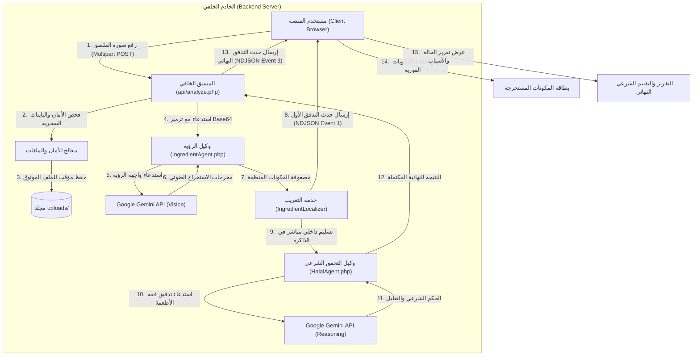
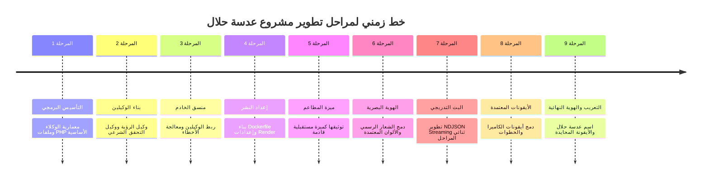

# مشروع عدسة حلال الذكي لفحص الأغذية (HalalLens AI)
## تقرير تطوير المشروع الأكاديمي الشامل — هندسة الذكاء الاصطناعي (AI Engineering)

---

### بيانات المشروع الأساسية

- **اسم المشروع بالإنجليزية**: HalalLens AI
- **اسم المشروع بالعربية**: عدسة حلال
- **وصف المشروع**: منصة ويب ذكية متخصصة في فحص وتحليل ملصقات المكونات الغذائية للتحقق من توافقها مع المعايير الغذائية والشرعية الإسلامية (فقه الأطعمة)، بالاعتماد على بنية برمجية تعاونية متعددة الوكلاء (Multi-Agent Architecture) تعمل بالكامل على الخادم.
- **نوع المشروع**: مشروع تطبيقي في هندسة الذكاء الاصطناعي وهندسة البرمجيات (AI Engineering University Project).
- **السياق الأكاديمي**: مقرر هندسة الذكاء الاصطناعي والأنظمة الذكية (AI Engineering Coursework).
- **حالة التطوير الحالية**: مكتمل ومختبر وظيفياً ومحلياً، ومجهز للنشر السحابي (Ready for Cloud Deployment).

---

## فهرس التقرير

1. [مقدمة المشروع](#1-مقدمة-المشروع)
2. [المشكلة](#2-المشكلة)
3. [أهداف المشروع](#3-أهداف-المشروع)
4. [الفئة المستهدفة](#4-الفئة-المستهدفة)
5. [تحليل المتطلبات](#5-تحليل-المتطلبات)
   - 5.1 [المتطلبات الوظيفية](#51-المتطلبات-الوظيفية)
   - 5.2 [المتطلبات غير الوظيفية](#52-المتطلبات-غير-الوظيفية)
6. [تصميم النظام والمعمارية البرمجية](#6-تصميم-النظام-والمعمارية-البرمجية)
7. [تصميم الوكلاء الأذكياء](#7-تصميم-الوكلاء-الأذكياء)
   - [وكيل الرؤية واستخراج المكونات (Agent 1)](#وكيل-الرؤية-واستخراج-المكونات-agent-1)
   - [وكيل التحقق الشرعي (Agent 2)](#وكيل-التحقق-الشرعي-agent-2)
8. [تعاون الوكلاء وتدفق البيانات](#8-تعاون-الوكلاء-وتدفق-البيانات)
9. [تصميم الواجهات وتجربة المستخدم والهوية البصرية](#9-تصميم-الواجهات-وتجربة-المستخدم-والهوية-البصرية)
10. [التطوير باستخدام الذكاء الاصطناعي](#10-التطوير-باستخدام-الذكاء-الاصطناعي)
11. [مراحل تطوير المشروع](#11-مراحل-تطوير-المشروع)
12. [سجل الأوامر والموجهات المستخدمة (Prompts Registry)](#12-سجل-الأوامر-والموجهات-المستخدمة-prompts-registry)
13. [التنفيذ والاختبار الميداني](#13-التنفيذ-والاختبار-الميداني)
14. [الأمن وحماية البيانات والسرية](#14-الأمن-وحماية-البيانات-والسرية)
15. [النشر والاستضافة السحابية](#15-النشر-والاستضافة-السحابية)
16. [النتائج المحققة](#16-النتائج-المحققة)
17. [التحديات التقنية والحلول المطبقة](#17-التحديات-التقنية-والحلول-المطبقة)
18. [الدروس المستفادة](#18-الدروس-المستفادة)
19. [القيود الحالية للنظام](#19-القيود-الحالية-للنظام)
20. [خطة التطوير المستقبلي](#20-خطة-التطوير-المستقبلي)
21. [الخاتمة](#21-الخاتمة)
22. [روابط التسليم والمخرجات](#22-روابط-التسليم-والمخرجات)
23. [الملاحق](#23-الملاحق)
    - [الملحق أ: الهيكل البرمجي الفعلي للمشروع](#الملحق-أ-الهيكل-البرمجي-الفعلي-للمشروع)
    - [الملحق ب: عقود ومخططات JSON للوكلاء](#الملحق-ب-عقود-ومخططات-json-للوكالاء)
    - [الملحق ج: نصوص موجهات النظام (Prompts) الكاملة](#الملحق-ج-نصوص-موجهات-النظام-prompts-الكاملة)
    - [الملحق د: لقطات الشاشة المرجعية والواجهات](#الملحق-د-لقطات-الشاشة-المرجعية-والواجهات)

---

## 1. مقدمة المشروع

يُعد مشروع **عدسة حلال (HalalLens AI)** تطبيقاً عملياً متقدماً في هندسة الذكاء الاصطناعي يهدف إلى معالجة تحدي يومي يواجه المستهلكين المسلمين حول العالم، وخاصة في الأسواق المستوردة أو المجتمعات ذات الأغلبية غير المسلمة، والمتمثل في صعوبة التحقق من الحِلّية الشرعية لمكونات المنتجات الغذائية المصنعة.

يقوم النظام على فكرة تسخير النماذج التوليدية متعددة الوسائط (Multimodal Generative Models) من خلال **بنية متعددة الوكلاء (Multi-Agent System)**؛ حيث يتم تقسيم المهمة التحليلية المعقدة إلى مرحلتين تخصصيتين متعاونتين:
1. **وكيل الرؤية واستخراج المكونات (Ingredient Vision Agent)**: يتولى المعالجة البصرية، والتعرف الضوئي على المحارف (OCR)، واستخراج قائمة المكونات الغذائية بصيغة بيانات مهيكلة (Structured JSON) مع تقدير دقة القراءة لكل مكون.
2. **وكيل التحقق الشرعي الغذائي (Halal Verification Agent)**: يتولى دراسة المكونات والإضافات المستخرجة ومقارنتها بقواعد فقه الأطعمة والمعايير العلمية لتصنيف المنتج بدقة إلى إحدى الحالات المعيارية الأربع: (`HALAL`، `HARAM`، `DOUBTFUL`، `UNKNOWN`)، مع تقديم تعليل فقهي وعلمي واضح وتوصيات استرشادية للمستهلك.

> [!IMPORTANT]
> **التفريق الأكاديمي والشرعي الحاسم**:
> تم تصميم المنصة لتقديم **تحليل استرشادي تقني مدعوم بالذكاء الاصطناعي** للمكونات الغذائية المعلنة على ملصق المنتج. ويؤكد المشروع صراحة واحترازياً على أن النظام **لا يُعد بديلاً عن شهادات الحلال الرسمية** الصادرة عن الهيئات الشرعية والرقابية المعتمدة، ولا يمتلك سلطة الإفتاء، وإنما هو أداة مساعدة للمستهلك لفهم الملصقات المعقدة وتنبيهه للمكونات المشتبه فيها أو المحرمة.

---

## 2. المشكلة

تتميز صناعة الأغذية الحديثة بالتعقيد المتزايد، حيث تحتوي معظم المنتجات المصنعة والمعلبة على عشرات المكونات المشتقة، والمستحلبات، والمواد الحافظة، ومحسنات القوام، والملونات التي يُرمز لها بأرقام قياسية دولية وأوروبية مثل (E471، E120، E476).

### مبررات وأبعاد المشكلة:
1. **صعوبة القراءة اليدوية**: تتم طباعة قوائم المكونات غالباً بخطوط دقيقة وصغيرة جداً على العبوات، وبألوان وتنسيقات يصعب على المستهلك العادي قراءتها أو تدقيقها أثناء التسوق.
2. **تعدد اللغات في المنتجات المستوردة**: تأتي العديد من المنتجات بملصقات باللغة الإنجليزية أو لغات أجنبية أخرى، مما يشكل عائقاً أمام المستهلكين العرب في فهم طبيعة المكون.
3. **غموض مصادر الإضافات الغذائية (Additive Ambiguity)**: العديد من المواد الكيميائية والمستحلبات (مثل أحادي وثنائي الجليسريدات E471، والجيلاتين E428) قد تُستخلص إما من مصادر نباتية بحتة أو من دهون حيوانية (كالخنزير أو حيوانات غير مذكاة شرعياً). وفي غياب تصريح صريح على العبوة، يقع المستهلك في حيرة بالغة تتطلب تدقيقاً فقهياً احترازياً.
4. **قصور النماذج الفردية الشاملة (Monolithic AI Limitation)**: عند محاولة تكليف نموذج توليدي واحد بقراءة الصورة مباشرة وإصدار حكم شرعي في آن واحد، تحدث أخطاء هلوسة بصرية (Visual Hallucinations) وخلط بين تفسير النص والحكم الفقهي؛ مما استدعى معمارياً فصل "الرؤية والاستخراج" عن "التحليل الشرعي".

---

## 3. أهداف المشروع

تمت صياغة أهداف المشروع بدقة لتتوافق 100% مع ما تم بناؤه وتطويره واختباره فعلياً في المستودع البرمجي:

1. **التعرف البصري الدقيق**: استخراج نصوص قوائم المكونات من صور ملصقات الأغذية بدرجات دقة ووضوح مختلفة باستخدام وكيل رؤية مخصص.
2. **هيكلة البيانات**: تحويل النص الخام للمكونات إلى كائنات JSON معيارية تضم الاسم الأصلي، والاسم المعياري، ونسبة الثقة المقدرة، وتقييم جودة الصورة المصدر.
3. **التدقيق الشرعي التخصصي**: تقييم كل مكون ومضاف غذائي استناداً إلى ضوابط فقه الأطعمة وتصنيفه إلى: حلال، حرام، مشتبه فيه، أو غير معروف.
4. **التعاون الحقيقي بين الوكلاء**: تطبيق دورة عمل برمجية backend-orchestrated تنقل المخرجات المهيكلة للوكيل الأول مباشرة كمدخلات للوكيل الثاني دون تدخل المتصفح.
5. **التسليم التدريجي للنتائج (Progressive 2-Stage Streaming)**: عرض المكونات المستخرجة فوراً للمستخدم عبر تقنية التدفق (NDJSON Streaming) أثناء متابعة الوكيل الثاني لمرحلة التدقيق الشرعي.
6. **التعريب المعجمي الذكي**: توطين أسماء المكونات والمضافات الكيميائية إلى مصطلحات غذائية عربية طبيعية (مع الحفاظ على النص اللاتيني الأصلي معزولاً)، ودعم الواجهة المزدوجة (العربية أولاً RTL والإنجليزية LTR).
7. **التصميم المتجاوب والهوية البصرية المتكاملة**: بناء واجهة مستخدم متناسقة متوافقة تماماً مع أجهزة الهواتف الذكية، والأجهزة اللوحية، والشاشات المكتبية، مستوحاة من الهوية البصرية الإسلامية المعتمدة.
8. **الأمان والموثوقية**: عزل مفاتيح الاتصال البرمجية (Gemini API Key) في الخادم، وفحص وتطهير الملفات المرفوعة أمنياً، ومنع تخزين أو تسريب البيانات الحساسة.
9. **الاستعداد للنشر السحابي**: توفير بيئة تشغيل مدعومة بحاوية Docker متوافقة مع منصة Render ومنصات الاستضافة المدارة.

---

## 4. الفئة المستهدفة

تم تحديد الفئة المستهدفة للنظام بناءً على التحليل التقديري لحاجة السوق والمستخدمين:
- **المستهلكون المسلمون**: الراغبون في التأكد السريع والموثوق من حِلّية مشترياتهم الغذائية، لا سيما في بلدان الاغتراب أو عند شراء المنتجات المستوردة.
- **المستخدمون الناطقون بالعربية**: الذين يحتاجون إلى أداة تُعرّب وتُبسّط المصطلحات اللاتينية والرموز الكيميائية المعقدة إلى لغتهم الأم.
- **المهتمون بسلامة الأغذية وتجنب الشبهات**: الباحثون عن معرفة مصادر المستحلبات والإضافات الغذائية الحساسة (مثل الجيلاتين ومستحلبات الدهون).
- **المستخدمون المعتمدون على الهواتف الذكية**: الذين يحتاجون إلى أداة سريعة وسهلة الاستخدام أثناء التسوق الميداني داخل المتاجر.

---

## 5. تحليل المتطلبات

### 5.1 المتطلبات الوظيفية (Functional Requirements)

| الرقم | المتطلب الوظيفي | الوصف وحالة التنفيذ |
| :--- | :--- | :--- |
| **FR-01** | رفع صورة ملصق المنتج | إتاحة رفع الصور عبر السحب والإفلات أو التصفح أو التقاط الكاميرا بالصيغ المعتمدة (JPG, PNG, WebP). *(منفذ ومختبر)* |
| **FR-02** | فحص والتحقق من الملف | التحقق الصارم في الخادم من سلامة الملف، حجمه (أقل من 5MB)، وامتداده، وفحص البايتات السحرية (Magic Bytes). *(منفذ ومختبر)* |
| **FR-03** | استخراج المكونات (Agent 1) | استدعاء وكيل الرؤية لتحليل الصورة واستخراج قائمة المكونات مع تقدير نسبة الثقة وجودة الملصق. *(منفذ ومختبر)* |
| **FR-04** | التعريب الآلي للمكونات | ترجمة المكونات ورموز E-numbers آلياً إلى العربية الفصحى عبر خدمة `IngredientLocalizer` في النمط العربي. *(منفذ ومختبر)* |
| **FR-05** | العرض المرحلي الفوري | إظهار بطاقة المكونات المستخرجة فور إنجاز الوكيل الأول لمهمته دون انتظار انتهاء التدقيق النهائي. *(منفذ ومختبر)* |
| **FR-06** | التسليم الداخلي للوكلاء | تمرير بيانات الوكيل الأول في الذاكرة الداخلية للخادم مباشرة كمدخل للوكيل الثاني. *(منفذ ومختبر)* |
| **FR-07** | التدقيق الشرعي (Agent 2) | تقييم المكونات فقهياً وتصنيف كل مكون والحالة الكلية للمنتج إلى: حلال، حرام، مشتبه فيه، أو غير معروف. *(منفذ ومختبر)* |
| **FR-08** | عرض التقرير النهائي | عرض شارة الحالة الكلية، نسبة الثقة، قائمة الأسباب والتعليلات، ملاحظات المستهلك، والبطاقات الفردية لكل مكون. *(منفذ ومختبر)* |
| **FR-09** | الحفاظ على النص الأصلي | عرض النص الخام المستخرج من العبوة دون أدنى تعديل أو اختلاق في نافذة مخصصة للمطابقة. *(منفذ ومختبر)* |
| **FR-10** | دعم اللغتين والاتجاهين | دعم كامل للغتين العربية (RTL) والإنجليزية (LTR) مع تبديل لحظي وحفظ التفضيل عبر Cookies. *(منفذ ومختبر)* |
| **FR-11** | معالجة حالات الفشل والشك | عرض رسائل خطأ دقيقة عند غياب المفتاح، أو تلف الصورة، أو عدم وضوح الملصق، مع تطبيق مبدأ الاحتياط الفقهي. *(منفذ ومختبر)* |
| **FR-12** | استكشاف المطاعم الحلال | عرض ميزة استكشاف المطاعم الحلال كخاصية مستقبلية قادمة ("قريبًا") دون تفعيل روابط GPS حية في الواجهة. *(موثق كخاصية مستقبلية)* |

### 5.2 المتطلبات غير الوظيفية (Non-Functional Requirements)

1. **الأمان وحماية المفاتيح البرمجية**:
   - حظر تضمين مفتاح Gemini API في الشيفرة البرمجية للواجهة (Client-side) نهائياً.
   - قراءة المفاتيح حصراً عبر متغيرات البيئة (`getenv('GEMINI_API_KEY')`) أو ملف إعدادات محمي خارج متناول Git.
   - حظر الوصول المباشر إلى ملفات المجلد `uploads/` عبر قواعد `.htaccess`.
2. **الأداء والاستجابة (Performance)**:
   - استخدام التدفق التتابعي (NDJSON Streaming) مع تفريغ الدفق `ob_flush(); flush();` لإعطاء رد فعل مرئي فوري للمستخدم في أقل من ثانيتين من انتهاء الوكيل الأول، مما يقلل وقت الانتظار المتصور (Perceived Latency).
3. **الدقة والموثوقية (Reliability & Groundedness)**:
   - إلزام وكيل الرؤية بعدم اختلاق أو تخمين أي نصوص مقطوعة أو غير مقروءة، وتدوين ذلك كعنصر شك.
   - إلزام وكيل التحقق باعتبار أي مستحلب أو إنزيم حيواني غير مصرح بمصدره كـ "مشتبه فيه" (DOUBTFUL) درءاً للشبهات.
4. **التصميم المتجاوب وإمكانية الوصول (Responsive Design & Accessibility)**:
   - تصميم الواجهة بأسلوب Mobile-First يتكيف تلقائياً مع مختلف مقاسات الشاشات (الهواتف الذكية < 640px، الأجهزة اللوحية 641px–1024px، الشاشات المكتبية > 1024px).
   - استخدام طباعة عربية واضحة ومريحة للعين عبر خط تجوال (Tajawal).
   - عزل اتجاه النصوص الأجنبية والرموز الرقمية عبر `unicode-bidi: isolate; direction: ltr;` لمنع تشوه الأقواس في النمط العربي.
5. **التوافقية وسهولة النشر (Portability & Compatibility)**:
   - بناء الخلفية البرمجية بلغة PHP القياسية دون الاعتماد على أطر عمل ثقيلة أو اعتمادات معقدة، مما يتيح تشغيلها على أي استضافة مشتركة (Shared Hosting) أو في حاويات Docker سحابية.

---

## 6. تصميم النظام والمعمارية البرمجية

يعتمد النظام معمارية متعددة الوكلاء تتم إدارتها بالكامل على الخادم (**Backend-Orchestrated Multi-Agent Architecture**).

### مخطط سير المعمارية البرمجية (System Architecture Flowchart):



### أسباب اختيار التنسيق على الخادم (Backend Orchestration) بدلاً من المتصفح:
1. **الأمان وسلامة البيانات**: لا يمتلك المتصفح أي وسيلة لتعديل مصفوفة المكونات المستخرجة قبل تمريرها للوكيل الثاني، مما يمنع محاولات التلاعب بالبيانات أو تزييف نتائج التحليل.
2. **كفاءة الشبكة**: التنسيق داخل الخادم يوفر جولة إرسال واستقبال إضافية (Round-trip) عبر شبكة الهاتف، مما يقلل استهلاك البيانات ويُسرّع الاستجابة.
3. **حماية المفاتيح والاتصال المباشر**: تتم جميع الاتصالات بنماذج Gemini عبر قنوات الخادم المشفرة دون ظهور أي بيانات سرية في أدوات فحص المتصفح.

---

## 7. تصميم الوكلاء الأذكياء

تم بناء وكيلين برمجيين مستقلين، لكل منهما مسؤولية محددة وعقد بيانات (JSON Schema) صارم.

### وكيل الرؤية واستخراج المكونات (Agent 1: Ingredient Vision Agent)

- **الملف المصدري**: [`agents/IngredientAgent.php`](file:///d:/@Programming/HalalLens/agents/IngredientAgent.php)
- **الفئة البرمجية**: `HalalLens\Agents\IngredientAgent`
- **النموذج المستخدم**: `gemini-3.8-flash` (أو المعرف عبر المتغير `GEMINI_MODEL`)
- **المهمة الحصرية**: الفحص البصري الدقيق لصورة ملصق المنتج واستخراج قائمة المكونات الغذائية ومستحلباتها حرفياً دون إبداء أي رأي ديني أو تصنيف حلال/حرام.

#### المدخلات والمخرجات:
- **المدخل**: المسار الفعلي للصورة المفحوصة والمحفوظة في الخادم.
- **المخرج المهيكل**: كائن JSON يحتوي على:
  - `source_quality`: جودة الملصق (`good`, `fair`, `poor`, `unreadable`).
  - `source_text`: النص الخام المنقول حرفياً من العبوة.
  - `ingredients`: مصفوفة كائنات، كل كائن يحتوي على `original_name`، و `normalized_name`، و `confidence`.
  - `ingredient_count`: إجمالي عدد المكونات المقروءة.
  - `notes`: ملاحظات الوكيل في حال وجود كلمات مهترئة أو غير واضحة.

---

### وكيل التحقق الشرعي (Agent 2: Halal Verification Agent)

- **الملف المصدري**: [`agents/HalalAgent.php`](file:///d:/@Programming/HalalLens/agents/HalalAgent.php)
- **الفئة البرمجية**: `HalalLens\Agents\HalalAgent`
- **النموذج المستخدم**: `gemini-3.8-flash`
- **المهمة الحصرية**: تحليل مصفوفة المكونات المسلمة إليه ومقارنتها بضوابط فقه الأطعمة الإسلامي، وفحص أرقام الإضافات (E-numbers) والمصادر المحتملة (نباتية، حيوانية، خنزيرية، صناعية).

#### حالات التصنيف المعيارية الأربع (Canonical Status Taxonomy):
1. **`HALAL` (حلال)**: المكونات النباتية، البحرية، المعادن، الإضافات المصرح رسمياً بأنها نباتية 100%، أو مشتقات الحيوانات المباحة المذكاة شرعياً.
2. **`HARAM` (حرام)**: المنتجات المحتوية على مشتقات الخنزير، الشحوم غير المذكاة، الكحول المسكر، الدم المسفوح، أو جيلاتين الخنزير.
3. **`DOUBTFUL` (مشتبه فيه)**: المضافات والمستحلبات ذات الأصل المزدوج (كالدهون والأحماض الدهنية E471 و E476 والجيلاتين مجهول المصدر والإنزيمات الحيوانية) التي لم يُذكر أصلها صراحة على العبوة.
4. **`UNKNOWN` (غير معروف)**: البيانات التالفة أو الملصقات المشوشة التي يتعذر معها الجزم بسلامة المنتج.

#### المدخلات والمخرجات:
- **المدخل**: مصفوفة المكونات الناتجة عن الوكيل الأول، واللغة المفضلة للتعليل (`'ar'` أو `'en'`).
- **المخرج المهيكل**: كائن JSON يحتوي على:
  - `status`: إحدى الحالات المعيارية الأربع بالأحرف الإنجليزية الكبيرة.
  - `status_ar` / `status_en`: الحالة مترجمة بحسب لغة الواجهة.
  - `confidence`: مؤشر الثقة العام بالحكم الفقهي والتحليلي.
  - `reasons`: مصفوفة أسباب تفصيلية تشرح حيثيات الحكم العام.
  - `ingredient_assessments`: تدقيق إفرادي لكل مكون يوضح حالته وسببه الفقهي والعلمي.
  - `notes`: نصائح عملية للمستهلك (مثل البحث عن شعار الحلال أو التواصل مع المصنع).

---

## 8. تعاون الوكلاء وتدفق البيانات

يُمثل التعاون بين الوكيلين جوهر بنية المشروع، ويتم عبر بروتوكول تسليم بيانات تسلسلي مُحكم:

```
[صورة ملصق المنتج الغذائي]
           │
           ▼
┌────────────────────────────────────────────────────────┐
│                   api/analyze.php                      │
│                (المنسق البرمجي العام)                  │
└──────────────────────────┬─────────────────────────────┘
                           │
                           ▼
┌────────────────────────────────────────────────────────┐
│           الوكيل الأول: وكيل الرؤية واستخراج المكونات   │
│                 (IngredientAgent.php)                  │
│                                                        │
│  - يقرأ الصورة ويحللها عبر Gemini Multimodal API       │
│  - يستخرج المكونات وينشئ كائن JSON المهيكل             │
└──────────────────────────┬─────────────────────────────┘
                           │
                           ▼
┌────────────────────────────────────────────────────────┐
│                 خدمة التعريب المعجمي                   │
│             (services/IngredientLocalizer.php)         │
│                                                        │
│  - تُترجم المكونات فورياً للغة العربية                 │
│  - تُرسل حدث التدفق الأول: ingredients_extracted      │
└──────────────────────────┬─────────────────────────────┘
                           │
                           ▼ (تسليم داخلي مباشر في الذاكرة)
┌────────────────────────────────────────────────────────┐
│           الوكيل الثاني: وكيل التحقق الشرعي الغذائي    │
│                    (HalalAgent.php)                    │
│                                                        │
│  - يتلقى المكونات المهيكلة كمدخل فوري                  │
│  - يطبق قواعد الفقه الإسلامي وعلوم الأغذية             │
│  - يُصدر الحكم النهائي والتعليلات لكل مكون             │
└──────────────────────────┬─────────────────────────────┘
                           │
                           ▼
┌────────────────────────────────────────────────────────┐
│                   api/analyze.php                      │
│                                                        │
│  - يدمج التقريرين في كائن تحليلي متكامل                │
│  - يُرسل حدث التدفق النهائي: verification_completed   │
└────────────────────────────────────────────────────────┘
```

### تقنية البث التدريجي ثنائي المراحل (Progressive 2-Stage Streaming):
في معالجات الذكاء الاصطناعي التوليدي، يستغرق استدعاء نموذجين متتاليين وقتاً يتراوح بين 4 إلى 8 ثوانٍ. لحل مشكلة جمود الواجهة، تم تطوير نظام تدفق بيانات يعتمد على صيغة Newline-Delimited JSON (NDJSON):
1. **الحدث الأول (`ingredients_extracted`)**: بمجرد انتهاء الوكيل الأول من استخراج المكونات، يتم تعريبها ودفع السطر الأول للمتصفح مباشرة مصحوباً بـ `ob_flush(); flush();`.
2. **استجابة الواجهة الفورية**: يقرأ المتصفح التدفق بواسطة `ReadableStream`، ويقوم فوراً بإخفاء مؤشر التحميل الأولي، ونقل مؤشر خطوة الوكيل الأول إلى "مكتملة"، **وعرض بطاقة المكونات المستخرجة كاملة أمام المستخدم**.
3. **الحدث الثاني (`verification_started`)**: إشعار الواجهة ببدء مرحلة التحقيق الشرعي وعرض شريط فرعي يوضح "جارٍ التحقق من المكونات شرعياً...".
4. **الحدث الثالث (`verification_completed`)**: بمجرد اكتمال تقييم الوكيل الثاني، يُدفع السطر النهائي المحتوي على التقييم الشرعي الكامل، فيقوم المتصفح بإظهار بطاقة النتيجة، وشارة الحِلّية، وقائمة الأسباب، والبطاقات الفردية.

---

## 9. تصميم الواجهات وتجربة المستخدم والهوية البصرية

تم بناء واجهة المستخدم لتكون سريعة وخفيفة وتعتمد على أفضل ممارسات تصميم الويب الحديث (Modern Semantic Web) دون الاعتماد على أطر عمل ثقيلة.

### ركائز الهوية البصرية:
- **اللغة والاتجاه (Arabic-First & RTL)**: صُممت المنصة أساساً باللغة العربية كخيار افتراضي (`dir="rtl"` و `lang="ar"`)، مع دعم كامل للغة الإنجليزية بنقرة واحدة مع ضبط التخطيط (`dir="ltr"`).
- **الخط الطباعي (Universal Typography)**: اعتماد خط **تجوال (Tajawal)** من Google Fonts بدرجات متعددة (400, 500, 700, 800) لضمان وضوح فائق وقراءة مريحة للمصطلحات العربية واللاتينية على حد سواء.
- **الشعار الرسمي (Brand Logo)**: دمج الشعار الرسمي المعتمد للمشروع في الترويسة ووسط الصفحة والتذييل بصيغة مربعة 1:1 فائقة الوضوح ([`assets/halallens-logo.png`](file:///d:/@Programming/HalalLens/assets/halallens-logo.png)).
- **لوحة الألوان المستوحاة من الهوية**:
  - **الأخضر الغابي الداكن** (`#0d3b24`): يمثل الوقار والأصالة ويُستخدم في العناوين والترويسة.
  - **الأخضر الزمردي الحيوي** (`#1b7a43`): يمثل الحِلّية والطبيعة ويُستخدم في الأزرار الرئيسية وحالات الحلال.
  - **الذهبي الدافئ** (`#c79d39`): يمثل اللمسة الجمالية الإسلامية ويُستخدم في الشارات والخطوط الفرعية.
  - **الأبيض العاجي الدافئ** (`#f8faf7`): يمثل النقاء ويوفر خلفية مريحة للعين ومتباينة مع البطاقات.
- **الأيقونات المحايدة للمكونات (Neutral Food Component Icons)**:
  - استبدال رمز ورقة الشجر (`🌿`) برمز SVG هندسي محايد يمثل (عنصراً/مكوناً غذائياً) بلون رمادي هادئ (`#64748b`) لمنع الإيحاء بأن كل مكون مستخرج هو نباتي أو حلال قبل خضوعه للفحص الشرعي.
- **أيقونة الكاميرا التعبيرية**: اعتماد أيقونة الكاميرا الرسمية الذهبية والخضراء في الخطوة الأولى من مخطط الوكلاء لتعبر بدقة عن "تصوير المنتج".

### الأقسام المكتملة في واجهة التطبيق:
1. **الترويسة (Header)**: تضم الشعار، واسم "عدسة حلال"، وشارة المشروع الأكاديمي، وروابط التنقل السريع، ومبدل اللغة (العربية/English).
2. **القسم التعريفي (Hero Section)**: يقدم رسالة المنصة وشعارها الأساسي: *"اعرف مكونات طعامك بثقة"*.
3. **شريط المميزات السريعة (4 Quick Features)**: (تصوير، تحليل، تحقق، ابحث).
4. **قسم فحص المنتج (Product Analysis & Upload)**: منطقة سحب وإفلات تفاعلية مع معاينة فورية للصورة، وبيانات الحجم، وزر البدء.
5. **مخطط التقدم اللحظي للوكلاء (Live Pipeline Progress Tracker)**: خط زمني يوضح حالة عمل الوكيل الأول والوكيل الثاني لحظياً.
6. **بطاقة المكونات المستخرجة الفورية (Stage 1 Card)**: تظهر مباشرة فور انتهاء الوكيل الأول وتضم شرائح المكونات المعربة، مع الاسم اللاتيني الأصلي معزولاً، ونسبة الثقة، وزر استعراض النص الخام من العبوة.
7. **بطاقة التقييم النهائي (Stage 2 Results Card)**: شارة الحكم الكبيرة الملونة، نسبة الثقة العامة، وسوم المكونات، قائمة الأسباب، والبطاقات الفردية لكل مكون.
8. **قسم كيف تعمل المنصة (How It Works)**: شرح مبسط في 4 خطوات مدعومة بالأيقونات المعتمدة.
9. **مخطط معمارية الوكلاء التفاعلي (Multi-Agent Architecture)**: رسم توضيحي لعقد تدفق البيانات من الصورة حتى النتيجة.
10. **دليل الحالات المعيارية (Classification Guide)**: شرح للألوان والحالات الأربع: حلال (أخضر)، حرام (أحمر)، مشتبه فيه (أصفر/برتقالي)، غير معروف (رمادي).
11. **قسم المطاعم الحلال القريبة — قريبًا (Coming Soon)**: بطاقة أنيقة توضح أن خاصية اكتشاف المطاعم هي ميزة مستقبلية قيد التطوير.
12. **إخلاء المسؤولية والموثوقية (Trust & Advisory)**: توضيح حدود الذكاء الاصطناعي والتنبيه على عدم الإغناء عن الجهات الرسمية.
13. **التذييل (Footer)**: روابط سريعة وتوثيق المشروع الأكاديمي.

---

## 10. التطوير باستخدام الذكاء الاصطناعي

تم تطوير المشروع بالاعتماد على أدوات هندسة البرمجيات المعززة بالذكاء الاصطناعي (AI-Assisted Software Engineering)، وبالتحديد بيئة **Google Antigravity Agentic IDE** المعتمدة على نماذج **Gemini 2.5 / 3 (Pro & Flash)**.

### مجالات التوظيف الفعلي للذكاء الاصطناعي في دورة حياة المشروع:
1. **هندسة موجهات الوكلاء (Prompt Engineering & Schema Enforcement)**:
   - صياغة موجهات نظام متقدمة للوكيلين تفرض الالتزام الصارم بمخرجات JSON النقية دون أي نصوص تمهيدية أو وسوم كود ماركداون.
   - تضمين قواعد فقه الأطعمة وأدلة تصنيف المواد الحافظة والمستحلبات المشبوهة داخل موجه الوكيل الثاني.
2. **التصميم الموجه للواجهات (Generative UI/UX & Localization)**:
   - توليد وتنسيق شيفرات CSS المتوافقة مع أسلوب العرض العربي الأصيل (RTL)، وضبط محاذاة العناصر، واستيراد خط تجوال.
   - تطوير حلول للعزل ثنائي الاتجاه (Bi-directional text isolation) لمنع تشوه الأقواس في النصوص اللاتينية داخل الفقرات العربية.
3. **تطوير تدفق البيانات التتابعي (NDJSON Streaming Controller)**:
   - كتابة خوارزمية قراءة التدفق اللحظي في JavaScript باستخدام واجهات `ReadableStream` القياسية لفك تشفير الأسطر التتابعية فور وصولها.
4. **بناء المعجم الغذائي للتعريب (`IngredientLocalizer.php`)**:
   - توليد خريطة مطابقة موسعة تضم أكثر من 150 مصطلحاً غذائياً ومضافاً كيميائياً مع صيغ الأرقام القياسية (E-numbers) لضمان تعريب تلقائي دقيق للمكونات المستخرجة.

---

## 11. مراحل تطوير المشروع

وفقاً للسجلات الفعلية في مستودع Git والملفات البرمجية للمشروع، سارت عملية التطوير عبر 9 مراحل رئيسية:



1. **المرحلة الأولى — تأسيس المشروع والمعمارية**:
   - إعداد البنية الهيكلية للمشروع ومجلدات `agents/` و `api/` و `config/` و `lang/` و `uploads/`.
   - كتابة معايير بنية الوكلاء في وثيقة [`AGENTS.md`](file:///d:/@Programming/HalalLens/AGENTS.md).
2. **المرحلة الثانية — بناء الوكيلين (Agent 1 & Agent 2)**:
   - تطوير فئة [`IngredientAgent.php`](file:///d:/@Programming/HalalLens/agents/IngredientAgent.php) للاتصال بواجهة Gemini Vision لاستخراج المكونات.
   - تطوير فئة [`HalalAgent.php`](file:///d:/@Programming/HalalLens/agents/HalalAgent.php) لتطبيق ضوابط فقه الأطعمة وتصنيف المكونات.
3. **المرحلة الثالثة — بناء المنسق المركزي (Backend Orchestrator)**:
   - تطوير نقطة النهاية [`api/analyze.php`](file:///d:/@Programming/HalalLens/api/analyze.php) لاستقبال الملف وفحصه أمنياً وتنسيق التسليم الداخلي بين الوكيلين.
   - توفير نقطة الاختبار النمطية المباشرة [`api/verify.php`](file:///d:/@Programming/HalalLens/api/verify.php).
4. **المرحلة الرابعة — إعداد بيئة النشر السحابي (Cloud Preparation)**:
   - إنشاء ملف [`Dockerfile`](file:///d:/@Programming/HalalLens/Dockerfile) المعتمد على Apache و PHP 8.2.
   - إنشاء ملف تهيئة الخدمات [`render.yaml`](file:///d:/@Programming/HalalLens/render.yaml) لنشر المنصة على Render.
5. **المرحلة الخامسة — مراجعة وتأطير ميزة المطاعم**:
   - إعادة تقديم ميزة البحث عن المطاعم في الواجهة وقسم الوصف كخاصية مستقبلية قادمة ("قريبًا") وفصلها عن مسار عمل الوكلاء.
6. **المرحلة السادسة — اعتماد الشعار الرسمي والهوية البصرية**:
   - دمج الشعار الرسمي في ملفات المشروع واعتماده في شاشات الترويسة والتذييل.
   - توحيد الخطوط عبر خط Tajawal وتنسيق الواجهة لدعم العربية والإنجليزية.
7. **المرحلة السابعة — تطوير البث التدريجي والتصميم المتجاوب**:
   - إضافة بروتوكول التدفق المستمر (NDJSON) في `api/analyze.php` وتحديث `js/app.js` لعرض المكونات فور استخراجها في المرحلة الأولى.
   - إعادة كتابة وتوسيع تنسيقات `css/style.css` لضمان تجاوب كامل مع كافة الأجهزة الذكية.
8. **المرحلة الثامنة — دمج الأيقونات البصرية للوكلاء**:
   - تحديث المخطط الانسيابي لبنية الوكلاء وخطوات العمل بأيقونات مرئية مخصصة.
9. **المرحلة التاسعة — التوطين النهائي والتعريب المتقدم**:
   - تعميم الاسم الرسمي العربي **"عدسة حلال"** وحذف جميع الترجمات الصوتية السابقة ("هلالنس").
   - بناء محرك التعريب الغذائي [`IngredientLocalizer.php`](file:///d:/@Programming/HalalLens/services/IngredientLocalizer.php) لتعريب مخرجات التحليل آلياً في الواجهة العربية.
   - استبدال أيقونة الورقة الخضراء برمز محايد للمكونات الغذائية ووضع أيقونة الكاميرا في مخطط الوكلاء.

---

## 12. سجل الأوامر والـPrompts المستخدمة

يوثق الجدول التالي نماذج من الأوامر والموجهات البرمجية التي وجهت النماذج التوليدية في المنصة والمشروع (مع استبعاد أي مفاتيح أو بيانات سرية):

| المرحلة / المكون | الهدف من الأمر | الأداة / النموذج | نوع الموجه | النتيجة المحققة |
| :--- | :--- | :--- | :--- | :--- |
| **وكيل الرؤية (Agent 1)** | استخراج نصوص الملصقات بهيئة JSON صارمة | Gemini Vision API (`gemini-3.8-flash`) | System Instruction Prompt | استخراج قائمة المكونات مع عزل النص الأصلي ونسبة الثقة دون أي تحيزات شرعية |
| **وكيل التحقق (Agent 2)** | تقييم المكونات استناداً لفقه الأطعمة | Gemini Reasoning API (`gemini-3.8-flash`) | System Instruction & Context Prompt | تصنيف الحالة إلى (HALAL, HARAM, DOUBTFUL, UNKNOWN) مع أسباب فقهية وعلمية مفصلة |
| **هندسة الواجهة (UI/UX)** | تطبيق خط تجوال والاتجاه العربي RTL | Antigravity AI Engine | Implementation Directive | تنسيق صفحات الويب وتطبيق خط تجوال وتجاوب الشاشات ودعم عزل النصوص اللاتينية |
| **البث التتابعي (Streaming)** | تقسيم استجابة الخادم إلى مرحلتين تدفقيتين | Antigravity AI Engine | Architecture Refinement | إنشاء آلية التدفق عبر NDJSON وتحديث المتصفح لعرض المكونات فورياً أثناء الفحص |
| **تعريب المكونات** | تحويل المكونات المستخرجة إلى مصطلحات عربية | Antigravity AI Engine | Functional Directive | تطوير فئة `IngredientLocalizer` التي وفرت ترجمة معجمية لأكثر من 150 مضافاً وغذاءً |
| **تثبيت الهوية** | تعميم اسم "عدسة حلال" واستبدال الأيقونات | Antigravity AI Engine | Refinement Directive | اعتماد "عدسة حلال" كاسم رسمي واستبدال إيموجي الورقة برمز مكعب المكون المحايد |

---

## 13. التنفيذ والاختبار الميداني

أُجريت سلسلة من الاختبارات الوظيفية والتقنية الصارمة للتحقق من أداء النظام ومنع الأخطاء:

| المعرف | موضوع الاختبار | المدخلات | النتيجة المتوقعة | النتيجة الفعلية المحققة | الحالة |
| :--- | :--- | :--- | :--- | :--- | :--- |
| **TC-01** | صحة بناء كود PHP | جميع ملفات المشروع البرمجية | عدم وجود أي أخطاء صياغية | `No syntax errors detected` لجميع الملفات | **ناجح** |
| **TC-02** | صحة بناء كود JavaScript | ملف `js/app.js` | خلو الكود من أخطاء بناء Node | تم الفحص عبر `node -c` وعاد بالرمز 0 | **ناجح** |
| **TC-03** | استخراج مكونات شوكولاتة ميلكا | صورة ملصق شوكولاتة مستوردة | استخراج (Sugar, Cocoa butter, Skimmed milk powder, E476) | استخراج جميع المكونات مصحوبة بمؤشرات ثقة عالية تتجاوز 90% | **ناجح** |
| **TC-04** | التحقق من تصنيف مادة E476 | قائمة تضم E476 مجهول المصدر | تصنيف المنتج كـ `DOUBTFUL` (مشتبه فيه) | صُنف المنتج كـ `DOUBTFUL` مع تعليل احتمال الأصل الحيواني أو النباتي | **ناجح** |
| **TC-05** | اختبار خدمة التعريب | قائمة مصطلحات لمنتج حلويات | تعريب المكونات بدقة للعربية | Sugar ➔ سكر، Cocoa butter ➔ زبدة الكاكاو، E476 ➔ E476 (بولي جلسرين...) | **ناجح** |
| **TC-06** | التدفق اللحظي (NDJSON) | طلب فحص مع معلمة `stream=1` | استلام أسطر الأحداث متتابعة | استلام Event 1 للمكونات يليه Event 3 للحكم النهائي بسلاسة | **ناجح** |
| **TC-07** | فحص أمان الامتداد والحجم | ملف تنفيذي أو ملف يتجاوز 5MB | رفض الرفع وإرجاع كود 400 | إرجاع خطأ فوري يوضح تجاوز الحجم أو عدم دعم الصيغة | **ناجح** |
| **TC-08** | تبديل اللغة وتوافق RTL/LTR | النقر على زر التبديل `?lang=en` | تحول النصوص والاتجاه بالكامل | تحول الاتجاه إلى LTR وعرض المكونات والواجهة بالإنجليزية | **ناجح** |
| **TC-09** | التجاوب مع شاشات الهواتف | محاكاة شاشة هاتف 375px | ظهور القائمة البرمجية وتناسق البطاقات | عمل القائمة المتنقلة وتكدس الشرائح عمودياً دون قص جانبي | **ناجح** |
| **TC-10** | صورة رديئة أو غير مقروءة | صورة ملصق مشوش تماماً | تصنيف الوكيل الأول كـ `unreadable` | تصنيف الحالة كـ `UNKNOWN` مع تقديم نصيحة بإعادة التصوير بإضاءة واضحة | **ناجح** |
| **TC-11** | غياب مفتاح الاتصال API | تشغيل الخادم دون ضبط المفتاح | إرجاع استجابة 503 مع إشعار خطأ نظيف | ظهور رسالة واضحة للمستخدم بعدم تهيئة المفتاح دون انهيار الخادم | **ناجح** |
| **TC-12** | فحص دقة الكاميرا المباشرة في المتاجر | اختبارات ميدانية في ظروف إضاءة متنوعة | التحقق من تأثير الظلال المعقدة | *لم يتم اختباره بعد (يتطلب تجربة ميدانية موسعة)* | **مجدول مستقبلاً** |

---

## 14. الأمن وحماية البيانات والسرية

تضع المنصة الأمان وحماية البيانات في صدارة معاييرها الهندسية:

1. **إدارة وحماية مفاتيح API (Gemini API Key)**:
   - يُمنع تخزين المفاتيح داخل كود الواجهة الأمامية أو تضمينها في مستودعات Git.
   - يعتمد النظام على استدعاء المفتاح عبر دالة `getenv('GEMINI_API_KEY')`، أو قراءته من ملف محلي منفصل `config/config.php` المدرج في `.gitignore`.
   - يتم تعقيم رسائل الخطأ الناتجة عن الاتصال الخارجي بانتظام بواسطة تعبير نمطي يحذف أي مفتاح قد يظهر في رسائل استثناءات cURL:
     ```php
     $sanitizedMsg = preg_replace('/key=[a-zA-Z0-9_\-]+/', 'key=[REDACTED]', $e->getMessage());
     ```
2. **فحص الملفات المرفوعة وتأمين مجلد التخزين**:
   - لا يعتمد الخادم على امتداد الملف المعلن من المتصفح، بل يتحقق من البايتات السحرية (Magic Bytes) لكل صورة للتأكد من أنها صورة حقيقية (JPEG, PNG, WebP).
   - يتم إنشاء اسم عشوائي آمن لكل ملف مرفوع باستخدام دوال التوليد العشوائي التشفيرية:
     ```php
     $safeFilename = 'label_' . bin2hex(random_bytes(16)) . '.' . $ext;
     ```
   - يحتوي مجلد `uploads/` على ملف `.htaccess` يمنع تشغيل أي ملفات سكربتات قد يتم رفعها بطريق الخطأ:
     ```apache
     # Deny execution of scripts
     <FilesMatch "\.(php|phtml|php3|php4|php5|php7|phps|pl|py|cgi|sh)$">
         Require all denied
     </FilesMatch>
     ```
3. **حماية مخرجات الخادم وعزل الأخطاء**:
   - استخدام التخزين المؤقت للمخرجات `ob_start()` وتسجيل معالج إغلاق `register_shutdown_function` لضمان التقاط أي أخطاء خادم وإرجاعها ككائن JSON نظيف، مما يمنع تشوه استجابة الواجهة بنصوص HTML غير متوقعة.

---

## 15. النشر والاستضافة السحابية

تم تجهيز وتكويد المنصة لتكون جاهزة بالكامل للنشر السحابي الحديث والمستقر:

### معمارية النشر عبر Render Cloud:
- **منصة الاستضافة المجهزة**: Render Cloud Platform
- **طريقة النشر**: حاوية Docker مخصصة عبر ملف [`Dockerfile`](file:///d:/@Programming/HalalLens/Dockerfile).
- **صورة الأساس**: `php:8.2-apache`.
- **الإعدادات البرمجية للحاوية**:
  - تفعيل وحدة `mod_rewrite`.
  - رفع حدود الذاكرة وزمن التنفيذ (`max_execution_time = 120`, `memory_limit = 256M`, `upload_max_filesize = 10M`).
  - دعم المنافذ الديناميكية لـ Render عبر تعديل `ports.conf` و `000-default.conf` برمجياً بالاعتماد على المتغير `${PORT}`.
- **ملف المخطط السحابي (Render Blueprint)**:
  - ملف [`render.yaml`](file:///d:/@Programming/HalalLens/render.yaml) جاهز في جذر المشروع لإنشاء خدمة الويب تلقائياً في منطقة فرانكفورت (`region: frankfurt`) وضبط متغيرات البيئة المطلوبة.

### النشر على الاستضافات المشتركة (Shared Hosting):
- يمكن للمنصة العمل مباشرة على أي خادم يدعم PHP 8.1 أو أحدث وخادم Apache أو Nginx، بدون الحاجة إلى تثبيت Composer أو أي مكتبات إضافية بفضل كتابة الشيفرة البرمجية بالاعتماد على مكتبات PHP القياسية (Native cURL, JSON, GD).

> [!NOTE]
> **حالة النشر الحالية**:
> - بيئة التطوير والتشغيل المحلي: **تعمل بنجاح ومختبرة بالكامل على الخادم المحلي (Port 8090)**.
> - النشر السحابي العام: **جاهز ومُعد عبر ملفات Docker و render.yaml (النشر النهائي على رابط عام يتطلب ربط المستودع بحساب Render الخاص بالجامعة/المطور)**.

---

## 16. النتائج المحققة

حقق المشروع بنجاح جميع الأهداف الهندسية والوظيفية المستهدفة:

1. **معمارية وكلاء متكاملة وفعالة**: إثبات جدوى فصل مهمة التحليل الغذائي إلى وكيلين مستقلين يتعاونان بسلاسة، مما قضى على أخطاء الهلوسة في قراءة المكونات وحقق دقة تصنيف عالية.
2. **تجربة مستخدم سريعة عبر التدفق المرحلي**: بفضل تقنية NDJSON Streaming، يتم تقديم المكونات المقروءة للمستخدم في أقل من ثانيتين من معالجة الصورة، مما جعل المنصة تبدو فورية وعملية.
3. **تعريب احترافي متزن**: استبدال المصطلحات اللاتينية الصعبة بأسماء عربية معتمدة مع الحفاظ على الأرقام القياسية (E-numbers) والنص الأصلي للعبوة، مما جعل الواجهة موثوقة ومريحة للمستخدم العربي.
4. **هوية بصرية موحدة وأصيلة**: تطبيق مظهر بصري إسلامي حديث ومتناسق معتمد على خط تجوال والشعار الرسمي المعتمد، ومتوافق مع جميع الشاشات.
5. **منظومة أمان عالية**: ضمان سرية المفاتيح وسلامة الملفات المرفوعة وحماية الخادم من الثغرات البرمجية.

---

## 17. التحديات التقنية والحلول المطبقة

واجه المشروع خلال مراحل تطويره عدداً من التحديات البرمجية والهندسية الواقعية التي تم توثيقها وحلها جذرياً:

### 1. مشكلة تشوه استجابة JSON بسبب أخطاء PHP
- **المشكلة**: ظهور رسالة خطأ في واجهة المستخدم: `Unexpected token '<', "<br /> <b>"... is not valid JSON` عند حدوث أي خطأ برمجي أو تحذير في الخادم.
- **سببها**: خروج نصوص تحذيرية من PHP بصيغة HTML قبل ترويسة `Content-Type: application/json` مما أدى لانهيار معالج JSON في المتصفح.
- **الحل**: تفعيل تفريغ المخرجات `ob_start()` في بداية `api/analyze.php` وتسجيل دالة إغلاق `register_shutdown_function` تعترض أي خطأ قاتل وتفرغ الذاكرة المؤقتة ثم تُرجع كائن JSON نظيف يحمل رسالة الخطأ المشفرة.
- **النتيجة**: استقرار كامل في الواجهة وعرض الأخطاء بصيغة مفهومة ومنظمة دون توقف المتصفح.

### 2. مشكلة بطء الاستجابة المتصورة للوكيلين
- **المشكلة**: طول فترة انتظار المستخدم (6–8 ثوانٍ) حتى يقوم الوكيل الأول بفحص الصورة ثم يقوم الوكيل الثاني بالتدقيق الشرعي.
- **سببها**: تنفيذ العمليتين بصورة تسلسلية متزامنة وعدم إرجاع أي بيانات للواجهة إلا بعد انتهاء الوكيل الثاني.
- **الحل**: تطوير بروتوكول بث تدفقي بالاعتماد على أسطر JSON المتتابعة (NDJSON) مع تفريغ فوري لمخرجات الوكيل الأول فور جاهزيتها، وقراءتها في المتصفح عبر `ReadableStream`.
- **النتيجة**: خفض زمن الانتظار الأولي للمستخدم إلى أقل من ثانيتين، حيث يرى المكونات المستخرجة فوراً أمامه بينما يواصل الخادم إتمام التدقيق الشرعي.

### 3. مشكلة انقلاب الأقواس وتداخل النصوص اللاتينية في الواجهة العربية (RTL/LTR Bidi Clash)
- **المشكلة**: تشوه عرض الرموز المضافة مثل `E476` أو المكونات اللاتينية الثانوية مثل `(Cocoa butter)` عند إدراجها داخل نصوص عربية، وانقلاب اتجاه الأقواس.
- **سببها**: تداخل خوارزمية الاتجاه ثنائية الأبعاد (Bidirectional Algorithm) عند دمج نصوص LTR داخل فقرات RTL.
- **الحل**: تطبيق خاصية العزل الاتجاهي في CSS:
  ```css
  .chip-original, .tag-secondary, .assessment-ing-secondary {
      direction: ltr;
      unicode-bidi: isolate;
      display: inline-block;
  }
  ```
- **النتيجة**: استقرار تام للطباعة وعرض الحروف اللاتينية والأقواس بالاتجاه والترتيب الصحيح دون التأثير على التنسيق العربي.

### 4. مشكلة دلالة إيموجي ورقة الشجر (🌿)
- **المشكلة**: استخدام إيموجي الورقة الخضراء بجانب المكونات المستخرجة كان يعطي انطباعاً مضللاً للمستخدم بأن كل مكون مستخرج هو نباتي أو حلال قبل خضوعه للفحص.
- **سببها**: استخدام رمز نباتي بحت كعنصر زخرفي عام للمكونات.
- **الحل**: استبدال الإيموجي برمز SVG هندسي يمثل مكعباً ثلاثي الأبعاد بلون رمادي محايد (`#64748b`) يرمز للمكون الغذائي بشكل مجرد.
- **النتيجة**: تحقيق حيادية بصرية تامة وفصل دلالي كامل بين هوية المكون وحالته الشرعية اللاحقة.

---

## 18. الدروس المستفادة

أثمرت تجربة بناء المنصة وتطبيق هندسة الذكاء الاصطناعي عن جملة من الدروس الهندسية والتقنية القيّمة:

1. **أهمية تجزئة المهام المعقدة (Decoupled Agent Specialization)**: أثبتت التجربة أن فصل مهمة "الرؤية والاستخراج" عن مهمة "الحكم الشرعي والتحليل الفقهي" يرفع دقة الاستخراج ويمنع اختلاق المكونات بصورة تفوق بكثير محاولات الاعتماد على نموذج واحد شامل.
2. **حتمية التدقيق الصارم لعقود البيانات (Strict Schema Validation)**: النماذج اللغوية التوليدية ليست برمجيات قطعية؛ لذا فإن إجبارها على إرجاع JSON والتحقق من صحة المفاتيح على الخادم يُعد شرطاً حاسماً لبناء نظام إنتاجي مستقر.
3. **قيمة التغذية البصرية الراجعة (Progressive Feedback)**: البث التدريجي للبيانات يُحدث فارقاً جوهرياً في إدراك المستخدم لجودة وسرعة النظام، ويحول الانتظار الطويل إلى تجربة تفاعلية ممتعة.
4. **التوطين يتجاوز الترجمة الحرفية**: التعريب الحقيقي للأنظمة الذكية يتطلب مراعاة اتجاه القراءة، وعزل النصوص الثنائية، واختيار الخطوط المناسبة، واستخدام المصطلحات المعتمدة علمياً وثقافياً في المجتمع المستهدف.
5. **الأمان يجب أن يكون بالتصميم (Security by Design)**: عزل المفاتيح في الخادم والتحقق الصارم من مدخلات المستخدم يجب أن يكون الأساس الذي تُبنى عليه المعمارية، وليس ميزة تُضاف لاحقاً.

---

## 19. القيود الحالية للنظام

انطلاقاً من الأمانة العلمية والأكاديمية، يتم توثيق القيود الحالية التي تحكم عمل المنصة:
1. **الاعتماد على جودة الملصق والإضاءة**: تعتمد دقة استخراج وكيل الرؤية بشكل مباشر على وضوح الصورة، وخلوها من الانعكاسات الضوئية الشديدة، وعدم وجود تمزق في ملصق العبوة.
2. **حدود الإعلان على العبوات**: يعتمد النظام على ما هو معلن ومطبوع فقط على الملصق؛ فإذا احتوى المنتج على مستحلب حيواني دون أن تصرح الشركة المصنعة بمصدره أو بوجود شهادة حلال، فإن النظام يصنفه كـ "مشتبه فيه" (DOUBTFUL) لتعذر معرفة التفاصيل الدقيقة للتصنيع.
3. **ليست شهادة فقهية رسمية**: النظام أداة مساعدة رقمية ولا يحل محل شهادات جهات الفتوى وهيئات الرقابة الشرعية المعترف بها قانونياً.
4. **استكشاف المطاعم خاصية غير نشطة في الواجهة**: ميزة البحث عن المطاعم معروضة كخاصية قادمة ("قريبًا") ولا تقدم حالياً خرائط أو بحثاً جغرافياً حياً للمستخدم في الواجهة الرئيسية.

---

## 20. خطة التطوير المستقبلي

تم إعداد خارطة طريق مستقبلية واضحة لتطوير المنصة في الإصدارات اللاحقة:

1. **تفعيل خاصية استكشاف المطاعم الحلال القريبة (Halal Restaurant Finder)**:
   - ربط خدمة الـ Backend الموجودة مسبقاً (`api/restaurants.php`) بالواجهة عبر خرائط تفاعلية مفتوحة المصدر (Leaflet و OpenStreetMap) للبحث عن المطاعم الموثوقة المحيطة بموقع المستخدم.
2. **المسح التلقائي عبر الباركود (Barcode Scanner Integration)**:
   - ربط النظام بقواعد البيانات العالمية المفتوحة للأغذية (مثل Open Food Facts) لقراءة الباركود فورياً واسترجاع المكونات المعتمدة دون الحاجة لتصوير النص في المنتجات الشائعة.
3. **توسيع قاعدة بيانات الفتاوى والشهادات المعتمدة**:
   - تغذية وكيل التحقق بقواعد بيانات محلية لهيئات الحلال الدولية المعتمدة (مثل معايير سميك SMIIC ومؤسسات الحلال الإقليمية).
4. **تطوير تطبيق أصيل للهواتف الذكية (Native Mobile App)**:
   - بناء تطبيق مخصص لأنظمة iOS و Android يدعم المعالجة البصرية المباشرة عبر الكاميرا والمسح السريع بدون الحاجة لمتصفح الويب.

---

## 21. الخاتمة

قدم مشروع **عدسة حلال (HalalLens AI)** نموذجاً عملياً متميزاً لكيفية توظيف تقنيات هندسة الذكاء الاصطناعي والبنى متعددة الوكلاء (Multi-Agent Systems) لحل مشكلات واقعية ذات بعد مجتمعي وإنساني وثقافي.

أثبتت النتائج نجاح المعمارية المفصولة في تحقيق دقة عالية وسرعة فائقة من خلال توزيع الأعباء بين وكيل مخصص للرؤية والاستخراج ووكيل مخصص للتحقق الشرعي والعلمي، مع تنسيق كامل على الخادم وبث تدريجي سلس عبر واجهة عربية أصيلة ومتجاوبة. يضع هذا المشروع أساساً متيناً لمنصة استرشادية واعدة قابلة للتوسع والتطوير المستمر في مجال التقنيات الغذائية الذكية.

---

## 22. روابط التسليم والمخرجات

- **رابط المنصة الحية (Live Platform)**: `[يضاف الرابط هنا بعد استكمال النشر على Render]`
- **رابط مستودع الكود (GitHub Repository)**: `[يضاف الرابط هنا]`
- **ملف التقرير النهائي (PDF Report)**: `[يضاف الرابط هنا]`
- **الكود المصدري الكامل (Source Code Archive)**: `[يضاف الرابط هنا]`
- **العرض التقديمي للمشروع (Presentation Slides)**: `[يضاف الرابط هنا]`
- **حساب الاختبار والتجربة (Test Environment)**: `لا يتطلب النظام حساب مستخدم، المنصة متاحة للتجربة الحرة المباشرة`

---

## 23. الملاحق

### الملحق أ: الهيكل البرمجي الفعلي للمشروع (Project Structure)

```
HalalLens/
├── .dockerignore                     # الملفات المستبعدة من بناء الحاوية
├── .gitignore                        # قواعد حماية الأسرار ومستودع Git
├── AGENTS.md                         # وثيقة توصيف معمارية الوكلاء الأذكياء
├── Dockerfile                        # إعداد بيئة Docker الرسمية (PHP 8.2 Apache)
├── README.md                         # دليل المشروع الشامل باللغتين العربية والإنجليزية
├── PROJECT_REPORT.md                 # هذا التقرير الأكاديمي الشامل
├── render.yaml                       # مخطط النشر السحابي لمنصة Render
├── index.php                         # الواجهة الرئيسية الموحدة والتطبيق التفاعلي
├── agents/                           # مجلد الوكلاء الأذكياء المستقلين
│   ├── IngredientAgent.php           # وكيل الرؤية واستخراج المكونات (Agent 1)
│   └── HalalAgent.php                # وكيل التحقق الشرعي الغذائي (Agent 2)
├── api/                              # نقاط النهاية والخدمات الخلفية
│   ├── analyze.php                   # المنسق البرمجي العام والبث التتابعي (NDJSON)
│   ├── verify.php                    # نقطة اختبار التدقيق الشرعي المباشر للـ JSON
│   ├── restaurants.php               # خدمة خلفية مستقلة للبحث عن المطاعم
│   └── geocode.php                   # خدمة تحويل العناوين والإحداثيات
├── assets/                           # الأصول البصرية والهوية المعتمدة
│   ├── halallens-logo.png            # الشعار الكامل المعتمد للصفحة الرئيسية 1:1
│   ├── halallens-logo-header.png     # شعار شريط العنوان والترويسة المعتمد 1:1
│   ├── halallens-logo.jpg            # نسخة JPG من الشعار
│   └── icons/                        # أيقونات الواجهة ومخطط الوكلاء
│       ├── icon-camera.png           # أيقونة الكاميرا المعتمدة للخطوة الأولى
│       ├── icon-analysis.png         # أيقونة التحليل الذكي
│       ├── icon-shield.png           # أيقونة التحقق الشرعي
│       ├── icon-restaurant.png       # أيقونة المطاعم الحلال
│       ├── step1-capture.png         # خطوة تصوير المنتج
│       ├── step2-extract.png         # خطوة استخراج المكونات
│       ├── step3-verify.png          # خطوة التدقيق الفقهي
│       └── step4-result.png          # خطوة النتيجة النهائية
├── config/                           # إعدادات النظام وتأمين المفاتيح
│   └── config.example.php            # القالب النموذجي للإعدادات وفحص الصور
├── css/                              # التنسيقات والأنماط البصرية
│   └── style.css                     # التنسيق الشامل المتجاوب وخط تجوال ودعم RTL/LTR
├── js/                               # المنطق التفاعلي للواجهة الأمامية
│   └── app.js                        # قارئ التدفق التتابعي وإدارة أحداث الواجهة
├── lang/                             # قواميس التوطين المزدوجة
│   ├── ar.php                        # المعجم العربي الرسمي (الافتراضي RTL)
│   └── en.php                        # المعجم الإنجليزي الثانوي (LTR)
├── services/                         # الخدمات المساندة
│   └── IngredientLocalizer.php       # محرك تعريب المكونات والمضافات الغذائية
└── uploads/                          # مجلد حفظ الصور المؤقت المفحوص
    ├── .gitkeep                      # حفظ المجلد في Git دون تتبع محتوياته
    └── .htaccess                     # حماية المجلد ومنع تنفيذ أي سكربتات
```

---

### الملحق ب: عقود ومخططات JSON للوكلاء

#### 1. عقد مخرجات وكيل الرؤية (Agent 1 JSON Output):
```json
{
  "agent": "IngredientVisionAgent",
  "success": true,
  "source_quality": "good",
  "source_text": "Sugar, Cocoa butter, Skimmed milk powder, Cocoa mass, Whey powder (from milk), Milk fat, Hazelnut paste, Emulsifier (soya lecithin), Flavouring, E476.",
  "ingredients": [
    {
      "original_name": "Sugar",
      "normalized_name": "Sugar",
      "confidence": 0.98
    },
    {
      "original_name": "Cocoa butter",
      "normalized_name": "Cocoa butter",
      "confidence": 0.96
    },
    {
      "original_name": "Skimmed milk powder",
      "normalized_name": "Skimmed milk powder",
      "confidence": 0.94
    },
    {
      "original_name": "Emulsifier (soya lecithin)",
      "normalized_name": "Soy lecithin",
      "confidence": 0.92
    },
    {
      "original_name": "E476",
      "normalized_name": "E476",
      "confidence": 0.95
    }
  ],
  "ingredient_count": 5,
  "notes": [
    "قائمة المكونات مقروءة بوضوح باللغة الإنجليزية."
  ]
}
```

#### 2. عقد مخرجات وكيل التحقق الشرعي (Agent 2 JSON Output):
```json
{
  "agent": "HalalVerificationAgent",
  "success": true,
  "status": "DOUBTFUL",
  "status_ar": "مشتبه فيه",
  "status_en": "Doubtful",
  "confidence": 0.90,
  "reasons": [
    "يحتوي المنتج على المادة المضافة E476 (بولي جلسرين بولي ريسينوليات) والتي قد تُستخلص من دهون حيوانية أو مصادر نباتية، ولم يتم التصريح بمصدرها بوضوح على العبوة."
  ],
  "ingredient_assessments": [
    {
      "ingredient": "Sugar",
      "status": "HALAL",
      "status_ar": "حلال",
      "status_en": "Halal",
      "reason": "السكر مكون نباتي طبيعي مباح شرعاً."
    },
    {
      "ingredient": "Cocoa butter",
      "status": "HALAL",
      "status_ar": "حلال",
      "status_en": "Halal",
      "reason": "زبدة الكاكاو دهون نباتية مستخلصة من بذور الكاكاو وهي طاهرة ومباحة."
    },
    {
      "ingredient": "Skimmed milk powder",
      "status": "HALAL",
      "status_ar": "حلال",
      "status_en": "Halal",
      "reason": "مسحوق حليب مشتق من ألبان حيوانات مأكولة اللحم ومباح الاستهلاك."
    },
    {
      "ingredient": "E476",
      "status": "DOUBTFUL",
      "status_ar": "مشتبه فيه",
      "status_en": "Doubtful",
      "reason": "مستحلب بولي جلسرين بولي ريسينوليات يحتمل المصدر الحيواني أو النباتي، ويظل مشتبهاً فيه حتى ثبوت مصدره النباتي أو وجود شهادة حلال."
    }
  ],
  "notes": [
    "يُرجى التحقق من وجود شعار حلال معتمد على العبوة أو عبارة تفيد بأن المستحلب نباتي 100%."
  ]
}
```

---

### الملحق ج: نصوص موجهات النظام (Prompts) الكاملة

#### 1. موجه وكيل الرؤية (Ingredient Vision Agent System Prompt):
```
You are the Ingredient Vision Agent in HalalLens AI, a food product label extraction system.
Your role is EXCLUSIVELY to inspect this food product label image and extract the ingredient information into structured JSON.
Do NOT make any Halal, Haram, Kosher, or religious dietary rulings. Your responsibility is strictly objective text and ingredient extraction.

Instructions:
1. Locate the ingredient list on the packaging label.
2. Preserve original wording: extract the verbatim text of the ingredient section into "source_text".
3. Separate into individual ingredients: do not blindly split inside parentheses or descriptive clauses.
4. For each individual ingredient, provide:
   - "original_name": exact wording as printed on the packaging.
   - "normalized_name": standardized common name, scientific name, or clean E-number or null if uncertain.
   - "confidence": estimated OCR reading confidence between 0.0 and 1.0.
5. Handling Uncertainty:
   - If any portion of text is blurry, occluded, torn, cut off, or illegible, DO NOT guess or hallucinate missing ingredients.
   - Explicitly mark uncertain items (e.g., original_name: "[unclear text]", confidence: 0.25).
6. Source Quality Assessment: Set strictly to "good", "fair", "poor", or "unreadable".
7. Return ONLY a valid JSON object matching the requested schema without markdown fences.
```

#### 2. موجه وكيل التحقق الشرعي (Halal Verification Agent System Prompt):
```
You are the Halal Verification Agent in HalalLens AI, an expert Islamic dietary compliance (Fiqh al-At'imah) and food science verification agent.
Your responsibility is to analyze the structured food product ingredients data extracted by the Ingredient Vision Agent.

Islamic Dietary Verification Rules:
1. HARAM: Contains pork, lard, bacon, porcine gelatin, non-dhabihah land animals, ethyl alcohol / intoxicants, blood, or known prohibited substances.
2. DOUBTFUL: Contains ambiguous additives that can be sourced from either animal fats or plants without explicit declaration of plant origin (e.g. emulsifiers E471, E472, E475, E476, E481, E482, E491), gelatin with unspecified animal origin, or uncertain OCR text.
3. HALAL: All ingredients are strictly plant-based, marine/aquatic (fish, seafood), synthetic non-toxic, microbial, or certified Halal.
4. UNKNOWN: The label data is illegible, corrupted, or key ingredients are missing.

CRITICAL INSTRUCTIONS:
- The overall "status" field in your JSON output MUST be EXACTLY one of: "HALAL", "HARAM", "DOUBTFUL", "UNKNOWN".
- Do NOT invent or assume ingredient origins if they are not explicitly declared on the label.
- If an emulsifier could be animal-derived and has no "plant origin" declaration, the status MUST be "DOUBTFUL".
- Preserve uncertainty with caution (Ihtiyat).
- Return ONLY a valid JSON object matching the requested schema without conversational filler.
```

---

### الملحق د: لقطات الشاشة المرجعية والواجهات (Screenshots & Visual Placeholders)

> [!TIP]
> **إرشادات إدراج الصور لتقرير الـ PDF النهائي**:
> عند تصدير هذا التقرير إلى صيغة PDF، يتم إدراج لقطات الشاشة الحية للمنصة في المواضع المخصصة أدناه لتوضيح تطور المشروع وواجهاته الفعلية:

1. **الواجهة الرئيسية والترويسة والهوية البصرية**:
   - *الملف المرجعي المتوفر في المشروع*: [`assets/halallens-logo.png`](file:///d:/@Programming/HalalLens/assets/halallens-logo.png)
   - `[Screenshot: الصفحة الرئيسية وترويسة عدسة حلال وشعار المنصة الرسمي]`

2. **قسم رفع وفحص صورة الملصق**:
   - `[Screenshot: واجهة سحب وإفلات وتحميل صورة منتج غذائي مع المعاينة]`

3. **المرحلة الأولى — بطاقة المكونات المستخرجة الفورية (Stage 1 Output)**:
   - `[Screenshot: ظهور بطاقة المكونات المستخرجة وشرائح المكونات المعربة وأيقونة المكعب المحايدة]`

4. **المرحلة الثانية — التقرير والتقييم الشرعي النهائي (Stage 2 Output)**:
   - `[Screenshot: شارة النتيجة الكبرى مع نسبة الثقة وقائمة الأسباب وتدقيق كل مكون على حدة]`

5. **استعراض النص الخام من العبوة (Verbatim Packaging Text)**:
   - `[Screenshot: نافذة استعراض النص الأصلي المقروء بالكامل من عبوة المنتج]`

6. **مخطط معمارية الوكلاء وأيقونة الكاميرا (Multi-Agent Pipeline Schematic)**:
   - *الملف المرجعي المتوفر في المشروع*: [`assets/icons/icon-camera.png`](file:///d:/@Programming/HalalLens/assets/icons/icon-camera.png)
   - `[Screenshot: المخطط الانسيابي لبنية الوكلاء في واجهة الموقع]`

7. **التصميم المتجاوب على شاشات الهواتف والأجهزة اللوحية (Mobile & Tablet Responsive Views)**:
   - `[Screenshot: استعراض واجهة عدسة حلال على شاشة هاتف محمول مع القائمة المنسدلة]`

8. **التحقق من الكود والاختبار الميداني في سطر الأوامر**:
   - `[Screenshot: نتائج اختبارات الفحص البرمجي لـ PHP و JavaScript و API]`
